# PeerCompute

**Core conjecture:** Given a globally distributed set of devices with varying
mutual bandwidth and compute resources, the optimal compute topology will emerge
automatically through cellular automata in which individual nodes try to maximize
compute throughput—like slime mold designing an optimal transit network.

PeerCompute is the JavaScript library for exploring this conjecture: peer-to-peer
networking, shared state and managed CPU/WASM/WebGPU execution for browser
applications. Its current controller provides local-rule neighbor selection and
connection management. Demonstrating the conjecture is a research goal of the
[Keystone experiment](plan/branch/keystone-demo.md).

[Try the demos](https://metaversejs.github.io/peercompute/) ·
[Library guide](peercompute/README.md) · [API](peercompute/docs/API.md) ·
[Roadmap](plan/plan.md)

## What it does

- Connects peers through libp2p discovery, relays and WebRTC, with game/room scoping.
- Synchronizes shared state with Yjs and separates it from local buffers and persistent storage.
- Runs JavaScript, WASM and WebGPU workloads through managed workers, with scheduling, cancellation and resource ownership.
- Distributes content-addressed files and routes supported compute/model requests to peers.
- Provides the foundation for multiplayer worlds, collaborative simulations, procedural generation and shared AI services.

## Quick start

Use **Node.js 24 LTS**. From a checkout of this repository:

```sh
nvm use 24
npm install
npm run dev
```

This starts the local relay and demo servers over HTTPS. Open NetViz at
`https://localhost:5182/` to inspect the network, or choose an application from the
[demo directory](demos/README.md), which lists ports and individual start commands.
Use a trusted development certificate for WebGPU and microphone access; certificate
and LAN setup are covered in that guide. GPU workloads need a compatible browser/device.

## Use the library

In a bundled browser application served from the repository root, import the source
entry point and provide a reachable relay configuration at `/relay-config.json`:

```js
import { createNode } from './peercompute/src/peercompute/index.js';

const { bootstrapPeers } = await fetch('/relay-config.json').then(r => r.json());
const node = await createNode({
  bootstrapPeers, gameId: 'my-app', roomId: 'lobby', enablePersistence: false
});
await node.start();

const state = node.getStateManager();
state.subscribe('message', value => console.log(value));
state.write('message', 'Hello peers');
// Call await node.stop() when the application closes.
```

Peers using the same game and room can share state. The [library guide](peercompute/README.md)
adds snapshots/events, layered DataState, worker tasks and persistence examples.
[Relay setup](peercompute/docs/RELAY_SERVER.md) explains discovery, configuration and hosting.

## Architecture

| Component | Responsibility |
| --- | --- |
| **NodeKernel** | Application lifecycle, orchestration and policy. |
| **NetworkManager + NetworkScheduler** | Discovery, topology, scoped transport, message cadence and delivery. |
| **StateManager** | Shared Yjs state, local DataState and persistent artifacts. |
| **ComputeManager** | Managed JS/WASM/WebGPU workers and task/resource lifecycle. |
| **Application I/O + GPU Hub** | Application input/output and render-coupled GPU work. |

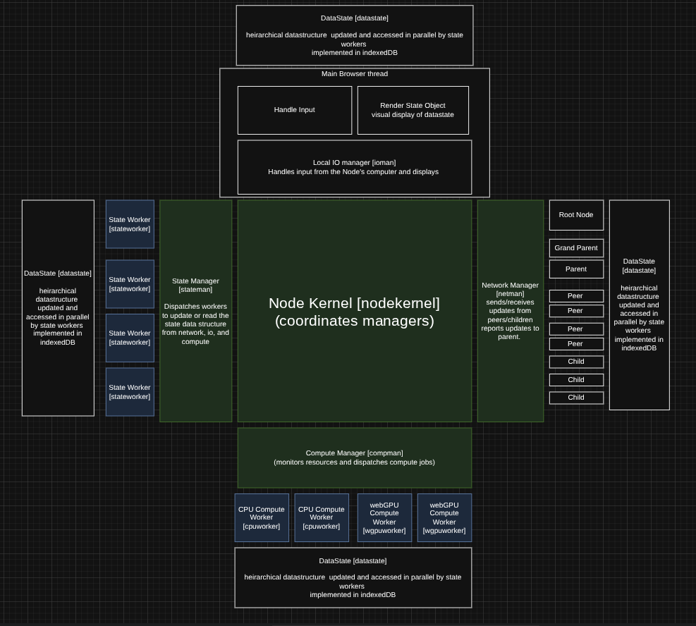
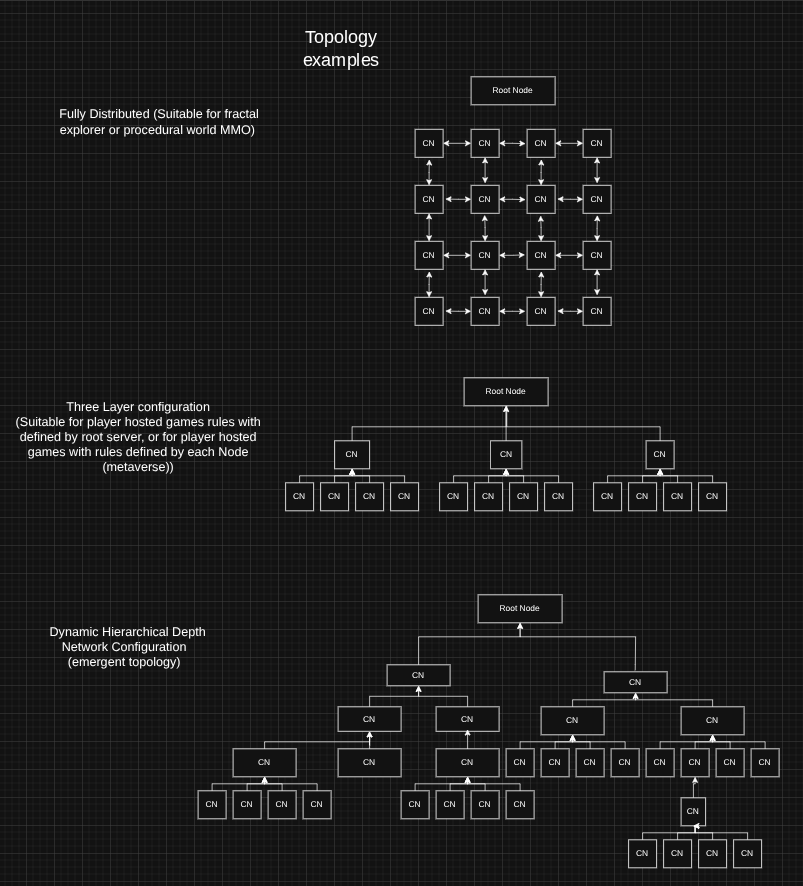

## Demos

| Example | What it demonstrates |
| --- | --- |
| [NetViz](demos/netviz/README.md) | Peer topology, connection paths and runtime telemetry. |
| [CubeChat](demos/cubechat/README.md) | Multiplayer state, video/text chat and embodied agents. |
| [Models and agents](demos/inference/README.md) | IPFS model storage and local/peer text, vision, image and voice inference. |
| [PlanetGen](demos/planetgen/README.md) / [Universes](demos/universes/README.md) | Procedural worlds and compute-driven generation. |
| [EarthGrid](demos/earth/README.md) / [RoadVector](demos/motorcycle/README.md) | Shared geodata, interactive worlds and vehicle simulation. |
| [Multiscale Ladder](demos/multiscale/README.md) / [Schrodinger](demos/schrodinger/README.md) | Experimental scientific workloads with explicit proxy-model boundaries. |

The [full demo directory](demos/README.md) includes the other games, visualizers and
physics experiments. Each demo owns its setup, controls and implementation notes.

## Screenshots

| | | |
| --- | --- | --- |
| [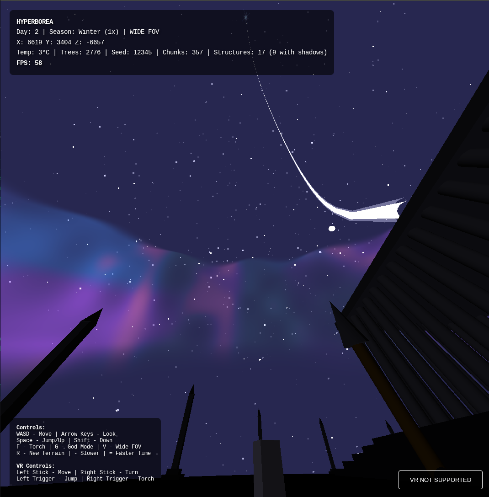](demos/hyperborea/README.md) | [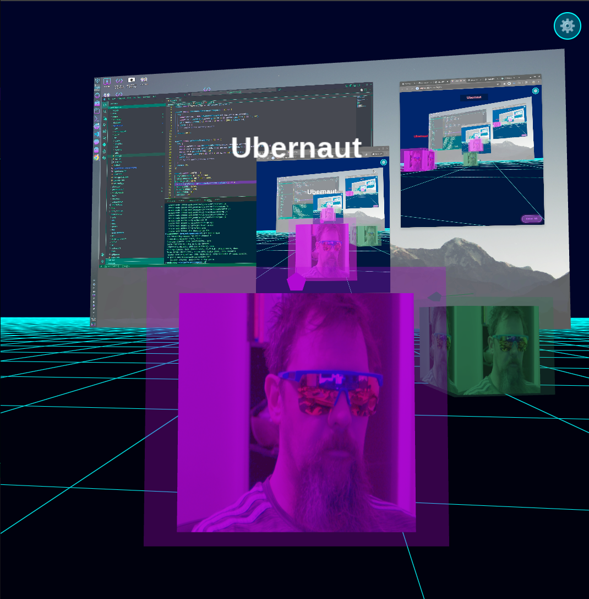](demos/cubechat/README.md) | [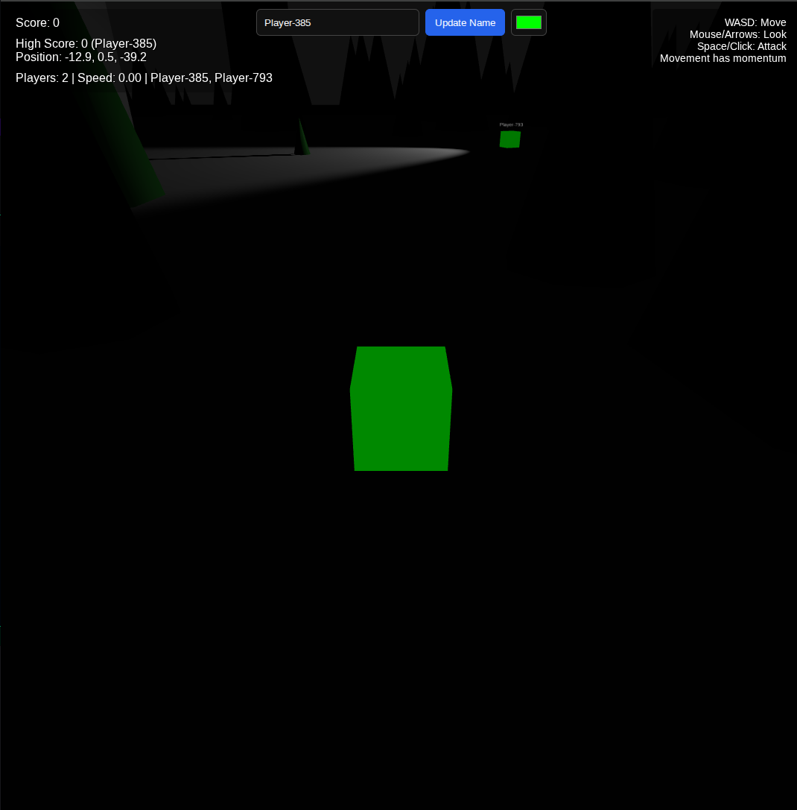](demos/sneakywoods/README.md) |
| [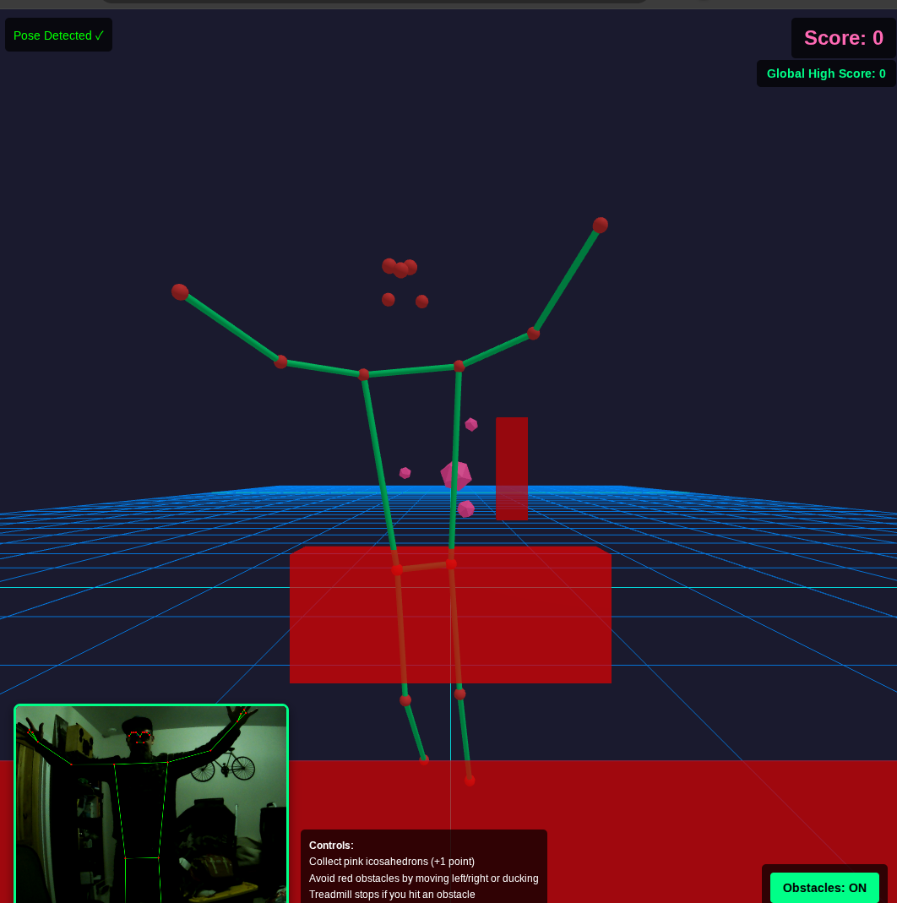](demos/daddygo/README.md) | [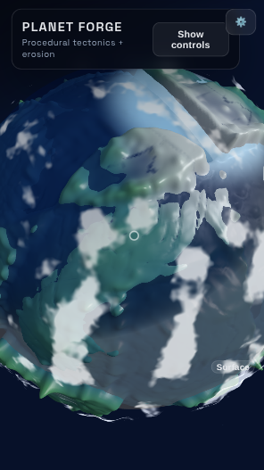](demos/planetgen/README.md) | [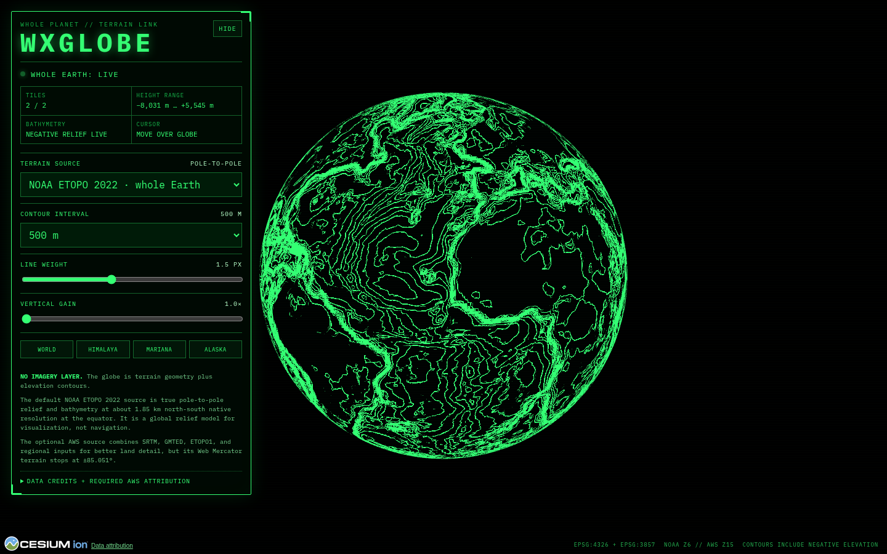](demos/wxglobe/README.md) |
| [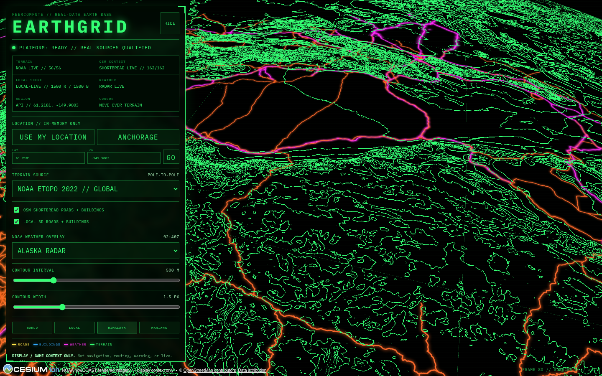](demos/earth/README.md) | [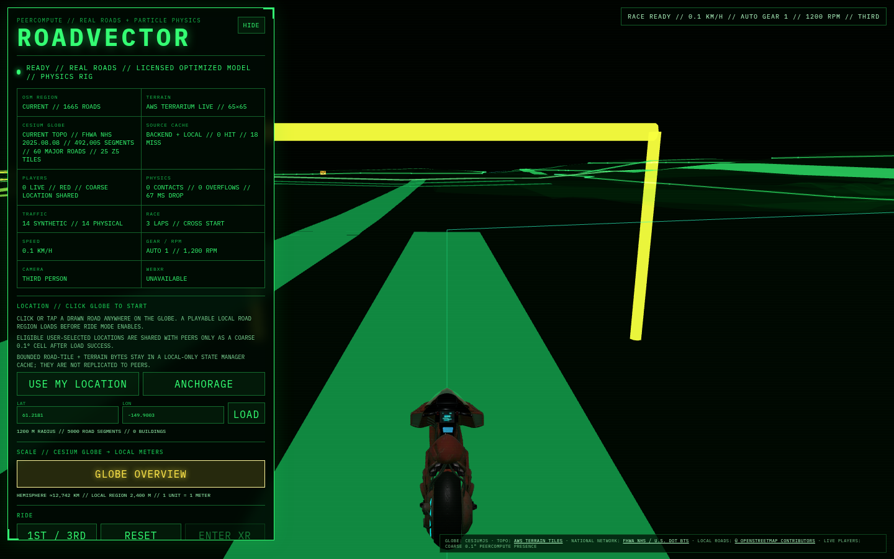](demos/motorcycle/README.md) | [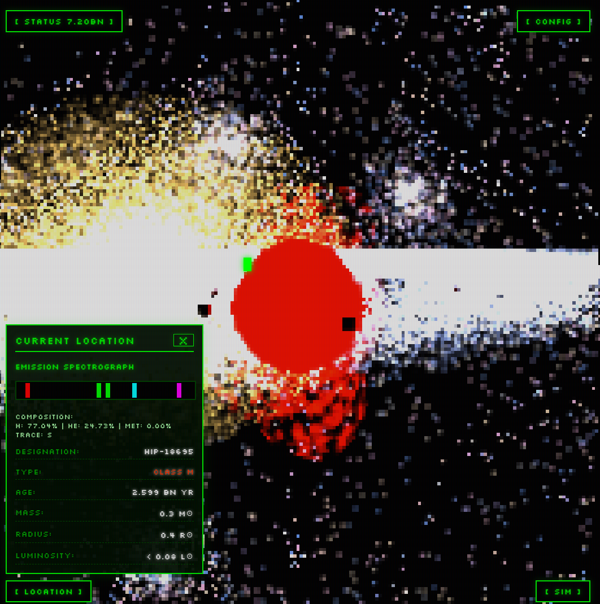](demos/universes/README.md) |
| [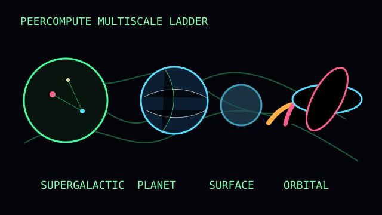](demos/multiscale/README.md) | [](demos/netviz/README.md) | [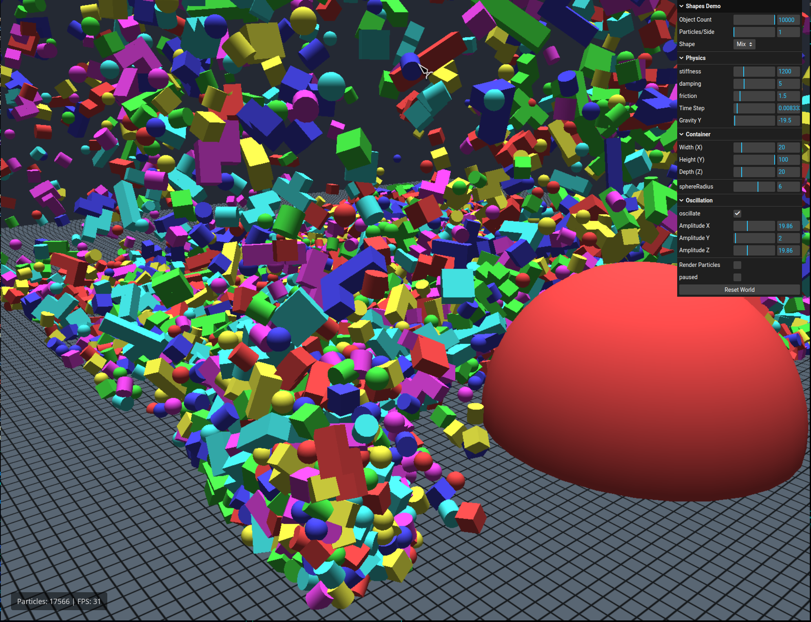](demos/webgpuphys/README.md) |
| [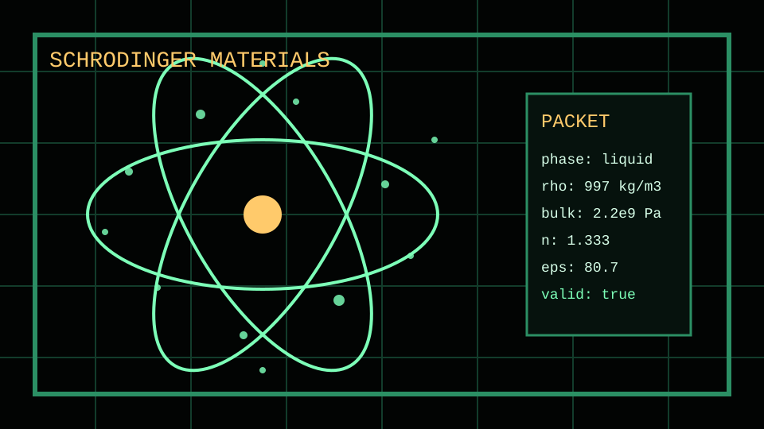](demos/schrodinger/README.md) | | |

## Development

Run core tests with `npm --prefix peercompute run test:unit`. Build the library and
all demos with `npm run build:all`; `npm run docs:preview` serves the result locally.
See [test coverage](plan/tests.md), the [network chaos lab](net-chaos-lab/README.md)
and [relay operations](peercompute/docs/RELAY_SERVER.md) for deeper workflows.

## License

MIT
