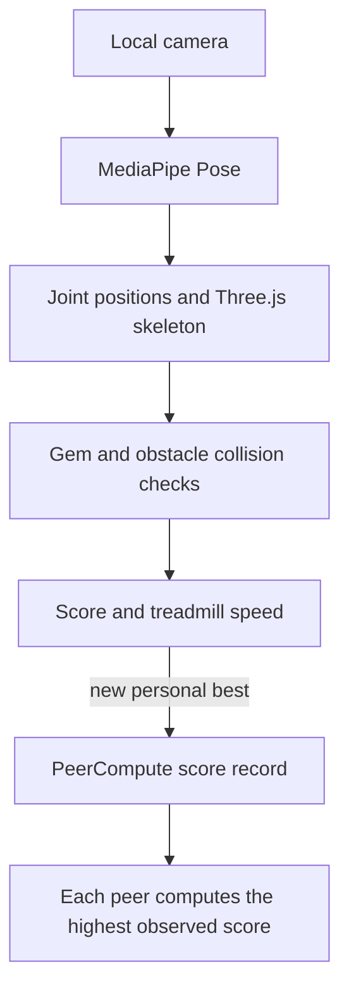

# Daddy Go!

## Overview

Use your camera to put a moving skeleton of your body on a virtual treadmill. Reach for pink gems, dodge red obstacles or duck beneath them. Each pickup speeds up the course. Connect a second player to see how your best scores compare across browsers.

## Play a round

Allow camera access and step back until the preview can see your shoulders, hips and limbs. A pink icosahedron gives you one point when it touches a tracked joint. The treadmill pauses while a joint intersects a red obstacle and resumes when you move clear. Use **Obstacles** to practice collecting without dodging.

## From pose to shared score



MediaPipe's landmarks drive the same skeleton the collision code tests. A pickup increases the treadmill speed by five percent. Camera frames and skeleton coordinates stay in the local game loop. The shared record contains a score and timestamp under a peer-specific key. Each client takes the greatest score it has seen in the current shared state. The session disables persistence and attempts to remove its own entry on exit, so the global display is a live comparison. [Game, tracking and score publication](src/main.js) · [Camera dependencies and UI](index.html)

## Run
```bash
cd demos/daddygo
npm install
npm run dev
```

Open `https://localhost:5181/`.

## PeerCompute Integration
Each player publishes their best score into a shared namespace; every client computes the global leader locally.

```js
const node = new NodeKernel({
  bootstrapPeers,
  enablePersistence: false,
  gameId: 'daddygo',
  roomId: 'global'
});

await node.initialize();
await node.start();

const state = node.getStateManager();
state.writeScoped('daddygo', `score-${peerId}`, { score, updatedAt: Date.now() });
```

## Notes
- Update `public/relay-config.json` with your relay bootstrap multiaddr.
