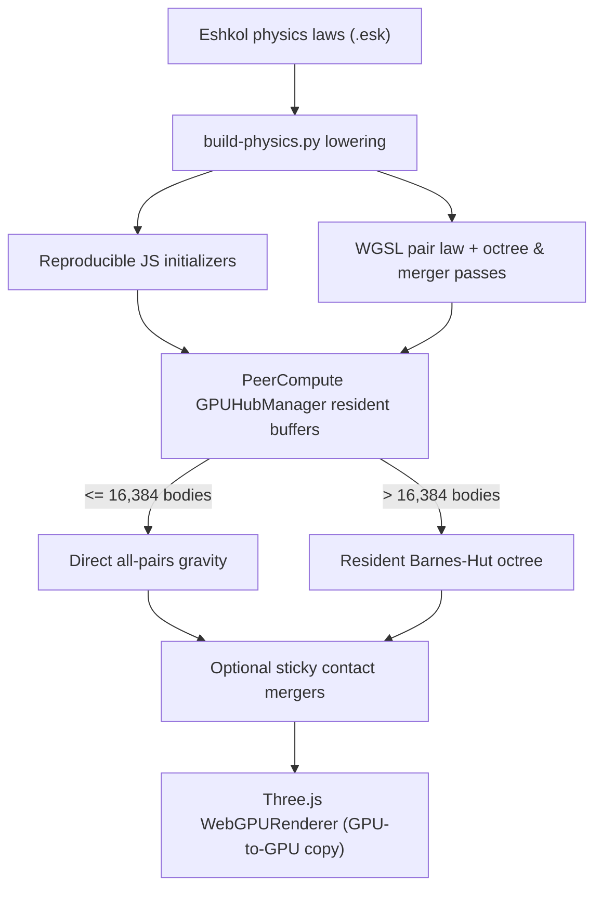

# Eshkols in Space

## Overview

Eshkols in Space simulates up to two million gravitating bodies on a single WebGPU device using pure typed Eshkol physics laws, PeerCompute's `GPUHubManager`, and Three.js WebGPU rendering. Choose a spiral disk, binary clusters, or a globular cluster, adjust gravity, time step, softening, and sticky contact mergers live, and watch the solver transition automatically from direct all-pairs summation to a resident Barnes–Hut octree above 16,384 bodies.

## Architecture



Eshkol defines the immutable `Vec3`, `Body`, and `Law` records, pairwise gravitational attraction, symplectic Euler drift, sticky contact conservation, and seeded initial conditions. `GPUHubManager` from the workspace PeerCompute library owns the resident ping-pong state buffers, octree storage, and merger index on the same WebGPU device that Three.js uses to draw sprites or GPU points without CPU round-trips. When launched inside the PeerCompute ExoWebTUI desktop (`peercompute-atlas-demo:`), the masthead exposes **← Atlas** (`peercompute.atlas.return.v1`). [All demos](../README.md) · [PeerCompute library](../../peercompute/README.md)

## Run locally

Use Node.js 24 LTS from the repository root:

```sh
nvm use 24
npm install
npm run dev:eshkols-in-space
```

Open `https://localhost:5191/` (or launch **Eshkols in Space** from the PeerCompute ExoWebTUI desktop at `https://localhost:4173/?prod=1`). Run `npm run test:eshkols-in-space` for physics, octree, and ULG capsule tests, and `npm run build:eshkols-in-space` to build `docs/eshkols-in-space/`.

## Controls and scaling

- **Formation, Body count, Seed, Mass distribution:** Rebuild reproducible spiral disk, binary cluster, or globular cluster initial states from 128 to 2,000,000 bodies.
- **Gravity, Time step, Softening, Merge on contact:** Tune Newtonian softening, integration step size, and momentum/volume-conserving sticky mergers live without resetting the system.
- **Pause, Step, Restart, Frame, Reference plane:** Freeze or single-step the simulation while orbiting and zooming freely in 3D.
- **Direct pairs vs Barnes–Hut tree:** Up through 16,384 bodies, the GPU evaluates every pair directly; larger populations switch automatically to a resident spatial octree rebuilt on GPU every step.
