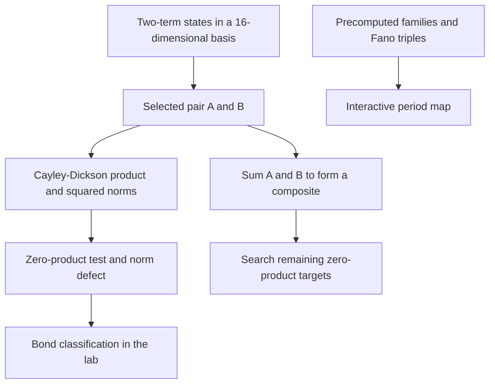

# Fano Reactor

## Overview

Choose two algebraic atoms and watch their product determine the bond classification. Some pairs multiply to zero even though neither atom is zero. Follow those pairings on the Fano map, then load the cascade sample to see which targets remain after two atoms form a composite.

## Try the experiment

In **bond-lab**, select an atom on the left and use **Pick valid target** to find a zero-product partner when one exists. Compare its norm defect and product with a different right-hand atom. **Load noble gas guard** demonstrates an inert partner. Switch to **fano-map** to compare period families.

## How a bond is classified



The defect is the squared norm of the product minus the product of the two squared norms. The lab computes the product for classification and the sum for the candidate composite. The cascade then searches for atoms that still annihilate the combined state. The names of the bonds belong to this algebraic model. All calculations run locally. [Arithmetic](src/algebra/sedenion.js) · [Classification and target search](src/model/chemistry.js) · [Reference paper](../../plan/refs/sedenion%20periodic%20table.pdf)

## Model details

- atoms are canonical two-term sedenion states `e_i +/- e_j`
- reactions are classified from the exact composition norm defect `Delta`
- the Fano plane highlights which period families can interact
- the UI reports zero-divisor targets, inert Cayley-Dickson partners, and a sampled stability cascade

## Development

```bash
npm --prefix demos/fano-reactor run dev -- --host
```

Default local URL:

- `https://localhost:5183/`

## What This Validates

- Exact Cayley-Dickson / sedenion multiplication in plain ES modules.
- Deterministic classification of atomic bond classes `Delta in {-4, 0, +4}`.
- Fano-governed target discovery for reactive states.
- A clean path toward a later PeerCompute `swarm` mode that shards pair evaluation across peers.
