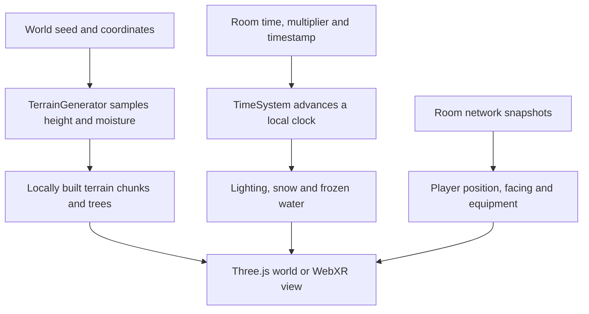

# Hyperborea

## Overview

Explore a procedural landscape of boreal forest and mountains with other players. The room shares its clock and seasons, so winter changes the snow cover and lets you walk on frozen water. Try the same landscape from ground level in an immersive session on a compatible headset.

## Explore the world

On desktop, click the scene for mouse look, use WASD to walk and press Space to jump. In winter, try crossing a low area that was open water in another season. Players in the same room can compare the time of day and snow cover from different points on the map.

## Shared time and local terrain



The room's time anchor carries the simulation time, its rate and when it was sent. A joining browser compensates for elapsed time and can calculate daylight and seasons between updates. Terrain height comes from several scales of noise, so each browser builds the chunks around its own player. Player snapshots carry compact position and equipment state independently of the environment. [World and room integration](src/game/Game.js) · [Terrain generator](src/systems/terrainGenerator.js) · [Time system](src/systems/timeSystem.js)

## Run
```bash
cd demos/hyperborea
npm install
npm run dev
```

Open `https://localhost:5175/`.

## Rooms + Settings
Use the Settings menu to change your player name/color and join public or private rooms.

## PeerCompute Integration
Hyperborea uses the NetworkScheduler snapshots for player state and event sync.

```js
const node = new NodeKernel({
  bootstrapPeers,
  enablePersistence: false,
  gameId: 'hyperborea',
  roomId: 'global'
});

await node.initialize();
await node.start();

const network = node.getNetworkManager();
network.configureScheduler({ snapshotHz: 20, keepaliveMs: 1500 });
```

## Notes
- Update `public/relay-config.json` with your relay bootstrap multiaddr.
