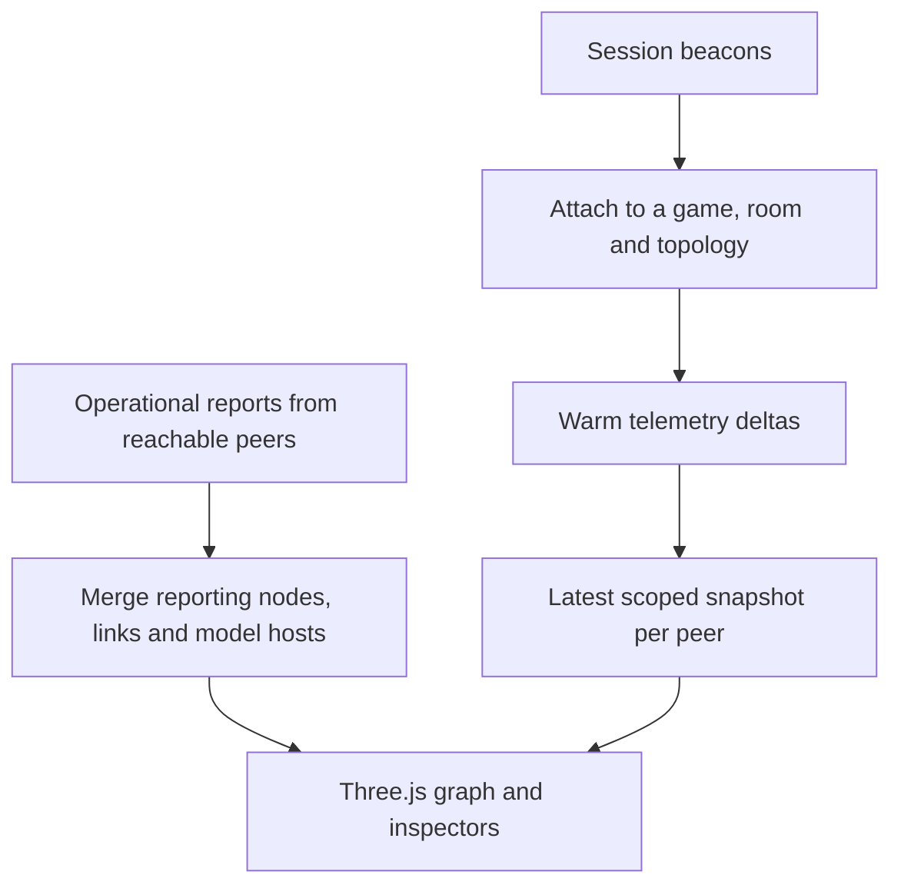

# NetViz

## Overview

Connect to see which peers are reporting across PeerCompute demos, which links they see and which models they host. Select a node or edge for traffic and latency details. Attach to one demo room to follow its compute workers and tasks as the session changes.

## How the graph is assembled



An edge may be reported from either end. When two reports describe the same link, the aggregate pairs send and receive directions to avoid counting the same bytes twice. A peer mentioned by its neighbor can appear as an inferred endpoint before it publishes a report of its own. A relay, an inferred endpoint and a reporting peer therefore have different meanings even if all three appear in one graph. [Aggregate model](src/observedNetwork.js) · [Scoped telemetry store](src/telemetryStore.js) · [Graph renderer](src/visualizer.js)

## Run From Repo Root
```bash
npm install
npm run dev:netviz
```

Click **Connect** to start observing. **All demos** is the default view; filter by application or connection role. A peer is a network instance, so world demos like CubeChat open both a green `world` cube (e.g. `cubechat / global`) and a cyan hex-pillar `models` client joined to the shared `models / default-room` subgroup (labeled with per-app counts such as `apps: inference×7, cubechat×2` so dual-connection tabs never look like duplicate room peers).

## All demos

The aggregate graph uses bounded operational reports shared across demo scopes.
It shows reported connections, compute worker/task counters and hosted models,
grouped by model with distinct hosting-peer and busy counts. Click a node or edge
for its report. Hosting-status failures are shown as unavailable and counts remain
explicitly partial. Chat, prompts, files and scene positions are not included.

Reports become stale after 15 seconds and leave the view after 60 seconds. Stale
hosts do not count as currently available. **Session only** nodes come from older
demo beacons: refresh those tabs from an updated build for full reports. **Hide
ghosts** controls endpoints named by other peers without reports of their own;
known relay endpoints remain visible when a reporting peer names a connection.
This observes reachable reporting peers, not a guaranteed census of the network.

Use **Selected session** or **Attach demo** for the original scoped topology view.
Attach preserves the selected game's ID, room and topology, so its warm telemetry
passes normal scope checks. It does not combine room state across applications.
`?view=all&autoConnect=1` opens the aggregate observer;
`?view=session&gameId=cubechat&room=global&topology=cubechat&autoConnect=1`
opens a specific scope.

## PeerCompute Integration
- NetViz listens for `telemetry:<peerId>` warm deltas and renders peer/link state from those snapshots.
- `NetworkManager` owns the shared operational reporting lifecycle, covering both NodeKernel demos and standalone model connections. NodeKernel also retains scoped debug telemetry for selected-session inspection.
- Demos publish NetViz session beacons on pubsub topic `peercompute-netviz-sessions`; NetViz consumes those beacons to attach across different demo ports/origins.
- NetViz still listens on `BroadcastChannel("peercompute-netviz-debug-v1")` for same-origin instant attach hints.
- Attach session metadata is preserved in the console. The Session Runtime panel renders worker counts, manager task totals, top task families, solver pressure, autoscale state, and warm-delta counts when a demo publishes structured metadata such as Multiscale Ladder's `peercompute.multiscale.netviz-session.v0`.

## UI Notes
- Click a node or edge to open an inspector panel with RTT, throughput, traffic counters, true ICE path (`lan-host`, `nat-srflx`, `nat-prflx`, `turn-relay`, `circuit-relay`, `direct-ws`, `direct-tcp`), direct unicast stream status (`/peercompute/direct/1.0.0`), relay retention role/`keepReason`, configured multi-relay LAN/WAN failover health, capability summary, and WorkMesh flow/resets.
- **Persistent Root Node Visibility**: when connecting to a deployment that publishes a public root directory descriptor (`model-evidence.json`, derived automatically from `relay-config.json` or `?rootDirectoryUrl=...`), NetViz renders the persistent root node (`peercompute-root`, magenta octahedron) linked to its relay with live/stale expiry status and protocol metadata in the inspector and **Root** role filter.
- **Whole-network & Subgroup Analysis** (`All demos` + `Selected session` views):
  - **Subgroup Clustering (`Group by`)**: organize peers into `Room / App`, `Host Group`, `Relay`, `Topology`, `Transport / LAN`, or `None` with translucent subgroup hulls, member/link/LAN%/churn badges, and non-disruptive subgroup focus (`Subgroup` selector or clicking a hull).
  - **Multi-Layer Overlays**: toggle **Transport** (colored by true ICE path), **Gossipsub** (control mesh edges), **WorkMesh** (active work-flow edges), **Hulls** (subgroup enclosures), and **Bridges** (Tarjan articulation/bridge cut edges highlighted in red).
  - **Color-by-Lens**: recolor nodes by `Role`, `Transport` (ICE path / direct vs relay), `RTT`, `Degree`, `WorkMesh` flow, or `Capabilities` (GPU/WASM/cores) in both `All demos` and `Selected session` views.
  - **Graph Diagnostics, LAN Readiness & Relay-Off Resilience**: live connected-component counts with relays vs with relays removed (instant warning if dropping relays partitions the mesh), isolated peer count, bridge/cut-vertex counts, ICE path mix, LAN-host vs TURN/circuit readiness summary, median/p95 RTT, and per-relay fan-in, `keepReason`, configured multi-relay failover health (`LAN`/`WAN`, RTT), and direct unicast stream counts in the **Relay Audit** card (available in both `All demos` and `Selected session` views).
  - **Goal Profile, Host Group & Custom Relay URL Controls**: switch `batch-throughput`, `lan-first`, `low-latency`, or `capability-weighted` goal profiles and `Host group` live while connected (`?profile=...&hostGroupId=...`), or paste a local LAN relay config URL (`npm run lan:relay`) into **Relay URL** (`?relayConfigUrl=...`) to inspect a physical laptop/Pi subnet alongside WAN failover.
  - **Rolling 5-Minute Sparklines & JSON Export**: inline SVG sparklines tracking Peer count, Direct %, LAN %, On-relay, Median RTT, and WorkMesh rate, plus **Export JSON** (`peercompute.netviz-analysis.v1`, including multi-relay health and direct unicast peers) in both views.
  - **Passive Observer Hygiene**: NetViz sets `allowDiscoveryDialWhenIsolated: false` so observing an active mesh never mutates peer connectivity.
- Topology selection sits above rooms and supports `distributed`, `hierarchical`, `throughput`, and `static` modes.
- Use "Attach demo" to target a running demo without manually typing topology/room values (connect NetViz first so it can discover session beacons).
- The Session Runtime panel follows the selected/latest attach session and shows runtime metadata without requiring console access.
- In selected-session distributed topology, drag your local cube to move its metric position and trigger neighbor recomputation.
- Use the "Hide ghosts" toggle to hide inferred nodes that have no telemetry yet.
- Orbit controls are enabled for pan/zoom; optional auto-rotate can be toggled on.
- NURBS links thicken with higher bandwidth, cache tube geometries across snapshots to avoid per-tick disposal churn, and animate pulses when traffic is flowing.
- Local-node inspector shows `RTC path evidence` (selected candidate-pair summary) and per-edge ICE path classification so LAN-host, STUN, TURN, and circuit-relay links are never conflated.
- Edge aggregation merges telemetry from both endpoints (`observedNetwork.js`) so neither side's ICE path, RTT, WorkMesh stats, or connection counts are discarded.
- Add `?chaosApi=/chaos-api` (or `?chaosApi=http://127.0.0.1:8866`) to show live chaos-lab topology + scenario behavior in the NetViz console and 3D graph overlay.
- Add `&autoConnect=0` to watch chaos-lab without immediately dialing relay bootstrap endpoints.

## Tests
```bash
node --test demos/netviz/tests/observedNetwork.test.js demos/netviz/tests/networkAnalysis.test.js demos/netviz/tests/relayOverlay.test.js
CHROME_BIN=/usr/bin/google-chrome node demos/netviz/tests/analysisBrowserCheck.mjs
npm --prefix demos/netviz run build
env NETVIZ_SMOKE_URL=https://localhost:4173/netviz/?render=off npm --prefix demos/netviz run test:session
```

For controlled UI, filter, mobile layout and actual scoped-reconnect checks, run
`NETVIZ_SMOKE_URL=https://localhost:5182/?view=all\&render=low\&autoConnect=1 node demos/netviz/tests/observedNetworkSmoke.mjs`
against an owned development server. Fixtures in that test validate rendering,
not cross-peer reporting; the shared live-browser integration test covers transport.
