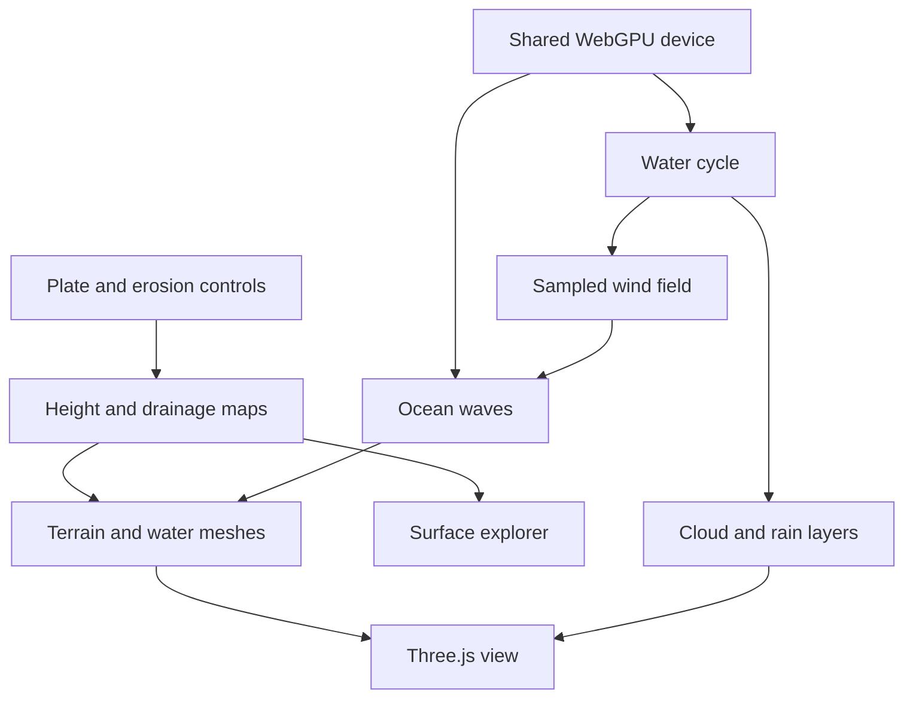
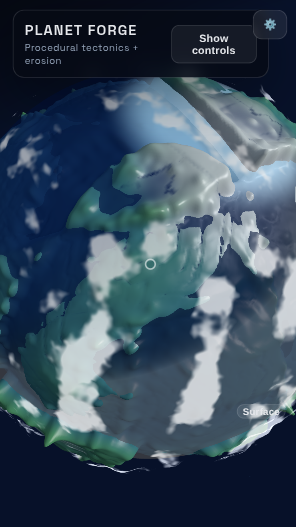
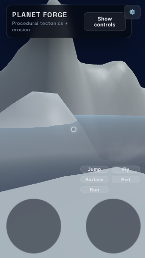
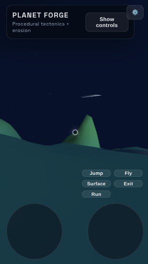

# Worldgen (Planet Gen)

## Overview

Build a planet by choosing its tectonic plates, applying erosion and setting the sea level. Orbit until you find a coastline, then drop to the surface and follow it on foot, swim offshore or fly over the ice. Optional weather and ocean simulations let you see how winds aloft affect waves below.

## Architecture



The heightfield supplies both the rendered terrain and the data the explorer uses to find the surface. The weather and ocean systems can also exchange a wind field. The ocean advances wave heights in alternating GPU buffers, then reads back a texture of height, normals and foam that the WebGL material can sample. The mesh, wave solver and explorer therefore work at different resolutions. [World generator](src/worldgen.js) · [Ocean simulation](src/OceanComputeSystem.js) · [Surface controls](src/TinyPlanetControls.js)

## Screenshots
- 
- 
- 

## Features
- **Procedural tectonics**: Plate-based heightfield with adjustable plate count, jitter, fault styles, and height deltas.
- **Hydraulic erosion & hydrology**: Rain/flow simulation, smoothing passes, river/lake masks, and water meshes.
- **Atmosphere & clouds**: Toggleable atmosphere shell plus volumetric clouds driven by a WebGPU water-cycle simulation (evaporation → condensation → precipitation), including wind/pressure fields and surface wetness.
- **Surface explorer**: Tiny Planet first-person mode with walking, running, swimming, flying, jump, and surface snap; orbit view uses Trackball controls.
- **Mobile-friendly controls**: HUD auto-collapses; mobile overlay with twin sticks, action buttons (fly/jump/run/exit/surface) and center reticle. Sensitivities and invert look are configurable via a cog menu.
- **Polar ice**: Water shader blends to ice based on the iceCap setting; ice cap size is adjustable. Frozen water is solid and walkable.
- **Shared GPU hub**: Ocean + weather compute use the PeerCompute GPU hub device when available (fallbacks to local WebGPU).

## PeerCompute Integration
PlanetGen tries to reuse the PeerCompute GPU hub device for the ocean and weather compute systems. The WebGL renderer samples their published textures.

```js
import { getSharedDevice } from './src/peercomputeDevice.js';
import { OceanComputeSystem } from './src/OceanComputeSystem.js';

const device = await getSharedDevice();
const ocean = await OceanComputeSystem.create({ device });
```

## Controls
- **Orbit view**: Drag to rotate, scroll/pinch to zoom, middle-click the planet to enter Tiny mode, Surface button snaps to visible point.
- **Tiny mode (desktop)**: WASD/arrows to move, Space jump, Shift run, Ctrl down, F fly toggle, Q/E roll, Esc exit.
- **Tiny mode (mobile)**: Twin sticks for move/look, buttons for jump/fly/run/exit/surface; reticle shows surface target.

## Config & UI
- HUD sections are collapsible; presets for fast/balanced/high fidelity.
- Config (cog button) for left stick sensitivity, horizontal/vertical look sensitivity, invert look.
- Preset-driven parameters for resolution, plates, erosion, smoothing, sea level, plate deltas, ice caps, atmosphere, clouds, etc.

## Future Plans
- **Input router expansion**: unify desktop/mobile/VR inputs, richer mobile visuals, and twin-stick tuning.
- **Swimming polish**: further refine shallow-water handling and orientation resets.
- **Water/ice visuals**: extra polish for polar blending and shoreline detail.

## Run locally

From the repository root with demo dependencies installed, run `npm run dev:planetgen` and visit `https://localhost:5177/`. Choose a terrain preset and use the surface button to explore the generated world.
