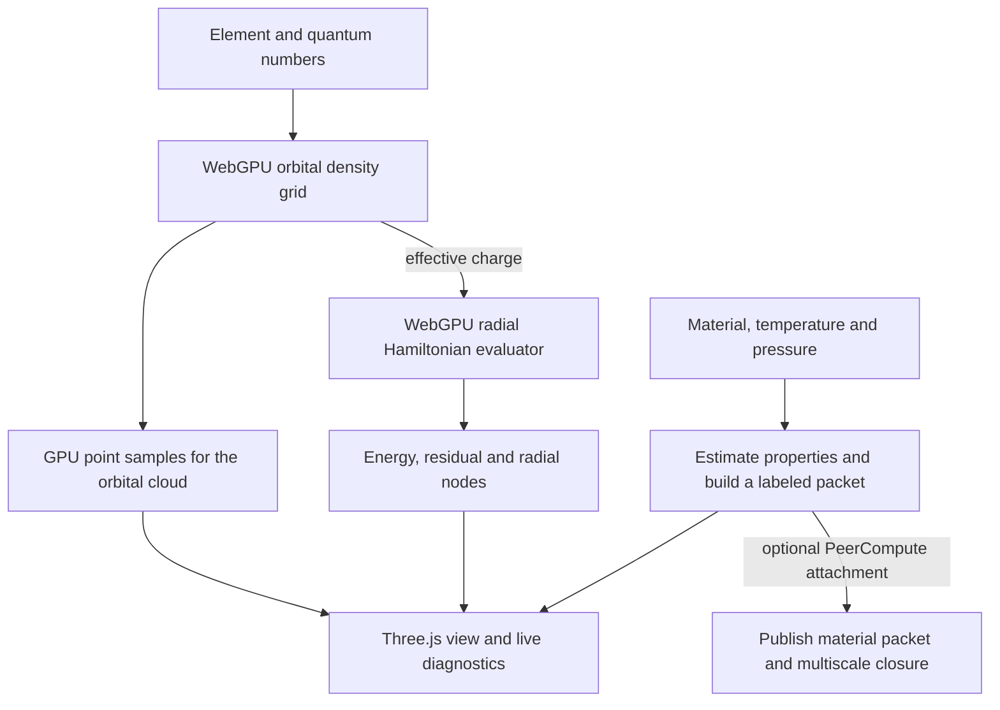

# Schrodinger Materials Console

## Overview

Choose an element and orbital to see where an electron is likely to be found, then compare its calculated energy with the reference value. Switch to the material cell to explore water at different temperatures and pressures, or mix atoms in the reactive sandbox to watch a simple bonding model evolve.

## Try the console

Choose **Orbital cloud**, select an element, and vary the principal, angular or magnetic quantum number. Look at the radial solver's energy, node count and residual as well as the cloud itself. **Material cell** changes the question to bulk properties. **Reactive atoms** lets you add atoms and observe bonds in a toy simulation.

## From quantum numbers to shareable results



The samples represent an electron probability distribution. The radial solve reports the state's energy, node count and residual, making convergence visible even when two clouds look alike. Published packets identify the model and its validation status, so another demo can interpret a result within the assumptions that produced it. The peer session publishes results computed here. [GPU solvers](src/quantum/webgpuWaveSolver.js) · [Property estimates](src/materials/materialProperties.js) · [Peer publication](src/peercompute/session.js)

## Development

```bash
npm --prefix demos/schrodinger run dev -- --host
```

Default local URL:

- `https://localhost:5184/`

## Current Scope

- WebGPU-generated hydrogenic/effective-charge orbital probability grid plus WebGPU-sampled point cloud visualization for selected elements.
- WebGPU-first one-electron radial Schrodinger basis/Hamiltonian evaluator for selected `n/l` states, with energy/error/residual/node diagnostics shown in the live stats panel. If WebGPU is unavailable, the orbital grid and radial solve report unavailable instead of using a CPU fallback.
- Water-first material-cell visualization with explicit H2O geometry, visible covalent/ionic bond classes, and molecule property packets across temperature and pressure conditions.
- Reactive atom sandbox with environment controls for temperature, ambient pressure, and gravity, plus toy real-time bonding for selected element pairs.
- Browser WebGPU capability/probability smoke plus orbital-grid, orbital point-sampling, and radial-Hamiltonian compute passes.
- Optional PeerCompute attach for warm property-packet publication plus shared `ClosureState -> ClosureResult` deltas under `multiscale-closures`.

The demo reports validation status and model IDs in every property packet. Property packets stay as the UI compatibility layer, while shared closure adapters let multiscale consumers read thermodynamic, transport, mechanics, electromagnetic, chemistry, phase, validity, uncertainty, and conservation fields consistently. The reactive atom sandbox is labeled `toy-reactive-atoms-v0`; it is for interaction design and does not claim ab initio molecular accuracy.
