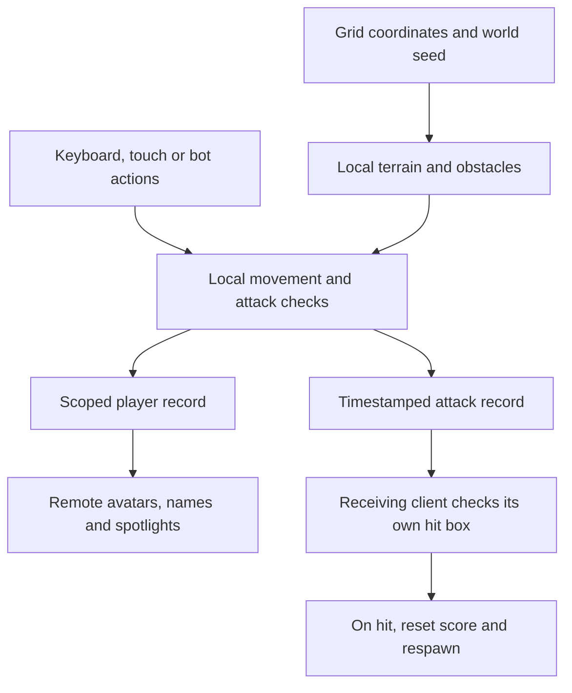

# SneakyWoods

## Overview

Join a dark forest arena where moving or attacking gives away your position with a spotlight. Weave through trees and buildings, get close to an opponent and strike, then watch for the next flash. Join friends in the same room using the Settings menu.

## How peers reconstruct a round



A repeatable random sequence for each grid coordinate gives peers the same scenery without sending meshes. A visible tab publishes player records at roughly ten updates per second. Attacks use a separate key per attacker so a receiver can discard duplicates and evaluate a hit against its current position. Each browser decides what happened to its own player. [Arena loop, grid generation and room sync](main.js)

## Controls
- WASD / arrow keys: Move
- Mouse or arrow keys: Look
- Space / click: Attack
- Mobile: twin sticks + attack button

## Run
```bash
cd demos/sneakywoods
npm install
npm run dev
```

Open `https://localhost:5180/`.

## Rooms + Settings
Open the Settings menu to change your name/color and join public or private rooms. Private rooms require a password to compute the room ID.

## PeerCompute Integration
SneakyWoods writes player state into a scoped namespace and listens for updates.

```js
const node = new NodeKernel({
  bootstrapPeers,
  enablePersistence: false,
  gameId: 'sneakywoods',
  roomId: 'global'
});

await node.initialize();
await node.start();

const state = node.getStateManager();
state.writeScoped('sneakywoods', `player-${peerId}`, payload);
state.observeNamespace('sneakywoods', (value, key) => {
  // apply remote updates
});
```

## Notes
- Update `public/relay-config.json` with your relay bootstrap multiaddr.
