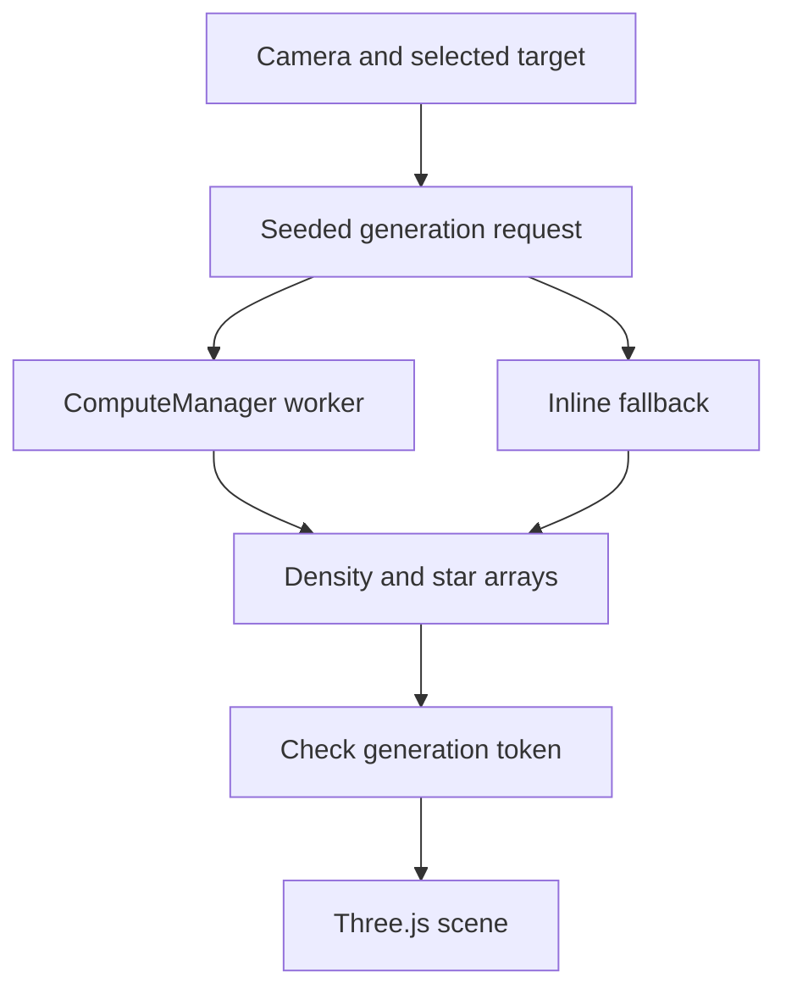

# Universes

## Overview

Follow a filament of galaxies into a single star system, inspect a planet, then return to orbit and choose another destination. Autopilot will take the tour for you. A seed determines the distribution of galaxies and stars, so the browser can build the next scale as you explore it.

## Architecture



The generator places clusters, connects sampled pairs with filaments and scatters points around them. It can generate a voxel density field for the large-scale view and a separate set of points for picking targets. At galaxy scale it returns typed arrays for stars and their orbits. The scene checks a generation token before accepting asynchronous results so reseeding mid-flight cannot install an old galaxy over the new one. The worker pool runs locally in this demo. The objects and spectra are procedurally generated. [Generation functions](compute/universeTasks.js) · [Scene and worker integration](main.js)

## Taking a tour

Open **Sim** and leave **Autopilot** enabled for a guided trip. For a manual trip, switch it off, select a target and use **Initiate Hyperdrive**. **Return to Orbit** takes you back up a level. **Reseed Universe** changes the distribution. **Config** provides quality presets for adjusting rendering cost.

## Run
```bash
cd demos/universes
npm install
npm run dev
```

Open `https://localhost:5178/`.

## PeerCompute Integration
The demo submits compute tasks to the worker pool and falls back to main-thread generation if unavailable.

```js
const manager = new ComputeManager({ maxWorkers: 1 });
await manager.initialize();

const result = await manager.submitTask({
  module: new URL('./compute/universeTasks.js', import.meta.url).href,
  exportName: 'generateUniverseData',
  data: { seed }
});
```
