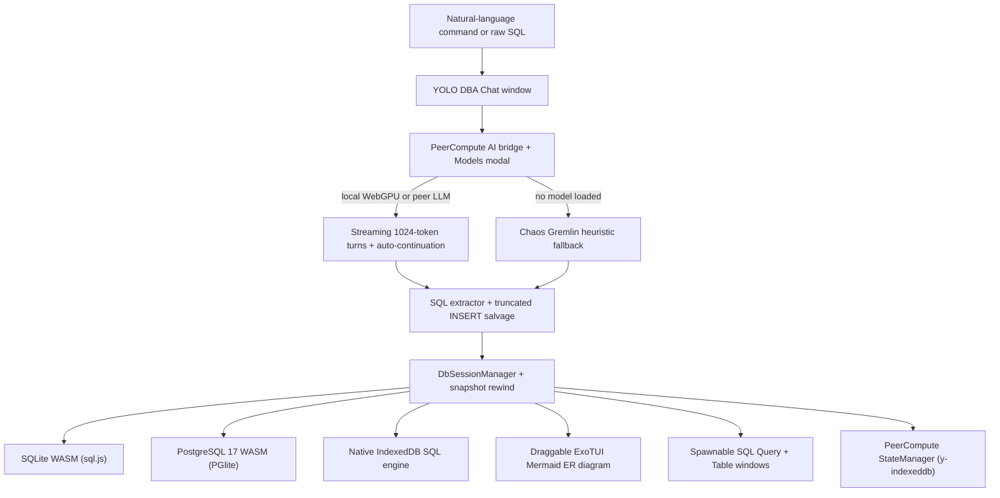

# VibeSlopDB

## Overview

VibeSlopDB lets you issue natural-language commands to a local WebGPU or peer-hosted PeerCompute LLM and watch it YOLO-administer live SQL against real in-browser databases: SQLite WASM, PostgreSQL 17 WASM via PGlite, and native browser IndexedDB. Every mutation updates a live draggable ExoTUI Mermaid ER schema diagram, spawnable SQL query and result table windows, and a carnage audit log with snapshot time-travel, while PeerCompute StateManager persists your database, theme, and custom ER layout locally across refreshes.

## Architecture



VibeSlopDB borrows PeerCompute's persistent inference runtime through the CubeChat-style `mountInferencePanel({ managementOnly: true })` modal so local WebGPU models and connected peer hosts remain resident after closing **Models**. It detects when launched inside the PeerCompute ExoWebTUI desktop (`peercompute-atlas-demo:`) and exposes **← Atlas** (`peercompute.atlas.return.v1`) while leaving CRT post-processing to the host shell. [Local Model Console](../inference/README.md) · [All demos](../README.md) · [PeerCompute library](../../peercompute/README.md)

## Run locally

Use Node.js 24 LTS from the repository root:

```sh
nvm use 24
npm install
npm run dev:vibeslopdb
```

Open `https://localhost:5190/` (or launch **VibeSlopDB** from the PeerCompute ExoWebTUI desktop at `https://localhost:4173/?prod=1`). Run `npm run test:vibeslopdb` for unit tests and `npm run build:vibeslopdb` to build `docs/vibeslopdb/`.

## Controls and URL options

- **⚙ Models (`Alt+M`):** Open the PeerCompute model library to load a local WebGPU/WASM model or connect to peer-hosted LLMs.
- **🌐 Peers:** Connect directly to the PeerCompute relay and auto-discover hosted text models (`?peers=1` connects on boot).
- **Drag ER entities:** Rearrange tables in the Mermaid ER diagram with live self-loop and parallel FK edge re-routing; click any table for `SELECT *`, `+ Column`, `Rename`, or `DROP TABLE`.
- **+ Query Win (`Alt+N`), Tile (`Alt+T`), Cascade:** Manage multiple independent SQL query and table result windows inside the ExoWebTUI workspace.
- **Rewind / Reset DB:** Roll back destructive LLM carnage using per-engine snapshots, or switch engines live between SQLite WASM, PostgreSQL 17 WASM, and IndexedDB.
