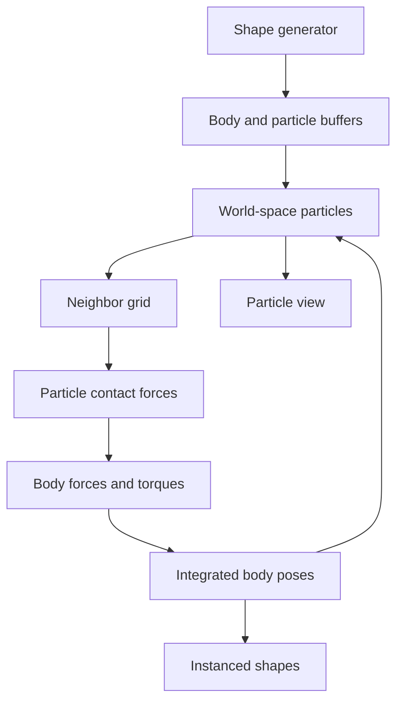

# Dynamics

## Overview

Drop a thousand boxes, cylinders, spheres or Tetris pieces into a container, then turn on the particle view to see what actually collides when they tumble. Change the number of particles per side and compare how the same shape balances, slides and settles on the floor.

## Try it

From the repository root, run `npm run dev:webgpuphys` and visit [the Dynamics page](https://localhost:5179/demos/toychest.html) in a WebGPU-capable browser. In **Shapes Demo**, choose **Tetris** and turn on **Render Particles**. Vary **Particles/Side** to change the collision geometry. Set **Gravity Y** closer to zero or turn on oscillation to push the pile with a moving sphere. **Reset World** repopulates the box.

## Architecture

Each body owns a rigid set of spherical collision samples. A uniform grid narrows the contact search to nearby particles. The compute passes evaluate spring, damping and friction forces at each contact, then sum forces and torques for the parent body. The integrator updates one position and quaternion per body. The renderer uses those GPU buffers directly, or draws the world-space samples to reveal the collision approximation. Increasing the resolution changes the work per body even when the body count stays fixed. [Scene and controls](../demos/toychest.js) · [World implementation](../src/world.js)

The simulation runs on the browser's GPU. Its initial physics step is 1/120 second, with up to eight substeps to catch up between draws. Render frame rate and simulation step size are separate controls on the cost of a frame. [Physics package and shader sequence](../README.md)
