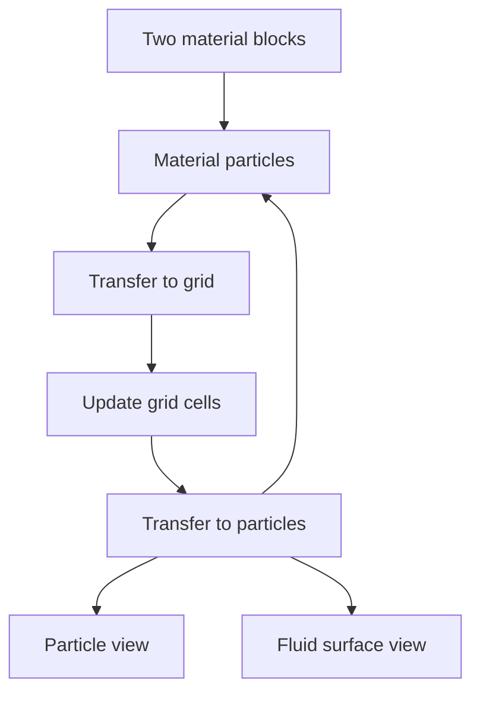

# MPM Visual

## Overview

Start with blocks of titanium and lead and watch them fall into the same container. Change either element, heat part of the material with an interaction sphere or switch between individual particles and a smooth fluid surface. Both views show the same evolving material, so you can see which details the surface rendering hides.

## Try it

Run `npm run dev:webgpuphys` from the repository root. Open [MPM Visual](https://localhost:5179/demos/mpm-visual.html) in a WebGPU-capable browser. Use **Element A** and **Element B** to choose starting materials. Under **Interaction Sphere**, enable **Active**, position the sphere inside a block and change **Heat Source (K)**. Switch **Render Mode** between **Particles** and **Fluid** while paused to compare the two renderings of one state.

## Architecture

The moving least squares material point method (MLS-MPM) carries mass, velocity, temperature and deformation on particles. Multiple particles deposit contributions into shared grid cells using fixed-point atomic additions. The grid supplies the updated velocities for the return transfer. The same GPU device runs the compute passes and renders the particles or reconstructs a surface from screen-space depth and thickness. Named elements use approximate material parameters. [Solver passes](../src/domains/mpm/domain.js) · [Memory layout](../src/domains/mpm/schema.js) · [Visual application](../demos/mpm-visual.js)

This page obtains a device through the PeerCompute GPU hub, with a local WebGPU fallback. For a worker-run experiment with mass and momentum diagnostics, the package also includes a [headless example](../demos/mpm-headless.html). [Package guide](../README.md)
