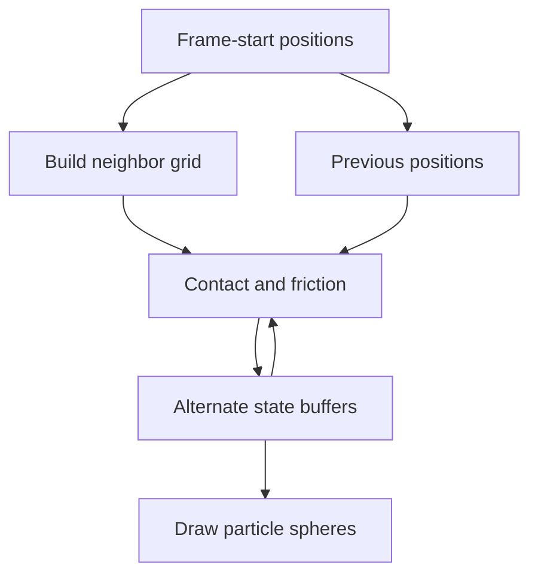

# PPF Contact Solver

## Overview

Drop a block of particles into a box and watch the pile spread as it hits the floor. Turn friction down to see it slide, then increase the number of solver iterations. The live particle count and frame rate let you compare the cost of refining contacts as the pile grows.

## Try it

From the repository root, run `npm run dev:webgpuphys` and open [PPF Contact Solver](https://localhost:5179/demos/ppf-contact-solver.html) in a WebGPU-capable browser. Start with the default 1,024 particles and eight iterations. Change **Friction** while keeping particle count fixed, then vary the iterations. Use the particle count field to reset the run with a different population. The address accepts `?particles=4096` for a repeatable starting count.

## Architecture

Once per frame the solver saves the starting positions and bins particles into a uniform grid. Within each iteration a particle examines its neighboring cells and box walls. A cubic barrier term repels nearby surfaces, while tangential displacement from the saved position determines friction. Each pass reads one state buffer and writes another, so neighbors in an iteration see a consistent input. The final position buffer feeds the renderer directly. [Solver and inline WGSL](../demos/ppf-contact-solver.js)

The grid has a fixed capacity per cell. A very dense pile can exceed that capacity, leaving some neighbor pairs unexamined. Increasing iterations repeats the solve over the same frame's grid. For comparison, the package includes a [simpler cubic barrier example](../demos/ppf-cubic-barrier.html). [Package guide](../README.md)
