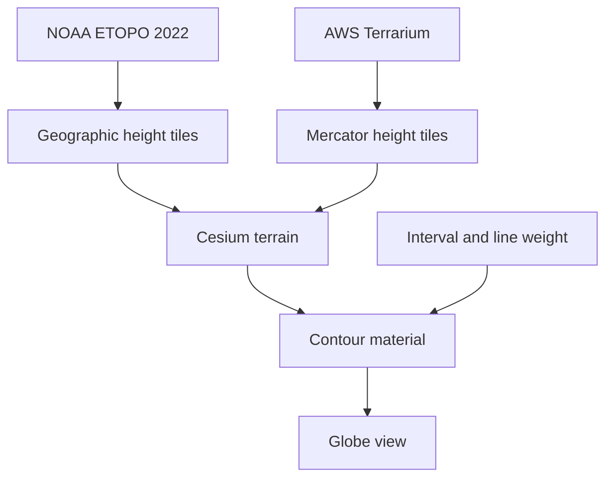

# WXGlobe

## Overview

Follow a contour from a mountain slope down to the ocean floor on a globe drawn entirely from elevation data. Change the contour interval or exaggerate the relief to reveal a trench, then switch terrain sources to see how resolution and polar coverage affect the same place.

## Architecture



The selected provider decodes heights and supplies matching edge samples to adjacent tiles, so a contour can cross a tile boundary. A Cesium material derives the lines from surface height. Adjusting the line spacing reuses the terrain already loaded in the browser. The same provider modules also supply elevation to other demos. WXGlobe runs locally and works without an imagery service or Cesium ion token. [Provider adapters](src/terrain/) · [Application](src/main.js)

[Open the demo](https://metaversejs.github.io/peercompute/wxglobe/) ·
[All demos](../README.md)

## Run

From the repository root with Node.js 24 and dependencies installed:

```sh
npm run dev:wxglobe
```

Open `https://localhost:5186/`. See the [demo setup guide](../README.md) for HTTPS
certificates and access from another device. A Cesium ion token is not required.
Use the controls panel to switch terrain source, choose camera presets and adjust
contour spacing, line weight and vertical exaggeration.

## Data and rendering

- **NOAA ETOPO 2022** is the default, covering both poles and ocean bathymetry at
  one arc-minute resolution. Native geographic requests stop at level 6;
  further display refinement is upsampling, not additional source detail.
- **AWS Terrarium** is optional, with mixed-source land detail through level 15
  and ETOPO1 bathymetry. Its Web Mercator tiles stop near ±85.05° latitude;
  use NOAA for the full poles. High zoom does not improve the source bathymetry.
- Terrain adapters produce 257 endpoint posts per side and reconcile shared
  edges. Bounded caches, native request caps, retries and provider-generation
  cancellation prevent stale source requests from updating a replacement view.
- The globe uses no imagery layers. Source credits are available through the
  Cesium credit display; preserve those attributions when reusing the adapters.

This is a terrain viewer, not a navigation product or an operational weather
service. It does not include the retired RTMA/GRIB pipeline. The reusable terrain
providers live in [geo-core](../../packages/geo-core); source contracts and
validation boundaries are recorded in [plan.md](plan.md).

## Build and check

```sh
npm --prefix demos/wxglobe test
npm run build:wxglobe
```

The build writes `docs/wxglobe/`, including Cesium's runtime files and licenses.
Unit tests cover source decoding, geographic seams, request bounds, cancellation
and contour behavior. Browser acceptance additionally switches between actual
NOAA/AWS sources and checks visible terrain; see [plan.md](plan.md) and the
[project test strategy](../../plan/test/test.md).
