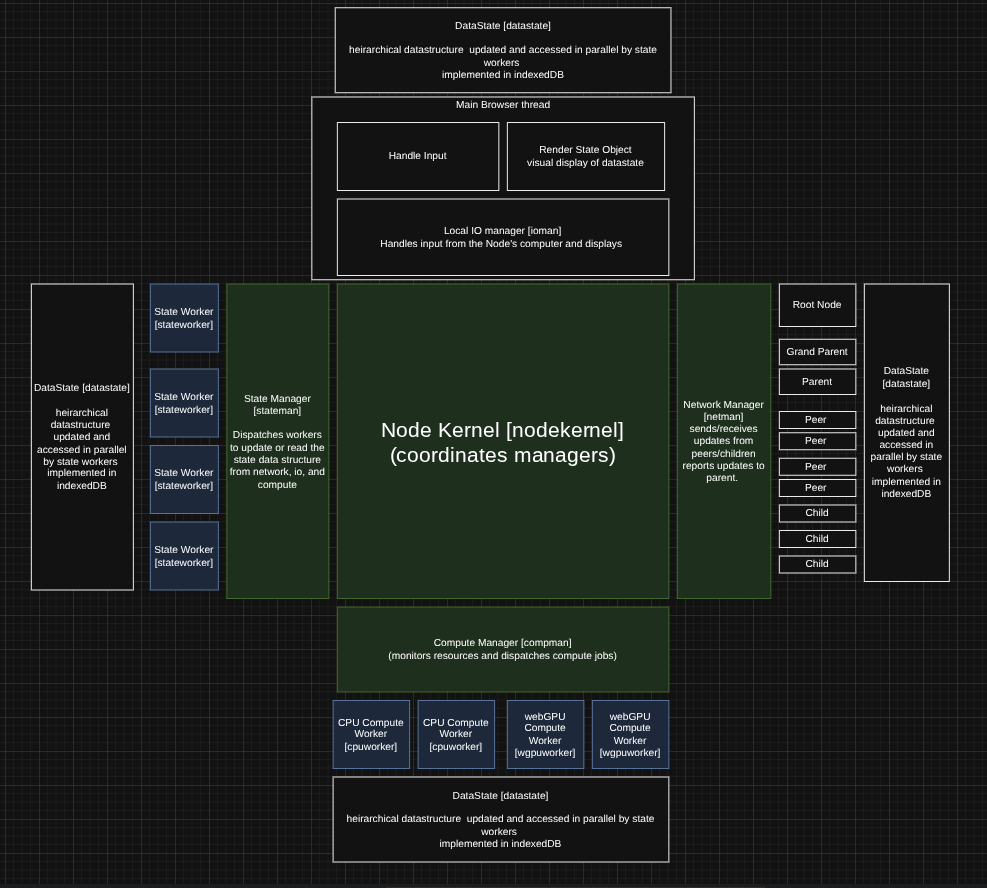
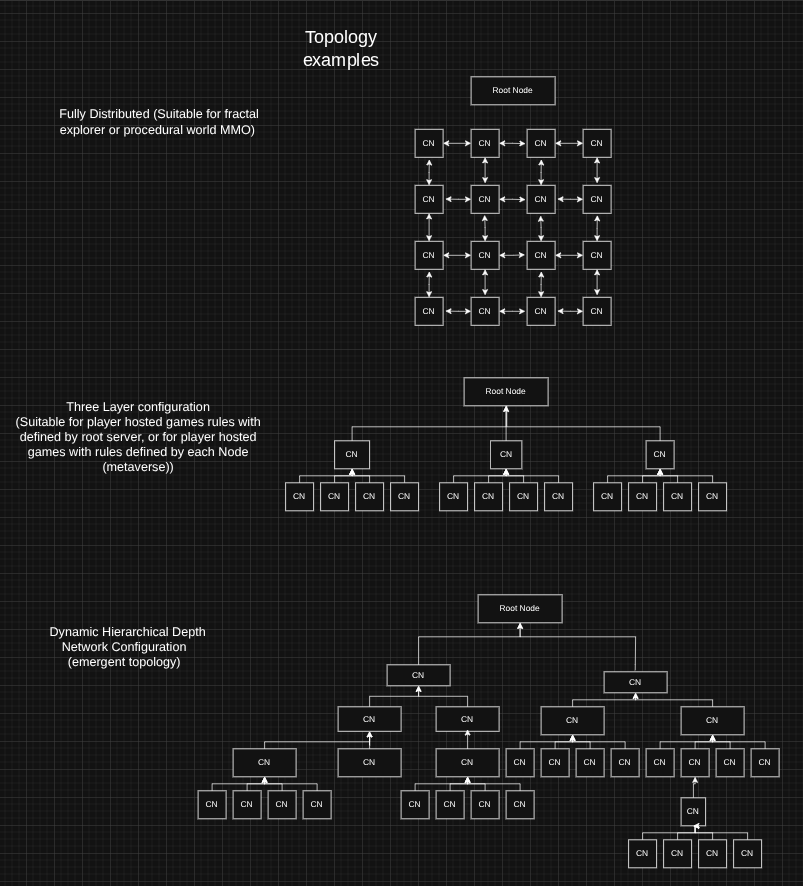

# PeerCompute core library

PeerCompute provides browser peers with shared state, networking and managed
JS/WASM/WebGPU execution for games, simulations and shared compute services.

The **core conjecture** is that, given globally distributed devices with varying
mutual bandwidth and compute resources, the optimal compute topology will emerge
automatically through cellular automata whose individual nodes try to maximize
compute throughput—like slime mold designing an optimal transit network.

The current topology controller selects neighbors using supplied spatial
metrics, connection limits, referrals and isolation recovery. Demonstrating the
conjecture through resource-driven placement and topology experiments remains
research work; see the [Keystone plan](../plan/branch/keystone-demo.md).

[Project overview](../README.md) · [Demo guides](../demos/README.md) ·
[Relay and deployment guide](docs/RELAY_SERVER.md)

## Capabilities

- Scoped libp2p discovery, WebRTC and relay transport for browser peers.
- Shared Yjs state, network snapshots/events and layered local DataState.
- Managed JS, WASM, WebGPU and hybrid workers with progress and cancellation.
- Verified IPFS/UnixFS artifacts with IndexedDB or filesystem retention.
- Optional model execution, peer inference and private persistent agent records.

This directory contains the reusable runtime and its core test harness. Vite
applications live in [`demos/`](../demos/README.md); their controls and runtime
requirements belong in their respective guides.

## Architecture Overview

### Core Components
- **NodeKernel**: orchestration and policy. Chooses what to send, when to send it, and who to send/request from.
- **NetworkManager**: transport, routing, discovery and scoping (libp2p), including
  artifact-provider discovery and authenticated peer inference streams.
- **NetworkScheduler**: timing primitive (cadence, batching, keepalive, retries).
- **StateManager**: shared state sync (Yjs + scoped namespaces), local DataState,
  verified artifact stores and private persistent agent records.
- **GPU Hub (main thread)**: shared WebGPU context for render-coupled compute tasks.
- **ComputeManager**: JS/WASM/WebGPU execution with worker offload, hybrid
  `wasm-webgpu` tasks, `commitDelta`, model residency and acknowledged cleanup.
- **DataState (layered)**: hot GPU buffers, warm CPU deltas, cold IndexedDB snapshots.

### Orchestration vs Transport
- NodeKernel defines **policy** (clock mode, profiles, dynamic throttling).
- NetworkManager executes **transport** (dial, pubsub, presence, scope filters).
- NetworkScheduler enforces **cadence** once policy is set.

### Block Diagram


### Network Topology


### Clocking Modes (Configurable)
NodeKernel currently accepts two clock-policy modes:
- **independent**: managers run independently.
- **kernel**: NodeKernel drives coordinated ticks.

Clock policy controls cadence; it does not by itself establish deterministic
execution across peers. Hybrid WASM+WebGPU tasks are a separate compute feature.

## Network Scheduler Features
- Separate **snapshot**, **event**, and **command** streams.
- **Keepalive** and **reconnect** behavior when idle.
- **Reliable events** with retries + ack (bounded retry budget).
- **Profile-based rates** so different games or rooms can use different cadence.

## Quick Start

Use Node.js **24 LTS** and install from the repository root:

```bash
nvm use 24
npm install
cd peercompute
bash ./start-dev.sh
```

This starts the core library's webpack harness and local relay. The core server
uses port **5173**; open `/test-p2p.html` for connectivity or `/games/sw2.html` and
`/games/cb.html` for the legacy examples. Use the protocol printed by the launcher.
For trusted HTTPS, provide `SSL_CERT` and `SSL_KEY` together, keeping the private
key outside the repository.

For the Vite demo stack, use the root [Quick Start](../README.md#quick-start).
Backend configuration, TURN and systemd instructions are in the
[relay guide](docs/RELAY_SERVER.md).

### LAN / Mobile
Start relay with a public host so other devices can dial it:

```bash
RELAY_PUBLIC_HOST=192.168.1.174 ./start-dev.sh
```

Clients read `relay-config.json` and rewrite loopback addresses to the page host
when needed. Remote microphone, service-worker and WebGPU use requires a trusted
secure context; use a certificate valid for the hostname opened on that device.

## Integration: Minimal Game Setup

Import `NodeKernel` into your ES module application; the path below is relative
to this package directory. The bundled legacy harness also exposes
`window.NodeKernel`. Serve the generated `relay-config.json` alongside the app;
see the [relay guide](docs/RELAY_SERVER.md#browser-configuration). This example
starts shared state and networking; artifact and model services are opt-in.

```js
import { NodeKernel } from './src/peercompute/index.js';

const cfg = await fetch('/relay-config.json').then(r => r.ok ? r.json() : null).catch(() => null);
const node = new NodeKernel({
  bootstrapPeers: cfg?.bootstrapPeers || [],
  enablePersistence: false,
  gameId: 'my-game',
  roomId: 'lobby-1'
});

await node.initialize();
await node.start();

const network = node.getNetworkManager();

// Scheduler configuration (optional)
network.configureScheduler({
  snapshotHz: 15,
  keepaliveMs: 1000,
  reliableEventTypes: ['spawn', 'join']
});
```

### Publish State via Scheduler
```js
network.registerStateProvider(() => ({
  position: { x, y, z },
  rotation: { y: yaw },
  color,
  ts: Date.now()
}), { id: 'player' });

network.addSnapshotHandler((peerId, message) => {
  const entries = message.payload || [];
  entries.forEach((entry) => {
    if (entry.id !== 'player') return;
    // apply remote player state
  });
});
```

### Send Events (Reliable or Best-Effort)
```js
network.queueEvent({ type: 'attack', victimId, ts: Date.now() }, { reliable: true });
```

## DataState + Compute Examples

### Layered DataState + commitDelta
```js
const node = new NodeKernel({
  enableGPUHub: true,
  enableWarmDeltaProvider: true,
  enableWebGPU: true,
  deltaNamespace: 'deltas'
});

await node.initialize();
await node.start();

const state = node.getStateManager();

state.commitDelta({
  taskId: 'physics',
  scope: 'deltas',
  version: performance.now(),
  payload: { positions },
  timestamp: performance.now()
});

const dataState = state.getDataState();
dataState.writeWarm('ui:stats', { fps }, 'ui');

const warmDeltas = dataState.getWarmDeltas('deltas');

// Hot layer (shared GPU buffers)
const gpuHub = node.getGPUHub();
await gpuHub.initialize();
const positionsBuffer = gpuHub.createHotBuffer(
  'hot:positions',
  byteLength,
  GPUBufferUsage.STORAGE | GPUBufferUsage.COPY_SRC
);
```

### Compute Workers (JS, WASM, isolated GPU, hybrid WASM+WebGPU)
```js
// CPU task (runs in a worker when available)
const cpuResult = await node.submitTask({
  data: { positions },
  fn: ({ positions }) => {
    const next = positions.map((p) => p + 1);
    return {
      commitDelta: {
        taskId: 'cpu-physics',
        scope: 'deltas',
        version: Date.now(),
        payload: { positions: next }
      },
      value: { count: next.length }
    };
  }
});

// Pure WASM task with memory IO and a result adapter
const wasmResult = await node.submitTask({
  runtime: 'wasm',
  wasm: {
    source: '/compute/scaleField.wasm',
    entry: 'scaleFirst',
    args: [4],
    inputViews: [
      { name: 'input', dataKey: 'input', view: 'Int32Array', byteOffset: 0 }
    ],
    outputViews: [
      { name: 'scaled', view: 'Int32Array', byteOffset: 0, length: 1 }
    ],
    resultModule: '/compute/scaleFieldResult.js',
    resultExport: 'toCommitDelta'
  },
  data: { input: [7] }
});

// WebGPU task in a worker (module-based, isolated GPU)
await node.submitTask({
  module: '/compute/stepWebGPU.js',
  exportName: 'stepWebGPU',
  data: { /* inputs */ }
});

// Hybrid task: WASM preprocessing + worker-local WebGPU orchestration
await node.submitTask({
  runtime: 'wasm-webgpu',
  wasm: {
    source: '/compute/prefixSum.wasm'
  },
  module: '/compute/prefixSumHybrid.js',
  exportName: 'runPrefixSumHybrid',
  data: { values }
});
```

```js
// /compute/stepWebGPU.js
export async function stepWebGPU(input) {
  // Use WebGPU in the worker and emit CPU deltas for DataState.
  return {
    commitDelta: {
      taskId: 'gpu-physics',
      scope: 'deltas',
      version: Date.now(),
      payload: { /* compact CPU delta */ }
    },
    value: { ok: true }
  };
}
```

```js
// /compute/scaleFieldResult.js
export function toCommitDelta({ outputs }) {
  return {
    commitDelta: {
      taskId: 'wasm-scale',
      scope: 'deltas',
      version: Date.now(),
      payload: { scaled: Array.from(outputs.scaled) }
    },
    value: outputs
  };
}
```

## Profiles (Suggested Defaults)
- **Action/FPS**: snapshotHz 10-20, reliable events: spawn/join/attack
- **Co-op**: snapshotHz 5-10, reliable events: spawn/join/revive
- **Turn-based**: event-driven, reliable events: join/turn/commit
- **Sandbox**: low Hz, reliable events: place/delete/join/commit

## Tests

From this `peercompute/` directory:

```bash
npm run test:unit
npm run test:auto
```

The root workspace also exposes focused artifact, inference, peer-inference,
agent and model-library suites. See [the test strategy and evidence](../plan/tests.md)
for hardware/browser prerequisites and remaining gates. Browser execution can be
blocked by sandbox policies; that does not establish a source or model failure.

## Project Structure
```
peercompute/src/peercompute/
├── index.js
├── nodeKernel/NodeKernel.js
├── stateManager/StateManager.js
├── artifacts/
├── agents/
├── inference/
├── networkManager/NetworkManager.js
├── networkManager/NetworkScheduler.js
├── computeManager/ComputeManager.js
└── utils/Utils.js
```

## Roadmap

The next library goals are measured resource-aware topology adaptation,
validated remote task-graph/result admission and portable placement across
JS/WASM/WebGPU workers. See [the project plan](../plan/plan.md) for implementation
status and [the test strategy](../plan/tests.md) for acceptance evidence.

## License
MIT
