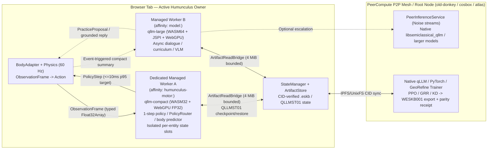

# Specification: Supporting `semiclassical_qllm` Models on PeerCompute (WebGPU + WASM Runtime & Humunculus Alignment)

- **Status:** Proposed architecture & implementation specification (`v0.1`)
- **Date:** 2026-11-25
- **Scope:** Cross-cutting design spanning `peercompute/inference`, `ComputeManager`, `ArtifactStore`, `PeerInferenceService`, `ModelEvidenceStore`, sibling `Tsotchke-Corporation/semiclassical_qllm`, and embodied agents in [`plan/demos/humunculus/humunculus.pdf`](../demos/humunculus/humunculus.pdf)
- **Grounded Baselines Inspected:**
  - PeerCompute `main` (`81f7dc6d`): `ModelInferenceService`, `gguf/` (`@wllama/wllama` WebGPU + WASM64 + JSPI), `ArtifactReadBridge`, `GgufArtifactReader`, `ComputeManager`, `ResourceLeaseBroker`, `tsotchkeModelCatalog.js`
  - `semiclassical_qllm` on `old-donkey` (`codex/qwen35-native-hybrid-parity-20260908` @ `5d9e9d2`): `backend.h`, `shaders_manifest.json`, `eskb_checkpoint.h`, `eskb_checkpoint_ffi.h`, `grr_inference.h`, `hybrid_inference.h`, `directed_sheaf.h`, `geometric_vocabulary.h`, `QLLM_PAPER_CLAIMS_LEDGER.md`, `QLLM_PRODUCTION_CAMPAIGN.md`, `QLLM_SCIENTIFIC_VALIDATION_CAMPAIGN.md`
  - Humunculus design study (`v0.1`, [`plan/demos/humunculus/humunculus.html`](../demos/humunculus/humunculus.html) / `humunculus.pdf`)

---

## 1. Executive Summary & Evidence Posture

This specification defines how **PeerCompute** can load, verify, execute, checkpoint, and peer-serve models built with **Tsotchke's `semiclassical_qllm`** in browsers (and interoperably on native PeerCompute / Root-Node peers) via a **WebGPU-enabled WebAssembly runtime (`qllm-wasm`)**.

Following the evidence discipline of both **Humunculus** (`Existing` / `Candidate` / `Research` / `Proposed`) and **`semiclassical_qllm`'s Paper Claims Ledger** (`MEASURED` / `STAMPED` / `PENDING` / `KILLED`), this spec strictly separates verified capabilities from proposed engineering:

| Tag | Meaning in this specification |
|---|---|
| **Existing** | Implemented and verified in PeerCompute (`81f7dc6d`) or `semiclassical_qllm` (`5d9e9d2`). |
| **Candidate** | Proven upstream component or pattern (`emdawnwebgpu`, WASM JSPI + `memory64`, `WESKB001`) requiring PeerCompute adaptation and device qualification. |
| **Proposed** | New runtime, WGSL kernel, manifest contract, state format, or acceptance gate defined by this spec. |
| **Research** | Scientific or architectural hypothesis (e.g., geometric policy sample efficiency, browser-side Riemannian updates) that requires controlled experiments and may fail. |

### Why a dedicated `qLLM` WebGPU/WASM runtime is needed
PeerCompute already ships two browser inference runtimes (`transformers.js` ONNX WebGPU and `@wllama/wllama` `llama.cpp` GGUF WebGPU+WASM64+JSPI). Neither can execute `semiclassical_qllm`'s distinctive model families:
1. **`WESKB001` (`.eskb`) GeometricLM checkpoints** — FP32 product-manifold models (`M = H^{d_h} × S^{d_s} × R^{d_e}`) using **causal directed sheaf attention (A4 D-operator)**, Poincaré/spherical embeddings, Born-rule readouts (`linear`, `softmax`, `sigsoftmax`, `complex_born`, `born_magnitude`), and KAN layers.
2. **GRR (Geometric Recursive Reasoning) networks & streaming binary geometric vocabularies** (`qllm_grr_network_t`, `qllm_hybrid_ctx_t`).
3. **GeoRefine Schema v2 export directories** (`compression_info.json` + SafeTensors + `head_importance*.safetensors` + `class_codebook.safetensors`) and `qLLM`'s native **Qwen3.5/3.6 hybrid DeltaNet/GQA + fused/shared MoE** runtime.

---

## 2. Strategic Alignment with Humunculus (`humunculus.pdf`)

Humunculus explicitly separates **continuous local embodied control** from **asynchronous deliberation, memory, speech, and offline/peer training** (`humunculus.pdf`, pp. 4–8, 12–18). A `qLLM` WebGPU+WASM runtime maps cleanly onto all three Humunculus execution loops — **without violating Humunculus's core isolation rules**:



### Concrete Humunculus Integration Requirements Satisfied by This Spec
1. **Two distinct runtime profiles matching Humunculus budgets (`humunculus.pdf` p. 12 & p. 18):**
   - **`compact-wasm32` (FP32-first, NO `shader-f16`, NO `memory64` required):** Serves Humunculus motor controllers, specialist routers (`PolicyRouter`), and body predictors (100k–10M params, 0.4–40 MB FP32, plus small `<256 MB` `.eskb` models). Directly satisfies `humunculus.pdf` p. 18 (*"Small FP32 controllers can avoid shader-f16"*) and keeps Poincaré ball math in FP32 where boundary stability requires it.
   - **`large-wasm64` (WASM64 + JSPI + WebGPU, optional `shader-f16`):** Serves larger `.eskb` language models (`qLLM-Small`), GeoRefine v2 text/VLM exports, and Qwen3.5/3.6 hybrid checkpoints using PeerCompute's existing streaming range-read pattern without copying multi-GB files into JS heap.
2. **Shared weights, isolated per-entity state (`humunculus.pdf` p. 7 & p. 18):**
   - Multiple Humunculus agents running the same policy CID share one GPU-resident weight set inside a worker while keeping completely isolated **entity state slots** (directed-sheaf KV caches `qllm_directed_sheaf_cache_t`, DeltaNet recurrent states, GRR manifold working states, and RNG states).
3. **Portable checkpointing & acknowledged host handoff (`humunculus.pdf` p. 7–8, M6):**
   - GPU-resident recurrent/KV/sheaf states serialize into a vendor-neutral little-endian binary format (**`QLLMST01`**) referenced by CID inside `agent.json`, enabling restart survival and acknowledged epoch-fenced handoff between independent peers (even across WebGPU ↔ native CPU/CUDA/Metal).
4. **Strict loop & deadline separation (`humunculus.pdf` p. 4, 6, 18):**
   - Motor control NEVER shares a worker, queue, or GPU command submission backlog with slow language deliberation. Stale observations (`simulationTick > expiresAtTick`) are dropped; missed deadlines invoke explicit neutral/bounded-hold actuation visible in `AgentOverlay` and excluded from skill performance claims.
5. **Honest backend & geometry telemetry (`humunculus.pdf` p. 22 & `qLLM` V0/V2):**
   - Every run reports actual execution placement (`webgpu` vs explicit `wasm-cpu`), observed `GPUDevice` dispatches/submissions/buffer peaks, and `qLLM`-specific invariants (e.g., operating point `u = √c · ρ` and causal directed-sheaf norm certificate `max_norm ≤ 1.0`). CPU fallback is **never** silently relabeled as GPU execution.
6. **Training placement boundary (`humunculus.pdf` p. 14, M4):**
   - **v1 scope is inference + explicit state checkpointing in browsers, with native training on PeerCompute/Root-Node peers** (`old-donkey`, `cosbox`, etc.) emitting verified `.eskb` candidate artifacts into `ArtifactStore`. Browser-side gradient/Riemannian training (`qllm_gradient_tape_t`) is explicitly deferred to a research-gated later phase (Q5).

---

## 3. Core Architecture & Boundary Rules

### 3.1 Strict `peercompute/core` Isolation (Non-Negotiable)
Per [`plan/plan.md`](../plan.md), `peercompute/core` MUST contain **0 `.wasm` assets** and **0 inference runtime imports**.
- All JS integration modules live under `peercompute/src/peercompute/inference/qllm/`.
- Registered exclusively in `peercompute/src/peercompute/inference/registerTaskModules.js` as built-in task module **`'peercompute:qllm-inference'`**.
- `demos/tests/demo-release.test.js` and `peercompute/tests/unit/workspaceBoundary.test.js` enforce that `peercompute/core` stays clean and that Vite bundles inference workers cleanly without raw base64 worker leaks.

### 3.2 Lean Inference-Only CMake Target in `semiclassical_qllm` (`QLLM_WASM_INFERENCE`)
`semiclassical_qllm` currently spans ~250K lines of C/C++/ObjC across 14 static libraries, including host-only dependencies (`OpenSSL`, `subprocess`, `mmap`, `pthread`, `OpenMP`, `BLAS`, `CUDA`, `Metal`, `TensorCore`, `QGTL`).

We MUST introduce a dedicated, minimal Emscripten-compatible CMake profile **`-DQLLM_WASM_INFERENCE=ON`** inside `semiclassical_qllm`:

| Subsystem | Included in `QLLM_WASM_INFERENCE`? | Portability Notes |
|---|---|---|
| `qllm_core` | **Yes (trimmed)** | `tensor.c`, `tensor_math.c`, `tensor_pool.c`, `memory.c`, `error.c`, `kv_cache.c`, `safetensors.c`, `config.c`, `fourier_optimized.c`, `rational_function.cpp`, vendored `cJSON`. Disable `mmap`, POSIX signal stack traces, `Accelerate`/`OpenBLAS`, and `thread_pool.c` (single-threaded worker + WASM SIMD128). |
| `qllm_geometric` | **Yes** | Poincaré ball, spherical, product manifold, geodesic, `geometric_simd.c` (portable scalar + WASM SIMD128 path). Exclude `qgtl_bridge.c` and host `riemannian_grad.c` (until Q5). |
| `qllm_model` | **Yes (inference subset)** | `eskb` forward path, `attention.c`, `attention_directed_sheaf.c`, `directed_sheaf.c`, `born_rule.c`, `born_head_complex.c`, `born_head_magnitude.c`, `grr.c`, `grr_inference.c`, `hybrid_inference.c`, `deltanet_cpu.c`, `transformer_with_embedding.c`, `moe.c`, `kan*.cpp`, `geometric_vocabulary.c`, `tokenizer_bpe.c`, `streaming_tokenizer.c`, `generation.c`, `constrained_decode.c`, `vision.c`, `vlm.c`. Exclude `grr_training.c`. |
| `qllm_loader` | **Yes (VFS-backed)** | `eskb_checkpoint.c`, `hf_loader.c`, `lora_loader.c`, `model_loader.c` compiled with `QLLM_NO_MMAP=1` and routed through a pluggable `qllm_vfs_t` byte-range reader callback. |
| `qllm_quantization` | **Yes** | Dequantization / mixed-precision unpackers for GeoRefine / quantized weights. |
| `qllm_backend` | **Yes (`cpu` + NEW `webgpu`)** | `backend.c`, `backend_cpu.c` (portable + SIMD128), **NEW `backend_webgpu.c`**. Exclude `backend_cuda.c`, `kernels.cu`, `backend_metal.m`, `backend_metal_sheaf.m`. |
| `qllm_network`, `qllm_agent`, `qllm_training`, `qllm_optimization`, `qllm_ffi` | **No (excluded in v1)** | Zero network sockets/OpenSSL, zero subprocesses, zero Eshkol/Python FFI, zero training loops in browser inference binary. |

### 3.3 Virtual Filesystem & Bounded Artifact Streaming (No `mmap`, No Whole-File Blobs)
Matching PeerCompute's proven `gguf/engine.js` & `ArtifactReadBridge.js` contract:
- **Zero unmanaged network access** from WASM. All model bytes flow from `ArtifactStore` over a `MessagePort` using `ARTIFACT_READ_PROTOCOL` (`peercompute.model-artifact-read.v1`) via a generalized `ArtifactRangeReader` (reusing `GgufArtifactReader.js`, max 4 MiB per read chunk, `maxReads: 1..2`, strict CID + SHA-256 verification on host).
- **Virtual file reads:**
  - In `large-wasm64` builds: Emscripten JSPI (`-sJSPI=1`) suspends WASM on `qllm_vfs_read(fd, offset, len, dst_ptr)` while JS awaits bounded `reader.read(path, offset, chunkSize, { signal })` chunks directly into WASM linear memory and streams tensors straight into `GPUBuffer`s (freeing temporary WASM staging immediately).
  - In `compact-wasm32` builds (`≤ 256 MiB`, targeting browsers without JSPI/`memory64`): PeerCompute pre-streams manifest files in 4 MiB bounded chunks through `ArtifactReadBridge` into a JS/WASM staging ring buffer and uploads tensor-by-tensor to `GPUBuffer`s before invoking `qllm_wasm_init_model()`, so WASM linear memory never needs to hold the full model + GPU duplicate simultaneously and **neither JSPI nor `memory64` is required for Humunculus compact policies**.
- **Explicit `mmap` prohibition:** `MEMFS` `mmap` throws immediately on virtual model files; `qllm_eskb_load_options_t.use_mmap` is forced `false`.

---

## 4. WebGPU Backend Design (`QLLM_BACKEND_WEBGPU`)

### 4.1 C API Strategy: `webgpu/webgpu.h` via `emdawnwebgpu` + PeerCompute Device Injection
Add `QLLM_BACKEND_WEBGPU` to `qllm_backend_type_t` in `include/semiclassical_qllm/backend.h` and implement `src/backend/backend_webgpu.c` against the standardized **`webgpu/webgpu.h` C API**:
- **Browser builds (Emscripten):** Link against `--use-port=emdawnwebgpu`.
- **Native builds (`old-donkey` / macOS / Linux CI):** Link the **exact same `backend_webgpu.c` and WGSL shaders** against Dawn or `wgpu-native`! This enables automated headless native WebGPU CTest parity checks against `backend_cpu.c` and PyTorch goldens without spinning up a browser for every kernel edit.
- **PeerCompute `GPUDevice` Ownership & Telemetry Hook:**
  - Mirroring `gguf/engine.js:161-167`, the Emscripten glue accepts a `peercomputeOnDevice(device)` hook (or receives a `GPUDevice` created via `requestManagedGpuDevice` in `peercompute/src/peercompute/capabilities/managedGpuDevice.js`).
  - `observeGpuDevice(device, evidence, { collect, onLost })` verifies:
    - Non-fallback hardware adapter (`!adapter.isFallbackAdapter`),
    - Required feature flags (only requiring `shader-f16` if the model manifest explicitly requests `f16` execution; FP32 models run without `shader-f16`),
    - Real `dispatchWorkgroups` / `queue.submit` counts, `requestedGpuBufferPeakBytes`, and `device.lost` propagation (which immediately transitions the session to `lost`, aborts in-flight generation/steps, and requires worker termination + lease release).

### 4.2 GPU-Resident Execution & Memory Layout Rules
To meet Humunculus's `p95 ≤ 10 ms` motor-step target and avoid WebGPU readback stalls:
1. **All weights, activations, KV caches, DeltaNet states, and directed-sheaf caches stay GPU-resident** (`WGPUBuffer` handles stored behind `qllm_tensor_t` device pointers).
2. **One batched `WGPUCommandEncoder` per forward step / decode token** (or per layer group if buffer limits require), submitting once to `WGPUQueue` rather than syncing per op.
3. **Single minimal readback per step:**
   - Text decode: sample on GPU (greedy / top-k / Born-rule CDF) or read back only `[vocab_size]` logits (or sampled `int32` token ID + scalar Born entropy / `max_norm` telemetry) at the end of the token step.
   - Humunculus motor `step`: read back only the compact action vector + uncertainty + scalar telemetry (`< 4 KB`) via a reusable double-buffered `MAP_READ` staging buffer.
4. **WebGPU `maxStorageBufferBindingSize` / `maxBufferSize` sharding:**
   - Browser WebGPU defaults can cap individual storage buffer bindings at **128 MiB** (`maxStorageBufferBindingSize`, often up to 1–4 GiB on desktop).
   - `backend_webgpu.c` MUST query `device.limits.maxStorageBufferBindingSize` and `device.limits.maxBufferSize` at init and automatically **shard oversized tensors** (notably large vocabulary embedding / LM-head tables `[248320 × dim]` in FP32!) across multiple `WGPUBuffer`s along the row dimension rather than failing or clamping silently.
5. **FP32 Numerical Safety on Curved Manifolds:**
   - Poincaré ball operations (`exp_map`, `log_map`, `mobius_add`, `hyperbolic_distance`, `conformal_factor`), RMSNorm accumulators, softmax/Born-rule normalizers, and directed-sheaf norm certificates MUST compute in **FP32** even when `shader-f16` is enabled for linear GEMMs. Near `‖x‖ → 1/√c`, FP16 underflows/overflows catastrophically.

### 4.3 Prioritized WGSL Kernel Matrix (Mapped from `src/backend/shaders_manifest.json`)
`semiclassical_qllm` already maintains a canonical kernel registry in `src/backend/shaders_manifest.json` (~45 Metal kernels + 2 sheaf kernels). We port them to WGSL in three explicit tiers:

#### Tier 1 — MVP: `.eskb` GeometricLM, Causal Directed Sheaf (A4), & Humunculus Policies
- **Linear & Elementwise:** Tiled workgroup-shared FP32 GEMM/GEMV (plus optional `f16`-weight/FP32-accum variant when `shader-f16` present), `rmsnorm`, `layernorm`, `residual_add`, `vec_add/mul/scale`, `relu`, `gelu`, `silu`, `fused_swiglu_gate_up`, `fused_swiglu_down`, `embedding_gather` (with multi-buffer vocab row sharding), `fused_rope`.
- **Standard Attention & Cache:** `kv_cache_append`, causal `flash_attention` (tiled online-softmax), `mha_decode`, `masked_softmax`, `reduce_max`, `reduce_sum`.
- **Geometric & Born Readout (FP32):** `exp_map`, `log_map`, `mobius_add`, `hyperbolic_distance`, `spherical_distance`, `product_manifold_distance`, `born_rule_amplitudes`, `born_rule_normalize`, `complex_born_readout`, `born_magnitude_readout`, `kan_basis_eval` (for `.eskb` models with `kan_K > 0`).
- **Causal Directed Sheaf D-Operator (Fused WGSL — Directly Addresses `T8`):**
  - *Empirical motivation from `old-donkey`:* `.icc/evidence/selection_is_constant_not_exponent_2026-08-07.md` proved **90.6%** of directed-sheaf runtime at `S=4096` was unfused PyTorch top-k selection (`22–39×` slower than a fused GEMM floor), and `T8` recorded a `1.45×` step overhead at `K=1`.
  - Design **two fused WGSL passes** (avoiding dense `S×S` global memory materialization on decode):
    1. `directed_sheaf_score_topk_wgsl`: computes causal `Q·K^T` (Euclidean or HELM Lorentzian `-d_L²/√m` per `attention_geometry` — respecting the A.4 sign & eq. 7 errata in `QLLM_PAPER_CLAIMS_LEDGER.md`!) in workgroup shared memory and maintains a per-row bounded top-`k` edge list (`sheaf_top_k_per_row`).
    2. `directed_sheaf_d_apply_wgsl`: applies diagonal/conformal restriction maps (`S_j`, `T_i`), enforces PSD degree `diag(Σ|w|)` + CFL certificate `dt·D_i < 1`, updates `qllm_directed_sheaf_cache_t`, and outputs per-layer `max_norm` certificate telemetry.

#### Tier 2 — Qwen3.5/3.6 Hybrid, GeoRefine v2, & GRR Reasoning
- `deltanet_conv_silu`, `deltanet_recurrence` (stateful asymmetric DeltaNet matching `5d9e9d2` CPU golden to `≤ 1e-4`), `attention_gate`, `moe_gate_topk` + fused/shared expert GEMV, `fused_rmsnorm_gemv`, `product_manifold_attention`, `geodesic_attention`, `phase_attention_forward`, `frechet_mean_step`, `parallel_transport_{hyp,sph}`, and dequant-in-register INT8 / INT4 / Q4_K / IQ4_XS GEMV kernels for GeoRefine quantized artifacts.

#### Tier 3 — Vision/VLM & Research-Gated Browser Adaptation
- ViT patch embedding & vision encoder passes (`vision.c` / `vlm.c`, strictly `batch = 1` per `semiclassical_qllm/README.md`).
- *Research-gated (Q5 only):* `geodesic_distance_backward`, `exp_map_backward`, `mobius_add_backward`, `riemannian_gradient_project`, `riemannian_adam_step`.

---

## 5. Artifact Manifest, Catalog & Admission Contracts

### 5.1 Manifest Schema (`peercompute.artifact.manifest.v1`)
Extends PeerCompute's existing content-addressed manifest model **without breaking `ArtifactManifest.js`**. Untrusted manifest fields can NEVER inject runtime binaries, bypass byte limits, or disable security checks.

```json
{
  "schema": "peercompute.artifact.manifest.v1",
  "id": "qllm-humunculus-nav-v1",
  "files": [
    {
      "path": "model.eskb",
      "cid": "bafkrei...",
      "size": 16777216,
      "sha256": "<64-hex>"
    },
    {
      "path": "qllm-attestation.json",
      "cid": "bafkrei...",
      "size": 1024,
      "sha256": "<64-hex>"
    }
  ],
  "model": {
    "runtime": "semiclassical-qllm",
    "runtimeVersion": "0.1.0",
    "format": "eskb",
    "profile": "compact-wasm32",
    "architecture": "qllm_geometric_lm",
    "task": "policy-step",
    "dtype": "fp32",
    "modalities": ["tensor"],
    "requiredFeatures": [],
    "qllm": {
      "attentionKind": "sheaf",
      "sheafMode": "causal_directed",
      "outputHeadMode": "linear",
      "stateSchema": "QLLMST01",
      "observationDim": 48,
      "actionDim": 4,
      "maxSeqLen": 256,
      "maxEntities": 8
    },
    "provenance": {
      "sourceRepo": "Tsotchke-Corporation/semiclassical_qllm",
      "sourceCommit": "5d9e9d2",
      "campaignStage": "V0",
      "parityReceipt": "abs<=1e-4,rel<=1e-3",
      "limitations": "Experimental policy artifact; behavioral capability requires held-out evaluation."
    }
  }
}
```

### 5.2 Supported Model Formats & Fail-Closed Admission Rules
`peercompute/src/peercompute/inference/qllm/runtimeDefinition.js` validates manifests before reserving workers or leases:

| `model.format` | Required Files | Hard Fail-Closed Rejections |
|---|---|---|
| **`eskb`** (`WESKB001`) | `*.eskb` (magic `WESKB001`, v1), `tokenizer.json` (if `task === 'text-generation'`) | Bad magic/version; `output_head_mode ∈ {'born_mix', 'mos'}` (no native C kernel); `sheaf_solver === 'cn'` above O(S³) cap (`maxSeqLen > 512`); tensor offset/shape overflow; missing `observationDim`/`actionDim` on `policy-step`. |
| **`qllm-grr`** | GRR weights + streaming binary geometric vocab (`*.gvocab`) + manifest JSON | Unbound vocabulary dimensions mismatching GRR `H×S×R` split; unverified checkpoint digest (`cc4fcce` attestation check). |
| **`georefine-v2`** | `compression_info.json` (`compression_schema_version <= 2`), `config.json`, `*.safetensors`, optional `head_importance*.safetensors` / `class_codebook.safetensors`, `tokenizer.json` (text/VLM) | Missing/empty/non-JSON `compression_info.json`; `..` path escape or symlinks; `BCTX`/`PPCX` or `georefine.tbe.serve.v1` codec containers (CUDA-only, explicitly excluded as in `tsotchkeModelCatalog.js`!). |

### 5.3 Runtime Asset & Capability Gates (`validateQllmRuntimeAssets` / `validateQllmCapabilities`)
- **Trusted same-origin runtime assets only:**
  - `runtimeAssets` must specify fixed same-origin URLs `{ mjs, wasm }` (for `compact-wasm32` or `large-wasm64`; optional pinned `wgsl` bundle if not embedded in `.wasm`). Query strings, credentials, cross-origin URLs, or manifest-supplied URLs are rejected.
- **Capability validation by profile:**
  - **`compact-wasm32` (WebGPU mode):** Hardware WebGPU adapter (`!isFallbackAdapter`), `maxStorageBufferBindingSize` & `maxBufferSize` sufficient for sharded weights + entity states. **Does NOT require `crossOriginIsolated`, `memory64`, JSPI, or `shader-f16`** (though uses `shader-f16` if requested and present).
  - **`compact-wasm32` (explicit `wasm-cpu` mode):** Allowed ONLY when caller passes `{ backend: 'wasm-cpu' }` and model `totalBytes ≤ 32 MiB` (e.g., tiny Humunculus router/VAD/fallback control). Tagged `actualBackend: 'wasm-cpu'` in all telemetry.
  - **`large-wasm64` (WebGPU mode):** Requires `crossOriginIsolated`, `SharedArrayBuffer`, WebAssembly JSPI (`Suspending`/`promising`), shared `memory64`, and non-fallback hardware WebGPU adapter (identical to `validateGgufCapabilities` in `gguf/runtimeDefinition.js:129-142`, except `shader-f16` is gated on `manifest.model.requiredFeatures.includes('shader-f16')` rather than unconditionally forced for FP32 models).

---

## 6. Worker & Host API Surface (`peercompute:qllm-inference`)

### 6.1 Module Layout in PeerCompute
```text
peercompute/src/peercompute/inference/qllm/
├── runtimeDefinition.js   # Manifest, runtime asset, option, & capability validators
├── eskbAdmission.js       # Bounded WESKB001 & GeoRefine v2 header inspection via ArtifactRangeReader
├── engine.js              # Emscripten + WebGPU device observer, VFS range bridge, WASM ABI wrapper
├── stateSnapshot.js       # QLLMST01 portable binary encoder/decoder & CID verification
├── modelTask.js           # ComputeManager worker task entrypoint (handleModelTask)
└── qllmCatalog.js         # Curated/pinned qLLM model & policy catalog entries with honest limitations
```

### 6.2 Commands Supported by `handleModelTask`
Reuses `ModelInferenceService` (`load`, `generate`, `status`, `cancel`, `unload`) and adds three Humunculus-oriented commands for dedicated policy workers:

| Command | Mode | Input / Output & Guarantees |
|---|---|---|
| `load` | Both | Validates manifest/assets/capabilities, streams verified weights via `ArtifactReadBridge`, allocates GPU buffers, initializes up to `maxEntities` isolated state slots, returns initial evidence (`adapter`, `actualBackend`, `requestedGpuBufferPeakBytes`, `wasmMemoryBytes`, `shardedTensors`). |
| `generate` | Language / VLM | Streaming text (and optional VLM `batch=1` image) generation with `AbortSignal`, bounded `maxNewTokens` / `maxOutputBytes`, `onToken` progress events, GPU `settleGpu()` on cancel, plus optional geometric telemetry (`operatingPointU`, `sheafMaxNorm`, `bornEntropy`). |
| `step` | Humunculus Control | Single deterministic forward step: `{ sessionId, entityId, authorityEpoch, simulationTick, expiresAtTick, observation: Float32Array, validityMask?: Uint8Array }`. Transfers `Float32Array` buffer zero-copy. Drops stale ticks (`simulationTick > expiresAtTick`). Returns `{ action: Float32Array, uncertainty, bornEntropy?, sheafMaxNorm?, stepMs, actualBackend }`. |
| `checkpoint-state` | Humunculus Persistence | Flushes GPU queue, reads back ONLY the named `entityId`'s state tensors (sheaf KV cache, DeltaNet state, GRR working point, RNG counter), packs into `QLLMST01` `Uint8Array` (transferable) for host `ArtifactStore.put()` → CID. |
| `restore-state` | Humunculus Restore / Handoff | Validates `QLLMST01` magic, `policyCid === loaded manifestCid`, tensor shapes, finite values (`!NaN/Inf`), and `authorityEpoch`, uploads state into `entityId`'s GPU slot without reloading shared weights. |
| `reset-entity` / `release-entity` | Humunculus Multi-Entity | Zeroes or frees one entity slot without perturbing sibling entities sharing the worker's weights. |
| `status` / `cancel` / `unload` | Both | Identical fail-closed cancellation, `settleGpu()`, and `requiresWorkerTermination: true` unload contract as `gguf/modelTask.js`. |

### 6.3 Portable Entity State Snapshot Format (`QLLMST01`)
```text
Offset  Size  Field
------  ----  -----------------------------------------------------------
     0     8  magic              = "QLLMST01" (little-endian)
     8     4  version            = 1
    12     4  flags              (bit0: little-endian, bit1: fp32-state)
    16     4  header_bytes       (aligned to 64 bytes)
    20     4  meta_json_bytes    (UTF-8 JSON: agentId, authorityEpoch,
                                  simulationTick, policyManifestCid,
                                  rngSeedState, stateSchemaVersion)
    24     4  num_tensors
    28     4  reserved           = 0
    32     M  meta_json
  32+M     T  TOC entries (same layout as WESKB001: name, dtype, ndim,
              offset, size_bytes, shape[])
  pad64       Raw contiguous FP32 state tensors (KV / directed-sheaf cache,
              DeltaNet recurrent matrices, GRR manifold coordinates)
```
- **Why this matters for Humunculus M6 (Hosted Continuity):** Because `QLLMST01` uses the exact same little-endian FP32 TOC layout as `WESKB001` and contains zero GPU-vendor-specific layouts, a Humunculus entity paused on Chrome/WebGPU (Windows/Linux/Android) can hand off its verified `agent.json` + `QLLMST01` CID to a Safari/Metal or Root-Node/CUDA peer and resume with identical state.

---

## 7. Resource Admission, Scheduling & Contention Policy

Directly implementing `humunculus.pdf` p. 18 ("Resident state and scheduling") over PeerCompute's `ComputeManager` + `ResourceLeaseBroker` + `ResidentModelAdmission`:

1. **Multi-Worker Pool Topology (Never Share Motor & LLM Workers):**
   - `ComputeManager` must be initialized with `workerCount >= 3` when running a full Humunculus stack:
     - **Worker 0 (`affinityKey: 'humunculus-motor:<group>'`):** `qllm-compact` resident motor + router policies.
     - **Worker 1 (`affinityKey: 'model:<dialogueSession>'`):** Async language/VLM specialist (`qllm-large`, `llama.cpp`, or `transformers.js`).
     - **Worker 2 (`affinityKey: 'speech:<session>'`):** Optional VAD/ASR/TTS.
   - Note from `humunculus.pdf` p. 18: *Worker affinity reserves an exclusive worker and does not provide preemption.* Separate workers + priority-gated GPU submissions prevent slow prefill from starving 20–60 Hz control.
2. **Conservative Memory Envelope Calculation (No Fake VRAM Claims):**
   - Host computes required `{ cpuBytes, gpuBytes }` strictly from the inspected `WESKB001` / `GeoRefine v2` config (mirroring `qllm_hybrid_estimate_memory_budget`):
     - `gpuBytes = weightBytes + maxEntities * (kvAndSheafStateBytes + recurrentStateBytes) + activationWorkspaceBytes`
     - `cpuBytes = wasmLinearHeapBytes + stagingChunkBytes (<= 16 MiB)`
   - Never derive or display "measured physical VRAM" from `navigator.deviceMemory` or `adapter.limits.maxBufferSize`.
3. **PeerCompute Network Serving (`PeerInferenceService`) & Root-Node Escalation:**
   - Larger `qLLM` models (e.g., `qLLM-Small` 192M–1.15B effective, GeoRefine 27B–35B hybrids) can be hosted by a **PeerCompute Root Node** or Tailscale peer running native `libsemiclassical_qllm.so`/Metal/CUDA and advertised through `PeerInferenceService` over authenticated Noise streams.
   - Remote inference supplies **advisory results** (`PracticeProposal`, dialogue, high-cost planning) — per `humunculus.pdf` p. 4 & p. 8, a remote inference peer **never** acquires body actuation authority.
4. **Native Training → Browser Deployment Loop (`humunculus.pdf` M4):**
   - Browser Humunculus nodes record fixed-step `TrajectoryWriter` episodes (`ObservationFrame`, actions, rewards, body/schema/policy CIDs) into `ArtifactStore`.
   - Native `qLLM` training peers (`old-donkey`, `cosbox`, etc.) fetch episode CIDs, run PPO / GRR / KD updates, export a versioned `WESKB001` candidate + parity receipt (`qllm-attestation.json`), and publish its CID.
   - Browser peers run independent held-out evaluation (`EvaluationSuite`) before promoting the new policy CID — keeping the previous policy CID pinned for instant rollback.

---

## 8. Security, Safety & Honest-Claims Invariants

1. **Zero remote code execution:** Manifests select only trusted built-in runtime IDs (`'semiclassical-qllm'`) and pinned same-origin WASM assets; no downloaded JS, WASM, or WGSL shaders are ever executed from peer artifacts.
2. **Fail-closed artifact integrity:** Every file read through `ArtifactReadBridge` is verified against pinned manifest CID + SHA-256 + exact byte length; `compression_info.json` path escapes and symlinks are rejected; `BCTX`/`PPCX`/`TBE` CUDA-only codec packages are refused at admission.
3. **No silent degradation:**
   - WebGPU device loss marks the session `lost`, rejects pending work, and terminates the worker to guarantee GPU memory release before releasing `ResourceLeaseBroker` capacity.
   - `wasm-cpu` never silently substitutes for requested `webgpu`.
   - Torch-only output heads (`born_mix`, `mos`) are rejected at admission rather than falling back to `linear`.
4. **Honest provenance & scientific claims:**
   - Every `qllmCatalog.js` entry and `ModelEvidenceStore` record carries `provenance.campaignStage`, `provenance.parityReceipt`, and `provenance.limitations` (e.g., distinguishing synthetic parity checks from trained-model capability, noting `T7` Born calibration-only vs ranking equivalence, and disclosing `T8` directed-sheaf cost alongside retrieval benefits).

---

## 9. Staged Implementation Roadmap & Acceptance Gates

| Stage | Scope & Deliverables | Concrete Exit / Acceptance Gates |
|---|---|---|
| **Q0 · Lean WASM-CPU Bring-Up** (`semiclassical_qllm`) | Add `-DQLLM_WASM_INFERENCE=ON` CMake target (no OpenSSL/subprocess/mmap/OpenMP); pluggable `qllm_vfs_t`; Emscripten build producing `qllm-compact-cpu.wasm` + `qllm-large-cpu.wasm` (JSPI + `memory64`). | Compiles cleanly under pinned `emsdk`; synthetic `.eskb` (softmax + causal directed sheaf + complex Born) and `test_qwen_hybrid_parity` fixtures match native C reference within **`abs ≤ 1e-5`** in Node WASM; zero `mmap` calls. |
| **Q1 · `QLLM_BACKEND_WEBGPU` + Tier-1 WGSL** (`semiclassical_qllm`) | Implement `src/backend/backend_webgpu.c` (`webgpu/webgpu.h`) + Tier-1 WGSL shaders (FP32 GEMM/GEMV, norms, RoPE, SwiGLU, Flash/MHA, Poincaré/spherical ops, Born heads, **fused causal directed-sheaf top-k + D-step**, multi-buffer vocab sharding). | Native Dawn/wgpu-native CTest suite passes; headless Chrome WebGPU parity vs C FP32 reference **`abs ≤ 1e-4`, `rel ≤ 1e-3`** across all Tier-1 ops; zero NaN/Inf at Poincaré boundary (`‖x‖ = 0.999/√c`); `directed_sheaf` certificate `max_norm ≤ 1.000001`; measured WGSL sheaf-vs-softmax step ratio recorded honestly. |
| **Q2 · PeerCompute `qllm` Runtime Integration** (`peercompute`) | Implement `peercompute/src/peercompute/inference/qllm/` (`runtimeDefinition`, `eskbAdmission`, `engine`, `modelTask`, `qllmCatalog`), register `'peercompute:qllm-inference'`, wire into `ModelInferenceService`, `PeerInferenceService`, `ModelEvidenceStore`, and `demos/inference/`. | Unit tests for fail-closed manifest/asset/capability/unservable-head (`born_mix`/`mos`) rejection; headless Chrome end-to-end load + streaming generate + cancel + GPU device-loss recovery + worker termination; `demo-release.test.js` confirms `0` `.wasm` in `peercompute/core` and `0` raw base64 worker leaks. |
| **Q3 · Humunculus Policy Step & Portable Continuity** (`peercompute` + `demos/humunculus/`) | Implement `step`, multi-entity isolated state slots, `QLLMST01` `checkpoint-state` / `restore-state`, dedicated motor worker affinity, and `AgentAuthority` epoch fencing (aligns with Humunculus **M1–M3 & M6**). | Two entities share one `.eskb` weight set with zero state cross-talk; desktop reference target **`p95 step ≤ 10 ms`, `<1%` deadline misses** under Three.js + 60 Hz physics load; `QLLMST01` checkpoint survives browser restart and acknowledged 2-peer handoff with numerical trace parity (`abs ≤ 1e-4`); actual backend & geometry metrics visible in `AgentOverlay`. |
| **Q4 · Hybrid DeltaNet/MoE, GeoRefine v2 & Native Training Loop** | Port Tier-2 WGSL kernels (`deltanet_conv_silu`, `deltanet_recurrence`, `moe_gate_topk`, INT8/INT4 dequant GEMV); add GeoRefine v2 loader in WASM; wire Root-Node native `qLLM` serving (`PeerInferenceService`) + native trainer → CID `.eskb` publish → browser `EvaluationSuite` gate (aligns with Humunculus **M4** & `qLLM` **P8**). | Qwen hybrid synthetic golden passes in browser WebGPU (`abs ≤ 1e-4`); GeoRefine v2 export loads via `ArtifactReadBridge` while rejecting BCTX/TBE codec packages; end-to-end native train → CID `.eskb` → browser eval promotion/rollback test passes. |
| **Q5 · Browser On-Device Adaptation *(Research-Gated)*** | Only if M4 justifies local updates: separate `qllm-train.wasm` target exposing `qllm_gradient_tape_t` + WGSL backward & `riemannian_adam_step` kernels under strict optimizer memory leases. | Analytic WebGPU backward gradients match native C exact-AD oracle (`tests/data/qllm_oracle_golden`) within declared tolerance; bounded memory/time budgets prevent starving live control. |

---

## 10. Open Engineering Decisions to Resolve in Q0/Q1 Prototypes

1. **WGSL Packaging (`embedded` vs `bundled`):** Embedding minified WGSL shader strings inside `backend_webgpu.c` simplifies `validateQllmRuntimeAssets` to just `{ mjs, wasm }` (matching `wllama`), whereas separate `.wgsl` assets ease browser shader debugging. Recommendation: embed validated WGSL strings in the C binary for release builds with a dev-only override test flag.
2. **Emscripten `emdawnwebgpu` vs Thin JS WebGPU Import Table:** `emdawnwebgpu` is recommended because it gives native Dawn/wgpu-native CTest parity from the same `backend_webgpu.c`; Q1 should benchmark binary size overhead (`qllm-compact.wasm` target `< 2.5 MB` gzipped) and confirm clean `GPUDevice` injection for PeerCompute's `observeGpuDevice` instrumentation.
3. **Tokenizer Weight / Bundle Size:** Qwen-scale vocabularies (`248,320` tokens) carry large `tokenizer.json` and embedding tables (`~1 GB+` FP32 at `d=1024`). For `compact-wasm32` Humunculus policies (`task: 'policy-step'`), no tokenizer is loaded; for `text-generation`, `large-wasm64` must stream `tokenizer.json` and shard embedding tables across `maxStorageBufferBindingSize` chunks.
4. **Fused Directed-Sheaf Top-k Kernel Ceiling:** Q1 should explicitly measure the WGSL fused `directed_sheaf_score_topk` + `d_apply` wall-clock ratio against WGSL FlashAttention across `S ∈ {256, 512, 1024, 2048}` to determine whether browser fused kernels close the `1.45×` / `3.46×` gap observed in PyTorch (`T8` / `V2`).
