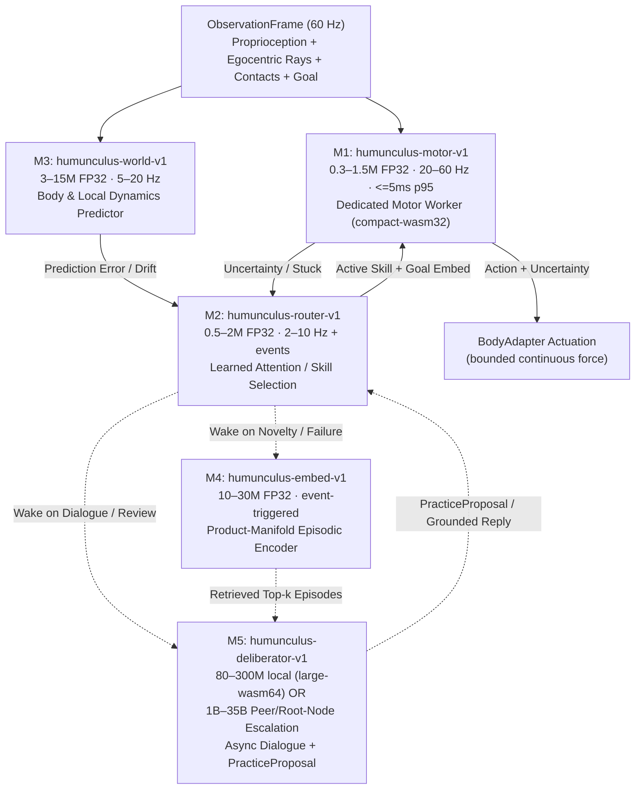

# Tsotchke Handoff Spec Sheet 2: Custom `qLLM` Model Suite for Humunculus Embodied Agents on PeerCompute

- **Document ID:** `PC-SPEC-HUMUNCULUS-QLLM-002` (`v1.0`)
- **Date:** 2026-11-25
- **Owner / Implementer:** Tsotchke (geometric ML, training, `semiclassical_qllm` / `GeoRefine` / `Selene` modeling team)
- **Consumer / Host Environment:** PeerCompute `demos/humunculus/` & `peercompute/inference/qllm/`
- **Runtime Dependency:** [Spec Sheet 1 — `qLLM` WebGPU-Enabled WASM Runtime](tsotchke-spec-1-qllm-webgpu-runtime.md) (`PC-SPEC-QLLM-RT-001`)
- **Primary Design Anchor:** [`plan/demos/humunculus/humunculus.pdf`](../demos/humunculus/humunculus.pdf) (source: [`humunculus.html`](../demos/humunculus/humunculus.html))

---

## 1. Purpose, Design Stance & Evidence Discipline

This specification defines a **custom suite of compact, composable `semiclassical_qllm` neural models** designed to run on top of the Spec Sheet 1 WebGPU/WASM runtime to power **Humunculus** — persistent, embodied learning agents inside PeerCompute browser worlds.

Both [`humunculus.pdf`](../demos/humunculus/humunculus.pdf) and `semiclassical_qllm`'s `QLLM_PAPER_CLAIMS_LEDGER.md` enforce strict scientific honesty. Every architectural choice below must respect four standing rules:
1. **Learned behavior only:** Navigation, movement, routing, and adaptation must arise from trained neural parameters, not scripted state machines. Deterministic bots remain experimental controls or optional labeled demonstration teachers.
2. **Matched controls are mandatory:** Every geometric specialist (`causal_directed` sheaf, `H×S×R` product manifold, Born readout, DeltaNet) MUST be benchmarked against a matched-parameter and matched-compute Euclidean baseline (`attention_kind: 'softmax'` or standard `MLP + GRU`) under identical observations, seeds (≥ 5 seeds), and resource budgets.
3. **Measure engagement, never assume it:** Every curved-manifold checkpoint must log the per-layer operating point **`u = √c · ρ`** (per `qLLM` `V0`) and directed-sheaf norm certificate **`max_norm ≤ 1.0`** (`T5`). Never claim a geometric benefit if `u ≈ 0` (near-Euclidean regime).
4. **Honest claim boundaries:** Respect `qLLM`'s established ledger facts — in particular **`T7`** (Born readouts affect probability **calibration**, not top-1 token/action ranking) and **`T8`** (always report step latency/throughput cost alongside retrieval/horizon gains).

---

## 2. Why a Multi-Model `qLLM` Suite Fits Humunculus

`humunculus.pdf` (pp. 4–8, 12–18) specifies **one persistent entity driven by several asynchronous execution loops** with radically different latency and memory envelopes — explicitly forbidding a slow language model from sitting on the 60 Hz actuator path.

`semiclassical_qllm`'s native primitives map onto Humunculus's loops as concrete, falsifiable engineering hypotheses:

| `qLLM` Mechanism | Humunculus Role | Testable Hypothesis (Requires Control Ablation) |
|---|---|---|
| **Causal Directed Sheaf D-operator (`K=1`, `T5`/`M5`)** | Long-horizon navigation memory & specialist routing | Length-stable KV-exact working memory (`‖p_θ(M)‖ ≤ 1`, `M5`: 0.912 @ 8×, 0.636 @ 32×) prevents attention dispersion during multi-minute episodes exceeding training horizon. |
| **Product Manifold `M = H^{d_h} × S^{d_s} × R^{d_e}`** | Embodied state, spatial/goal encoding, & episodic memory | Separates metric kinematics (`R`), cyclic heading/orientation/gaze (`S`), and hierarchical goals/skills/relationships (`H`) cleanly in low parameter budgets (0.3M–30M). |
| **Hybrid DeltaNet Recurrence (`5d9e9d2`)** | High-rate continuous sensorimotor streams (20–60 Hz) | Constant-size `O(1)` recurrent state supports unbounded continuous gameplay without KV-cache growth or eviction jitter. |
| **Born-Rule Calibration (`T7`)** | Routing uncertainty & curiosity / escalation trigger | Calibrated entropy over skill/action distributions triggers vision/memory/LLM escalation more reliably than uncalibrated linear/softmax logits. |
| **Portable FP32 `WESKB001` + `QLLMST01` State** | Multi-entity weight sharing & cross-peer handoff (M6) | Multiple agents share one GPU-resident `.eskb` weight set while keeping isolated, vendor-neutral FP32 states that survive browser restarts and peer handoff. |

---

## 3. The Custom Humunculus `qLLM` Model Suite

All browser-resident models MUST export as **FP32 `WESKB001` (`.eskb`)** bundles (no Torch-only `born_mix`/`mos` heads) verified via Spec Sheet 1's `compact-wasm32` profile (no `shader-f16` required) — except `humunculus-deliberator-v1`, which may use `large-wasm64` or PeerCompute remote peer hosting.

### Model 1 — `humunculus-motor-v1` (Embodied Motor & Navigation Controller)
- **Target Loop & Budget:** `20–60 Hz` in dedicated worker (`affinityKey: 'humunculus-motor:<group>'`); **0.3M–1.5M params (1.2–6.0 MB FP32)**; desktop reference latency **`p95 step ≤ 5 ms`** (leaving 5 ms margin inside `humunculus.pdf`'s `≤ 10 ms` total control budget including physics/rendering).
- **Runtime Profile:** `compact-wasm32` (`webgpu` FP32; **no `shader-f16`**).
- **Input Tensor Contract (`ObservationFrame` flat `Float32Array`, fixed schema `humunculus.obs.v1`):**
  - **Proprioception (`R`, dim 16):** linear velocity `(vx, vy, vz)`, angular velocity `(wx, wy, wz)`, grounded/contact flags (4), previous action (4), normalized stamina/effort/time-delta (2).
  - **Local Geometry (`S × R`, dim 32–64):** 16–32 egocentric ray distances + hit-class encodings within declared sensor range (plus validity mask for occluded/stale rays).
  - **Active Goal & Skill Conditioning (`H × S`, dim 16):** relative target bearing (`sin θ, cos θ`), clamped distance, active skill embedding from `humunculus-router-v1`, observation age.
  - **Strict Privilege Barrier (`humunculus.pdf` p. 5):** Full simulator/world-truth state may feed an offline critic during training, **never** the deployed actor input tensor.
- **Proposed `qLLM` Architecture:**
  - Product-manifold input projection into `M = H^{d_h} × S^{d_s} × R^{d_e}` (e.g., `d_h=32, d_s=32, d_e=64`, total `d=128`).
  - 2–4 blocks using **either** (Arm A) stateful DeltaNet recurrence (`O(1)` per-tick state) **or** (Arm B) bounded-window causal directed sheaf (`K=1`, `sheaf_mode: 'causal_directed'`, `maxSeqLen: 128`).
  - **Outputs (`PolicyStep`, flat `Float32Array`):**
    - Continuous bounded actions for CubeChat v1 body adapter (`forceX ∈ [-1, 1]`, `forceZ ∈ [-1, 1]`, `turnRate ∈ [-1, 1]`, `jumpImpulse ∈ [0, 1]`, `stopIntent ∈ [0, 1]`) — directly addressing `humunculus.pdf` M0's requirement for direct continuous forces rather than keyboard-thresholded bot outputs.
    - Calibrated uncertainty vector + value/competence estimate (`dim 2`).
- **Per-Entity State (`QLLMST01`):** `≤ 256 KB` per entity (`maxEntities ≥ 8` sharing one loaded `.eskb`).
- **Required Control Baselines:** Identical-observation Euclidean `MLP + GRU` (PPO) and `attention_kind: 'softmax'` variant at equal params & FLOPs.

### Model 2 — `humunculus-router-v1` (Learned Attention & Specialist Router)
- **Target Loop & Budget:** `2–10 Hz` + event triggers (co-resident in motor/routing worker or separate low-latency slot); **0.5M–2.0M params (2–8 MB FP32)**; **`p95 step ≤ 4 ms`**.
- **Runtime Profile:** `compact-wasm32` (`webgpu` FP32 or explicit `wasm-cpu` option if `< 4 MB` and benchmarked faster than GPU launch overhead).
- **Input Contract (`WorkspaceSummary` `Float32Array`):**
  - Latest `humunculus-motor-v1` uncertainty & stuck/contact indicators,
  - `humunculus-world-v1` prediction-error / physical-drift scalar & vector,
  - Episodic memory retrieval scores & observation ages (`observationAgeMs` per specialist, plus validity mask),
  - Speech/dialogue event flags (new user turn, interruption flag),
  - Current PeerCompute resource headroom (queue depths, active deliberation busy flag).
- **Proposed `qLLM` Architecture:**
  - 2–3 layer **causal directed sheaf (`K=1`)** over specialist slots (inspired by Recurrent Independent Mechanisms + Option-Critic in `humunculus.pdf` p. 6) with **Born-rule calibrated readout** (`output_head_mode: 'complex_born'` or `'born_magnitude'`) over discrete specialist wake decisions and skill options.
- **Outputs (`RoutingDecision`):**
  - Sparse specialist wake probabilities `[wakeVision, wakeMemoryQuery, wakeWorldRollout, wakeDialogue, wakePracticeReview]`,
  - Active skill ID (`0..K-1`) + skill termination probability `β ∈ [0, 1]` + 16-dim skill/goal conditioning vector passed to `humunculus-motor-v1`,
  - Calibrated decision entropy (`bornEntropy`).
- **Required Control Baselines:** Fixed-schedule timer router and monolithic single-policy baseline (`humunculus.pdf` M3).

### Model 3 — `humunculus-world-v1` (Predictive Body & Local World Model)
- **Target Loop & Budget:** `5–20 Hz` live prediction + asynchronous short imagination rollouts (`H = 8..16` steps); **3M–15M params (12–60 MB FP32)**; **`p95 single-step ≤ 8 ms`**.
- **Runtime Profile:** `compact-wasm32` (`webgpu` FP32).
- **Input Contract:** Current compact `ObservationFrame`, applied action `a_t`, and **Body Morphology Descriptor (`bodyCid` feature vector: mass, friction estimate, dimensions, and for M7: joint graph + actuator limits)**.
- **Proposed `qLLM` Architecture:**
  - Product-manifold latent dynamics model (`R` kinematics + `S` orientation + `H` interaction/contact state) with DeltaNet or causal directed-sheaf recurrence and residual manifold stream (using fixed `7420a81` LResNet-scaled `residual_add`, never the voided pre-fix M7 centroid!).
- **Outputs:** Predicted next proprioception + contact probability + reward/collision estimate + **unexpected-drift / surprise score** (the exact trigger in `humunculus.pdf` p. 16: *"the body predictor reports unexpected drift on a slippery surface"* → triggers `PracticeProposal`!).
- **Morphology Readiness (Humunculus M7):** Accepts a variable-length or padded `MetaMorph`-style body descriptor so physical self-modification (changed mass, friction, or articulated joints) conditions dynamics predictions explicitly instead of silently corrupting a rigid cube policy.

### Model 4 — `humunculus-embed-v1` (Geometric Episodic Memory Encoder)
- **Target Loop & Budget:** Event-triggered (on memory append & retrieval query); **10M–30M params (40–120 MB FP32)**; **`p95 encode ≤ 15 ms`** per compact event record.
- **Runtime Profile:** `compact-wasm32` (`webgpu` FP32).
- **Purpose:** Drop-in geometric competitor to `humunculus.pdf`'s `all-MiniLM-L6-v2` (22.7M, 384-d) retrieval baseline.
- **Input / Output Contract:**
  - Input: Bounded structured event text (`≤ 128` tokens: speaker/entity ID, location summary, action taken, observed outcome, timestamp bucket).
  - Output: Normalized **product-manifold embedding `(e_H ∈ H^{64}, e_S ∈ S^{192}, e_R ∈ R^{128})`** (384 dims total) scored with `qLLM`'s exact product-manifold distance (`d_M² = α_H d_H² + α_S d_S² + α_R d_R²`).
  - **Provenance Rule (`humunculus.pdf` p. 7):** Original append-only event records and CIDs stay stored locally alongside vectors; upgrading `humunculus-embed-v1` requires a versioned reindex (never mix vector spaces across model versions).

### Model 5 — `humunculus-deliberator-v1` (Grounded Dialogue & Curriculum Planner)
- **Target Loop & Budget:** Strictly **asynchronous / event-triggered** in a **separate worker** (`affinityKey: 'model:<dialogueSession>'`), never blocking control. Two deployment tiers:
  - **Tier 5A — Local Browser Specialist (`80M–300M` active params, e.g., `qLLM-Small` ~192M distilled or compact hybrid DeltaNet/Directed-Sheaf):**
    - Packaged as `WESKB001` (or GeoRefine v2 quantized export), `≤ 1.2 GiB` total GPU footprint on `large-wasm64` (competing directly with PeerCompute's pinned 1.771 GB `Qwen3.5-2B-q4` ONNX baseline in `humunculus.pdf` p. 11).
  - **Tier 5B — Peer / Root-Node Escalation Specialist (`1B–35B`, e.g., GeoRefine Qwen3.5/3.6 hybrid or larger `qLLM`):**
    - Hosted on `old-donkey`, `cosbox`, `atlas`, or an ExoPute Root Node via `PeerInferenceService` over Noise streams for rare high-difficulty curriculum reviews or body-design reasoning.
- **Required Capabilities:**
  - **Grammar-Constrained Decoding (`constrained_decode.c`):** Must reliably emit valid JSON matching `humunculus.pdf`'s `PracticeProposal` schema (`{ hypothesis, taskFamily, scenarioRanges, targetSkill, allowedRewardParameters, episodeBudget, computeBudget, stoppingRule, expectedImprovement, supportingEventIds }`) and typed action/goal intents without arbitrary code execution.
  - **Grounded Epistemic Separation:** Trained/prompted to separate observed events (`supportingEventIds`), inferred beliefs, proposed actions, and confirmed outcomes (`humunculus.pdf` M2 & p. 23).

### Optional Research Model 6 — `humunculus-connectome-v1` (Fly-Connectome Specialist, Humunculus M8)
- **Scope:** Strictly isolated research module for Humunculus **M8** (`humunculus.pdf` p. 17) — **NOT** a prerequisite for M1–M7.
- **Contract:** A bounded biological heading/path-integration or visual-following sub-circuit compiled to run through the **exact same `ObservationFrame → PolicyStep` + `QLLMST01` state contract** (`membrane` + delay variables serialized inside `QLLMST01`, immutable connectome graph/weights inside `WESKB001`/artifact bundle) so intact, rewired, and ablated connectome controls can be compared directly against `humunculus-motor-v1` at matched budgets.

---

## 4. Shared Memory Budgets & Composed Browser Footprint

Per `humunculus.pdf` p. 18, all weights, states, rendering buffers, and speech assets share one user device. Tsotchke's custom models MUST target these **composed browser budgets** on the reference desktop profile (and degrade gracefully when deliberation is offloaded to a peer):

| Component | Target Parameters | FP32 Weight Bytes | Per-Entity State (`QLLMST01`) | Worker Pool |
|---|---:|---:|---:|---|
| `humunculus-motor-v1` | 0.3M – 1.5M | 1.2 – 6.0 MB | ≤ 256 KB | Dedicated Motor Worker (`compact-wasm32`) |
| `humunculus-router-v1` | 0.5M – 2.0M | 2.0 – 8.0 MB | ≤ 256 KB | Dedicated Motor/Router Worker (`compact-wasm32`) |
| `humunculus-world-v1` | 3M – 15M | 12 – 60 MB | ≤ 1 MB | Motor/World Worker (`compact-wasm32`) |
| `humunculus-embed-v1` | 10M – 30M | 40 – 120 MB | stateless | Async Specialist Worker (`compact-wasm32`) |
| **Subtotal — Core Embodied Stack (M1–M4)** | **~14M – 48M** | **~55 – 194 MB** | **≤ 1.5 MB / agent** | **Fits comfortably on broad WebGPU devices (no `shader-f16` / `memory64`)** |
| `humunculus-deliberator-v1` (Tier 5A Local) | 80M – 300M | 320 MB – 1.2 GB (or quant) | KV/DeltaNet bounded (`n_ctx ≤ 2048`) | Separate Async Dialogue Worker (`large-wasm64`) or Peer-Hosted |

---

## 5. Training, Artifact Exchange & Promotion Pipeline (Tsotchke Fleet ↔ PeerCompute)

Following `humunculus.pdf` p. 14 ("Training placement"), **v1 training executes natively on Tsotchke's Linux/GPU fleet (`old-donkey`, `cosbox`, `TensorCore` DiLoCo) while PeerCompute browsers collect grounded episodes, execute policies, and gate promotion.**

### 5.1 Reproducible Episode Bundle (`humunculus.episode.v1`)
Browser peers (`TrajectoryWriter`) write content-addressed episode artifacts into `ArtifactStore` containing:
- `simulatorVersion`, `bodyCid`, `obsSchemaVersion`, `rewardVersion`, `policyManifestCid`, `seed`, `fixedDt` (`1/60 s`),
- `sourceKind ∈ {'agent', 'demo_teacher', 'eval_control'}`, `actualBackend`,
- Contiguous little-endian binary streams: `observations.f32`, `validity_masks.u8`, `actions.f32`, `rewards.f32`, `dones.u8`, `entity_state_boundary_cids[]`.

### 5.2 Training Rules by Specialist
| Model | Native Training Method (Tsotchke Fleet) | Strict Hygiene Constraints |
|---|---|---|
| `motor-v1` | Recurrent PPO (optional labeled imitation bootstrap compared against from-scratch RL) | **On-policy freshness:** never mix stale peer trajectories from older `policyManifestCid`s into PPO updates; log demonstration provenance separately (`humunculus.pdf` p. 14–15). |
| `router-v1` | Contextual bandit / Option-Critic RL over measured specialist outcomes & compute costs | Penalize switching thrash and wasted wakeups; evaluate against fixed-schedule control. |
| `world-v1` | Supervised/self-supervised multi-step latent prediction over bounded off-policy replay buffer | Separate held-out friction/mass/obstacle regimes for Stage E adaptation testing. |
| `embed-v1` | Contrastive / triplet metric learning on product manifold `H×S×R` from Humunculus episode/dialogue retrieval pairs | Compare Recall@k / MRR directly against `all-MiniLM-L6-v2` on identical memory query suites. |
| `deliberator-v1` | Multi-teacher KD (using `qLLM` P3 committee cache + `qllm_uniform_token_to_byte_probs` / logit KD) + schema-constrained SFT on grounded `PracticeProposal` & epistemic dialogue tasks | **No unverified capability claims:** evaluate JSON validity, hallucinated-event rate, and actual downstream curriculum improvement vs fixed curriculum at matched episode/compute budgets. |

### 5.3 Export & Independent Qualification Gate
Every candidate checkpoint exported by Tsotchke MUST ship as a `peercompute.artifact.manifest.v1` package containing:
1. `model.eskb` (`WESKB001` FP32, validated with `convert_to_eskb.py` — zero `born_mix`/`mos`),
2. `qllm-attestation.json` recording: `sourceCommit`, `datasetCids`, `trainingSeeds`, `rewardVersion`, `operatingPointU`, `sheafMaxNorm`, native-vs-WebGPU numerical parity receipt (`abs ≤ 1e-4 / rel ≤ 1e-3`), and **matched Euclidean control scores**,
3. Optional pinned `tokenizer.json` (`embed-v1`, `deliberator-v1`).

PeerCompute's `EvaluationSuite` runs independent held-out episodes before promoting a candidate CID to active policy status and **always retains the previous accepted CID for rollback**.

---

## 6. Model Delivery Milestones & Acceptance Gates

Aligned 1:1 with [`humunculus.pdf`](../demos/humunculus/humunculus.pdf) (Curricula `A–F`, Milestones `M0–M8`) and `semiclassical_qllm`'s Scientific Validation Campaign (`V0–V9`):

| Milestone | Models Delivered | Quantitative Acceptance Gates (5+ Seeds, Held-Out Suite) |
|---|---|---|
| **HM-1 · Learned Cube Navigation & Following** *(Humunculus M1, Stages A–C)* | `humunculus-motor-v1` + matched Euclidean `MLP+GRU` control | **`≥ 90%`** reaching success on 100 unseen layouts (collisions & stuck-time reported separately); continuous actions from neural policy; native-vs-browser WebGPU trace parity **`abs ≤ 1e-4 / rel ≤ 1e-3`**; desktop **`p95 step ≤ 10 ms`**, **`< 1%`** deadline misses under Three.js + 60 Hz physics; `u = √c · ρ` logged. |
| **HM-2 · Identity, Geometric Memory & Grounded Deliberation** *(Humunculus M2, Stage D)* | `humunculus-embed-v1` + `humunculus-deliberator-v1` (Tier 5A or 5B) | Two persistent entities share one `.eskb` weight set with **0** state leakage; `QLLMST01` state survives restart and 2-peer acknowledged handoff (`M6`); `embed-v1` Recall@5 reported head-to-head vs `all-MiniLM-L6-v2`; `deliberator-v1` distinguishes observed vs inferred events and emits `≥ 98%` schema-valid `PracticeProposal`s. |
| **HM-3 · Learned Routing & Predictive Adaptation** *(Humunculus M3–M4, Stage E)* | `humunculus-router-v1` + `humunculus-world-v1` | `router-v1` demonstrates measurable ablation gain (capability or compute efficiency) over fixed scheduling & monolithic policy; `world-v1` detects friction/mass shifts and triggers candidate retraining that **exceeds frozen weights on new conditions while retaining prior tasks**; LLM-directed curriculum beats or matches fixed curriculum at identical episode/compute budgets (negative results recorded honestly). |
| **HM-4 · Morphology-Conditioned Articulation** *(Humunculus M7, Stage F)* | `humunculus-motor-v2` + `humunculus-world-v2` (morphology-conditioned) | Stable balance/gait/reaching across declared articulated rig variations; explicit out-of-range detection and rollback to prior body+policy CID. |
| **HM-5 · Connectome Specialist Experiment *(Optional Research, Humunculus M8)*** | `humunculus-connectome-v1` + rewired/ablated controls | Native circuit reproduction + WebGPU numerical parity (`abs ≤ 1e-4`) + equal-budget comparison against `humunculus-motor-v1`; published honestly whether positive or null. |

---

## 7. Explicit Contracts Required Between Tsotchke & PeerCompute

To keep both teams decoupled and moving cleanly in parallel:
1. **Frozen Observation / Action Schemas (`humunculus.obs.v1`, `humunculus.action.v1`):** PeerCompute owns the fixed-step body adapter (`M0`, CubeChat v1 continuous-force physics) and provides a headless Node/browser deterministic rollout harness + golden episode fixtures so Tsotchke can train and evaluate models offline before browser integration.
2. **Frozen Checkpoint & State Formats (`WESKB001` & `QLLMST01`):** Tsotchke owns `WESKB001` export and `QLLMST01` state serialization inside `semiclassical_qllm`; any schema bump increments the format version integer and keeps forward-compat or fail-closed rejection.
3. **Zero Unqualified Claims in Catalog:** PeerCompute will display each model's exact `qllm-attestation.json` metadata (`campaignStage`, `parityReceipt`, matched-control deltas, `operatingPointU`, and `limitations`) directly in the retro-terminal `AgentOverlay` and `demos/inference/` catalog.
