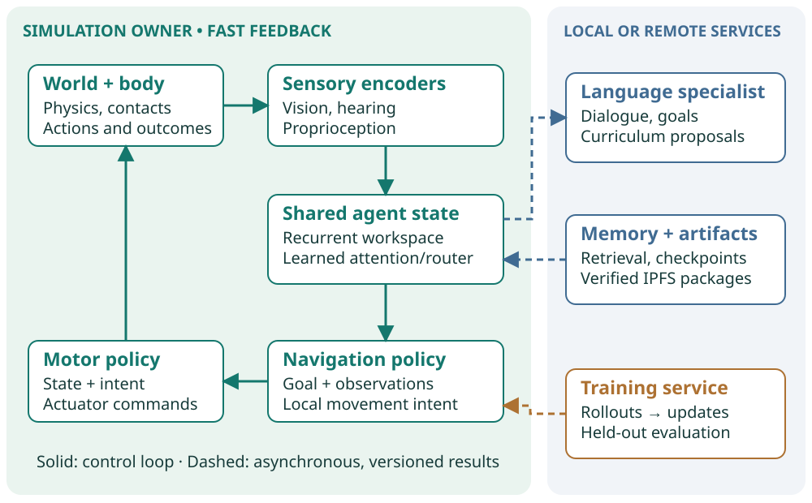
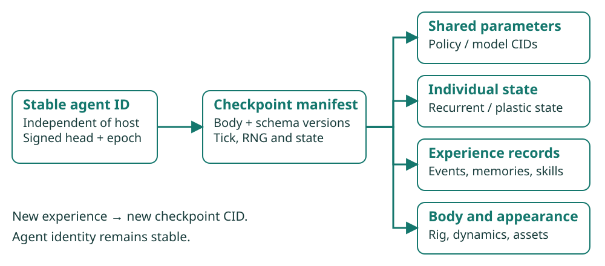
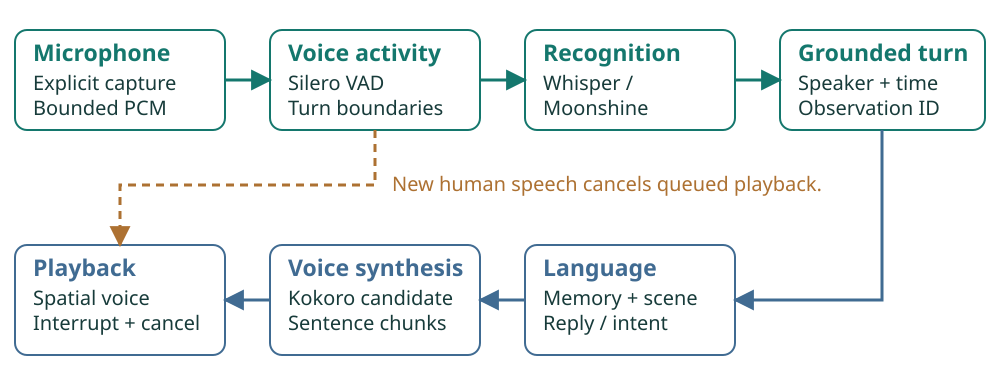
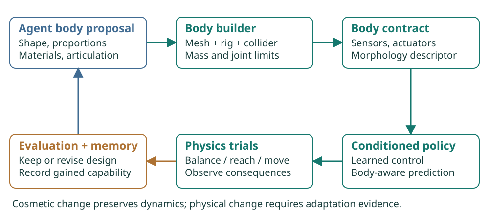
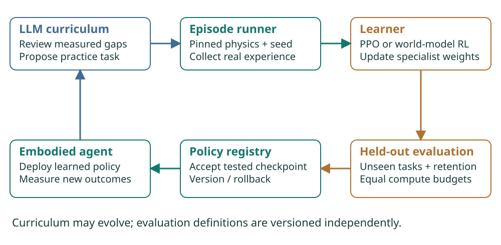
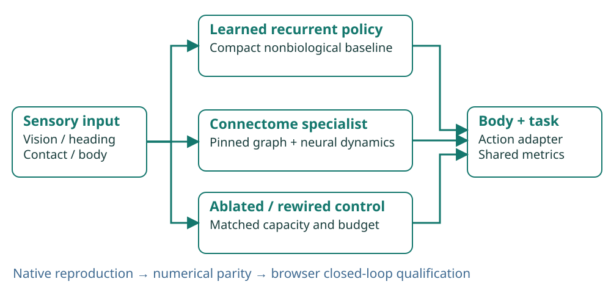

# HUMUNCULUS — Persistent embodied learning agents

> **A distributed architecture for entities that perceive, act, remember and learn.**

Small neural specialists coordinate through learned attention. A persistent identity connects experience across sessions and hosts. A language model helps choose what to investigate, while embodied policies learn how to navigate, interact and adapt their own bodies.

**Loop:** `SENSE → PREDICT → ACT → LEARN`

- **Design scope:** Browser execution, peer-hosted services, self-directed curricula, speech, vision, memory, body construction and experimental connectome control.
- **Engineering stance:** Learned behavior with measurable outcomes. Explicit boundaries between demonstrated capabilities, proposed components and research questions.

- Version 0.1 · 4 November 2026
- Architecture proposal and implementation roadmap
- Repository baseline: `1c58fc6d` · `feature/ipfs-artifacts-webgpu`
- Prepared from the PeerCompute design discussion and primary research sources.

---

<a id="abstract"></a>

## Abstract & introduction

### Abstract

Humunculus is a proposed architecture for persistent, embodied learning agents in PeerCompute environments. It combines compact neural policies for perception, navigation and motor control with learned information routing, a predictive world/body model, episodic memory, and a language specialist for communication and deliberative learning direction. Agent identity is independent of the browser, hosting peer and model checkpoint. Immutable, content-addressed artifacts preserve policies, body descriptions and experience checkpoints, while bounded replicated state coordinates their use.

The design separates continuous local control from asynchronous language inference and training. An LLM may propose practice tasks, inspect measured failures and suggest curriculum changes; learning algorithms update neural parameters, and independent evaluation determines whether capability improved. The first implementation targets a simple physical body, followed by speech, social interaction, host handoff and articulated morphology. Fly-connectome models are evaluated as optional sensory or motor specialists through controlled comparisons. The document catalogs candidate models, integration boundaries, training procedures and staged acceptance criteria. It describes an engineering program, not an implemented autonomous entity or evidence of subjective experience.

### Introduction

PeerCompute can already execute selected language and vision models in managed browser GPU workers and serve inference to other peers. Humunculus extends that foundation toward an entity whose actions affect an environment and whose subsequent decisions depend on the consequences. The central requirement is that behavior, navigation and movement arise from learned neural policies. Existing deterministic bots remain useful experimental controls or optional demonstration teachers; their behavior is not presented as the learned entity.

The intended experience is a recognizable character that meets players, explores, acquires skills, remembers shared events and modifies its appearance or body. Several specialized models may contribute, but their separate outputs must form a coherent ongoing interaction. This requires stable contracts, shared state, deadlines, ownership and learning provenance as much as model selection.

“Self-directed” means choosing experiments and practice within an engineered learning system. The childhood analogy describes incremental exploration and feedback. The language model brings prior knowledge, and the system still needs defined senses, actuators, learning objectives and resource budgets.

> **First proof:** a small neural agent learns to approach and follow a player, adapts to changed conditions, retains that improvement after restart, and can show the evidence behind its claim.

---

<a id="guide"></a>

## Scope, evidence & navigation

This document records the agreed direction and a proposed implementation sequence. No autonomous-agent runtime, policy-training service or speech integration has been implemented by producing this design.

### Architecture

- [Execution architecture](#architecture) *(p. 04)*
- [Perception and contracts](#perception) *(p. 05)*
- [Learned routing and timing](#routing) *(p. 06)*
- [Identity and memory](#memory) *(p. 07)*
- [Hosting and authority](#network) *(p. 08)*
- [Speech interaction](#speech) *(p. 09)*
- [Speech candidates](#speech-models) *(p. 10)*
- [Vision and reasoning candidates](#cognition-models) *(p. 11)*
- [Neural policy candidates](#policies) *(p. 12)*
- [Self-designed bodies](#body) *(p. 13)*

### Learning and delivery

- [Training architecture](#training) *(p. 14)*
- [Training curriculum](#curriculum) *(p. 15)*
- [LLM-directed learning](#self-direction) *(p. 16)*
- [Fly-connectome placement](#fly) *(p. 17)*
- [Browser execution budgets](#browser) *(p. 18)*
- [Implementation modules](#modules) *(p. 19)*
- [Implementation stages](#roadmap) *(pp. 20–21)*
- [Evaluation and acceptance](#evaluation) *(p. 22)*
- [Demo experience and operations](#experience) *(p. 23)*
- [Primary sources and provenance](#references-a) *(pp. 24–26)*

### Evidence labels

| Label | Meaning in this document |
| --- | --- |
| `Existing` | Implemented repository capability with stated historical validation. It does not imply every device or composed workload is qualified. |
| `Candidate` | Published model or runtime with useful evidence. PeerCompute adaptation and acceptance remain required. |
| `Research` | Architecture or scientific hypothesis requiring reproduction, training and experiments. |
| `Proposed` | Engineering choice, resource target or future acceptance gate. Not a measured result. |

Source baseline: selected live files and README at commit `1c58fc6dd3a32f9a625e9f0201bdb06ede81a0a2`. Primary web sources were reviewed on 4 November 2026. Current catalog entries alone are not proof of runtime qualification. The final pages identify sources and exact code locations for follow-up.

---

<a id="architecture"></a>

## One entity, several execution loops

Keep the active body and its fast neural feedback loop together on one simulation owner. Invoke slower specialists asynchronously. All results carry the observation, policy and authority versions under which they were produced.



*Figure 1. Logical architecture. The workspace and router are proposed modules. Remote inference supplies a result; it does not acquire control of the body.*

| Existing foundation | Humunculus integration |
| --- | --- |
| ComputeManager | Own model workers, residency, cancellation, admission and affinity. Extend with trusted small-policy tasks and explicit training jobs. |
| StateManager / DataState | Replicate bounded identity heads, public state and authority metadata. Keep high-rate tensors local; persist versioned checkpoints separately. |
| ArtifactStore | Verify and retain model files, body assets and checkpoints by CID. Local retention and online availability remain distinct. |
| NetworkManager | Use authenticated transport and discovery for allowed inference/artifact services. Add agent-specific authority and speech protocols explicitly. |

The cognitive router selects information and skills. The compute scheduler selects execution resources. These are separate decisions with separate failure modes. A large language model must not sit on the deadline path for every actuator update.

---

<a id="perception"></a>

## Perception grounded in a body

The agent observes an environment through a declared sensor contract. Its training and deployed policy must receive equivalent information. Full simulator state may assist diagnostics or an explicitly privileged training critic, but must not silently leak into the deployed actor.

| Channel | Initial observation | Later extension |
| --- | --- | --- |
| Proprioception | Velocity, orientation, contact flags, previous action and body descriptor. | Joint positions/velocities, actuator effort, balance and contact forces. |
| Local geometry | Egocentric rays or depth samples within a declared range; nearby object observations. | Learned visual spatial representation and uncertainty. |
| Vision | Bounded first-person image captured on demand, timestamped to a simulation tick. | Motion features, attention-selected crops and low-rate scene interpretation. |
| Hearing | Speech transcript with speaker/source, time and uncertainty; nearby interaction events. | Audio localization and environmental sound classification after qualification. |
| Internal state | Current goal, skill, prediction error, memory query results and available compute. | Learned competence estimates and body capability predictions. |

### Versioned data contracts

```text
ObservationFrame: {agentId, authorityEpoch, simulationTick,
  schemaVersion, bodyCid, sensorPose, observationAgeMs,
  proprioception, visibleEntities, contactEvents,
  visionRef?, speechEvents[], memoryRefs[]}

PolicyStep: {observationId, policyCid, previousState,
  action, nextState, uncertainty, expiresAtTick}
```

Normalize tensor units and coordinate frames before training. Use typed arrays and stable layouts for worker/physics interoperability. Store validity masks for missing or stale sensors. Every receiver validates shape, bounds, finite values and versions; delayed results must not act on a different world state.

#### Embodiment choice matters

CubeChat uses a 6 × 6 × 6 Cannon box, horizontal forces and grounded jump impulses. Its wrapper imposes orientation and damping. This supports navigation experiments; articulated gait and balance require a new body adapter.

---

<a id="routing"></a>

## Learned attention & specialist routing

A compact recurrent router chooses which specialists receive an observation, which skill remains active and when deliberation is useful. Specialists exchange versioned observations, goals, predictions and confidence through a shared workspace. Unrelated model embeddings are not interchangeable; adapters or jointly trained representations must establish a common meaning.

### Two complementary decisions

#### Information routing

Select vision, memory, body prediction or language processing based on novelty, uncertainty, current goals and observed failure. Keep state for inactive modules and make observation age visible.

#### Behavior selection

Select or compose learned skills and decide when they terminate. Navigation supplies intent to a motor policy. The engine enforces valid actuation and ownership without supplying a scripted sequence of behavior.

Recurrent Independent Mechanisms provides a precedent for selective activation and sparse communication. Option-critic provides a precedent for learning skills, selection and termination. These inform the design; neither supplies a pretrained browser controller for our physics. [20](#r20) [21](#r21)

| Loop | Initial design target | Scheduling rule |
| --- | --- | --- |
| Physics integration | Fixed 60 Hz for the initial CubeChat adapter | Preserve simulator semantics; never wait for a language response. |
| Motor inference | 20–60 Hz, then measure | Local resident policy; budgeted action hold between steps. |
| Navigation / skill routing | 2–10 Hz plus events | Update when goals, obstacles or uncertainty change. |
| Vision / dialogue | Event-triggered | Bound queue depth and input age; cancel superseded work. |
| Curriculum / training review | After episodes or sufficient evidence | Use aggregated measurements and retrieved history. |

All neural frequencies above are proposed targets, not benchmarks. During deadline misses, an explicit actuator policy holds a bounded recent command briefly or returns to neutral. That failure state is visible and is never counted as learned skill performance.

#### Start small, expand with evidence

Begin with perception, one motor/navigation policy, a router and language/memory services. Add specialists when an ablation shows improved performance or reduced cost. Uncoordinated simultaneous learning changes the distribution seen by every module; versioned curricula and staged updates make failures attributable.

---

<a id="memory"></a>

## Identity survives a model or host change

A stable agent identifier connects personality, goals, relationships, body and experience. Model weights are shared resources where appropriate; each entity retains its own recurrent state, memory and learned adaptations. Changing inference providers must not silently merge identities.



*Figure 2. Identity is a durable reference. Checkpoints and their constituent files are immutable content-addressed artifacts.*

| Memory type | Representation and use |
| --- | --- |
| Working state | Current observations, recurrent activations, active intention and pending requests. Local, frequently updated and bounded. |
| Episodic memory | Append-only events: who, where, when, observation, action and outcome. Preserve provenance and confidence; distinguish observation from inference. |
| Semantic / relational | Derived facts, preferences, relationships and summaries linked to supporting events. Conflicting claims remain traceable. |
| Procedural memory | Skill descriptors and policy/adaptor CIDs, conditions of use, evaluation results and known failure ranges. |

Use local persistence for events and a small embedding model for retrieval. Keep original records alongside summaries and vectors. Retrieve only the context relevant to the next decision; a persistent memory store is not an ever-growing prompt.

A checkpoint records physical state, model and normalization versions, recurrent/plastic variables, random-generator state, memory heads, body contract and authority epoch. GPU buffers must be read into a defined portable format. ArtifactStore can package an `agent.json` file under its existing file-manifest schema; new manifest fields require an explicit schema change.

---

<a id="network"></a>

## Hosting, availability & authority

Inference hosting and agent ownership are different services. Several peers may serve the same model. Exactly one authorized simulation owner applies an agent's actions at a time. StateManager replication and CRDT convergence do not establish exclusive control.

| Resource | Where it belongs | Failure behavior |
| --- | --- | --- |
| Fast neural state | Owner's managed resident worker | Explicit pause/neutral actuation after deadline; restore from compatible checkpoint. |
| Slow inference | Local or admitted peer service | Cancel stale work, choose another provider before request commitment where safe; avoid duplicate side effects. |
| Public agent head | Bounded replicated state with owner and version | Validate authority and epoch before accepting actions or checkpoint updates. |
| Artifacts / checkpoints | Verified local storage and explicitly retained online providers | Retry available providers; expose unavailable dependencies without inventing state. |
| Private experience | Local persistence or explicitly protected replication | No automatic publication of raw audio, private dialogue or personal memory. |

### Acknowledged handoff first

1. The current owner pauses decisions and drains or cancels pending actions.
2. It writes a consistent checkpoint and exposes its verified artifact set.
3. The receiver validates versions, capacity and an authenticated transfer record binding agent ID, sender, recipient, old/new epochs and checkpoint CID.
4. The old owner durably records relinquishment before acknowledging. The receiver persists the accepted transition and rejects replay.
5. The receiver restores state and applies actions. Restarts honor persisted authority; stale epochs and delayed responses are rejected.

Automatic failover during a partition requires a separately designed arbitration or consensus mechanism. The initial design prefers an explicit pause over two divergent controllers. A local timeout or Yjs merge must not become an implicit authority election.

**Availability:** a CID identifies bytes without guaranteeing an online provider. Saved agents remain paused without an active owner, retained dependencies and compute capacity.

Use the existing authenticated peer transport, provider discovery and model residency rules. Remote policy-training results require provenance and evaluation before deployment; successfully receiving a file is not a behavioral qualification.

---

<a id="speech"></a>

## Hearing, speaking & taking turns

Speech becomes an observation and action channel of the embodied agent. A transcript carries time, source and uncertainty into the same memory and decision loop used for other events. Spoken output corresponds to an agent turn and can be interrupted without leaving queued audio behind.



*Figure 3. Proposed speech pipeline. The existing peer protocol does not yet provide ASR/TTS execution or streamed audio framing.*

### Initial interaction contract

- Start microphone capture explicitly. Use a visible listening state and bounded audio buffers, with resampling appropriate to the selected model.
- Voice activity detection segments turns. Partial recognition may drive a visible transcript; final or reconciled text drives committed requests.
- Attach speaker/session identity and source position when known. Speech detection alone does not identify a speaker.
- Retrieve relevant memories and recent world observations before producing a response or intent. Distinguish proposed actions from actions confirmed by the engine.
- Synthesize sentence chunks and schedule playback. New player speech cancels the current turn's queued generation and playback; preserve the interrupted event in memory.

#### Browser and network integration

Use Web Audio for capture/playback and a worker for preprocessing. ASR and TTS enter managed compute admission just like other model tasks. Small VAD work can run explicitly on CPU/WASM. A WASM speech implementation is a valid browser choice, but must not be reported as GPU execution.

Remote speech requires versioned PCM framing, sample rate, channels, sequence, turn ID, maximum duration and cancellation semantics. Existing text/image generation task names are insufficient. Prefer local raw-audio processing initially; send derived transcripts to a peer only under the chosen session-sharing policy.

**First stack:** Silero VAD → Whisper Tiny or Moonshine → language specialist → Kokoro. Qualify interruption and contention before adding simultaneous speakers.

---

<a id="speech-models"></a>

## Candidate models: voice input/output

All speech entries below are `Candidates` for PeerCompute. Published browser examples support feasibility; they do not qualify our managed-worker, artifact or peer-protocol integration.

| Candidate / role | Size / license | Execution evidence and integration decision |
| --- | --- | --- |
| Whisper Tiny / Base — *(Speech recognition)* | 39M / 74M parameters — MIT | Transformers.js ONNX exports and WebGPU examples exist. Start Tiny; compare recognition accuracy before upgrading. Interactive use needs buffering, VAD and transcript reconciliation. [6–7](#r6) |
| Moonshine Tiny / Base — *(Legacy English ASR)* | HF checkpoints: 27.1M / 61.5M — MIT for English | Existing Transformers.js ONNX exports are candidates. Current architecture inventory uses different reported counts; pin the exact checkpoint and language license. [8](#r8) |
| Moonshine Tiny Streaming — *(Conversational hearing)* | 34M parameters — MIT | Maintained `moonshine-wasm` browser microphone/partial-transcript examples. This is WASM evidence, not a WebGPU qualification. [9](#r9) |
| Silero VAD — *(Speech boundaries)* | Small artifact; upstream JIT about 2 MB — MIT | Browser ONNX integrations exist. Supports 8/16 kHz. Prefer inexpensive explicit CPU/WASM execution initially; measure false speech triggers. [10](#r10) |
| Kokoro-82M v1.0 — *(Speech synthesis)* | 82M parameters — Apache-2.0 model / JS library | Kokoro.js demonstrates browser WASM/WebGPU and sentence streaming. Upstream recommends FP32 on WebGPU. Include voice and phonemization assets in the verified package. [11–12](#r11) |
| Piper voices — *(Alternative local TTS)* | Voice-dependent — Current engine GPL-3.0-or-later | Browser ports exist, but runtime/phonemizer/voice licenses differ. Pin a specific voice and review its model card. Keep as an alternative pending integration review. [13](#r13) |

### Selection measurements

Compare word-error rate on representative player speech, end-of-turn latency, time to first audible response, interruption delay, pronunciation, peak memory and render-frame impact. Use the same clips, playback settings, device and concurrent workload for each candidate.

Parameter count is not package size or peak memory. Model weights, preprocessing, voice assets and runtime buffers must be measured together. Current Moonshine streaming models are MIT; specified legacy non-English models have different terms. The older `moonshine-js` repository redirects to the maintained WASM package.

---

<a id="cognition-models"></a>

## Vision, reasoning & memory retrieval

| Model / role | Evidence | Recommended use and limits |
| --- | --- | --- |
| Qwen3.5 2B all-q4 — *(Vision + dialogue + deliberation)* | `Existing` — 1.771 GB pinned package — Apache-2.0 | Primary language/vision starting point. Managed text/image inference has repository evidence. Curriculum quality and social consistency remain untested; use bounded observations and compact retrieved context. [2](#r2) |
| Qwen3.5 0.8B GGUF — *(Lightweight dialogue)* | `Existing` — Small quantized profile | Useful lower-cost text specialist. Current GGUF path is text-only and requires shader-f16. An upstream multimodal architecture does not establish vision support in this adapter. |
| SmolVLM 256M / 500M q4 — *(Visual interpretation)* | `Existing` — 0.269 / 0.490 GB packages — Apache-2.0 | Cheap occasional scene descriptions and visual questions. These are not qualified geometric estimators or reliable long-horizon planners. [3](#r3) |
| FunctionGemma 270M — *(Typed intent specialist)* | `Candidate` — Gemma terms | A game fine-tune already has a WebGPU physics demo. Needs architecture admission, tool/developer templates and call parsing here. Task-specific fine-tuning is appropriate; it does not replace learned motor control. [4–5](#r4) |
| all-MiniLM-L6-v2 — *(Memory embeddings)* | `Candidate` — 22.7M; 384 dimensions — Apache-2.0 | Practical retrieval baseline with a Transformers.js export. Store provenance and original events alongside vectors. Changing the embedding model requires a versioned reindex. [14](#r14) |
| Larger peer-hosted language model — *(Difficult planning review)* | `Candidate` — Profile-specific | Optional escalation for rare curriculum or design decisions. Qualify the exact model/runtime and resource envelope; catalog presence is insufficient. |

### Choose by demonstrated task quality

Evaluate valid intents, observation grounding, contradiction handling, memory relevance and useful practice-task selection. “Uncensored” or “abliterated” naming does not establish better control or planning. Compare each variant against its base under the same gameplay tests.

Qwen package pin: `onnx-community/Qwen3.5-2B-ONNX-OPT`, revision `ed446636739bf426e73c5a00714fd8e010d36c21`. Configured 8 GiB RAM/GPU envelopes are admission policy, not universal measured minima. Historical execution used Chrome 155 / RTX 5060 Ti; composition with rendering and speech needs new measurement.

---

<a id="policies"></a>

## Small policies & predictive models

The following are trainable approaches, not interchangeable pretrained checkpoints. Their usefulness depends on the body, observations, action space and training distribution. The first control policy should operate from compact egocentric observations before adding expensive pixel-based learning.

| Approach | Role | Integration / decision gate |
| --- | --- | --- |
| MLP + recurrent state — trained with PPO | Motor/navigation policy with short-term memory under partial observations. | Initial baseline. Train against actual game dynamics; export one-step inference and explicit state. PPO is the learner, not a model size. [16–17](#r16) |
| Dreamer-style world model | Predict latent outcomes and rewards; learn actor/critic from imagined trajectories. | Later comparison when sample efficiency matters. Published implementation uses Python/JAX; browser export and training require new work. [18–19](#r18) |
| Recurrent Independent Mechanisms | Selective activation and sparse communication between specialized recurrent modules. | Architecture inspiration for the router/workspace. Compare against a simpler recurrent policy at equal cost. [20](#r20) |
| Option-critic | Learn skill policies, skill selection and termination. | Candidate for behavior routing after useful skills exist. Watch frequent switching and collapsed specialization. [21](#r21) |
| MetaMorph-style conditioning | Condition control on a description of the current body. | Articulated-body research stage. Generalization depends on trained morphology families. [22](#r22) |

### Proposed custom-network budgets

| Component | Target parameters | FP32 weights only |
| --- | --- | --- |
| Motor controller / small router | 100k–1M each | 0.4–4 MB each |
| Navigation / body predictor | 1–10M | 4–40 MB |
| Compact latent world predictor | 5–30M | 20–120 MB |

These are proposed budgets for our own networks, not published Dreamer or MetaMorph sizes. Decimal MB = parameters × four bytes. Activations, recurrent state, temporary tensors, optimizer state and experience buffers are additional. Capability and latency at these sizes remain experimental.

---

<a id="body"></a>

## Designing and learning a body

Give the agent a structured body recipe and a way to inspect the result. Separate appearance from physical morphology. A new material or accessory can preserve the existing controller; changed mass, sensors, joints or contacts changes the control problem.



*Figure 4. Physical self-modification is an experiment with consequences. The previous body and controller remain recoverable.*

### Three levels of capability

1. **Appearance:** choose colors, proportions within cosmetic bounds, materials, accessories and identity cues. Construct meshes through validated Three.js recipes.
2. **Expression:** learn selection and parameters for gaze, gestures and posture. Animation clips can provide demonstrations; label any clip playback separately from learned physical movement.
3. **Morphology:** expose mass, joint structure, actuator limits and sensor placement. Train a conditioned controller and body predictor, then evaluate the modified body on new tasks.

| Asset candidate | Role and limitation |
| --- | --- |
| Hunyuan3D-2mini | 0.6B shape model; native GPU candidate for mesh generation from an image. Upstream pipeline lists 6 GB VRAM for shape / 16 GB for shape plus texture, not our browser measurements. Rigging, collision and topology validation remain separate. [23](#r23) |
| HY-Motion-1.0-Lite | 0.46B human motion model; upstream minimum 24 GB VRAM excluding optional LLM prompt processing. Native service candidate; retarget generated motion to a compatible skeleton. [24](#r24) |

Begin with procedural bodies and known articulation. Store recipes, geometry, rigs, collision shapes and controller compatibility by CID. Mesh generation does not automatically produce a playable or balanced body. Native asset-generation services require a new peer runtime; they are not current browser model-console capabilities.

---

<a id="training"></a>

## From experience to a better policy

Training is an explicit execution path with measurable parameter updates. A model-generated explanation, changed prompt or new memory entry is not evidence that the motor policy learned. Every training result identifies the exact experience and configuration that produced it.



*Figure 5. Self-directed practice is coupled to independent validation. A rejected checkpoint remains an experimental artifact, not an active skill.*

### Reproducible episode contract

Record simulator/body/schema versions, seed, fixed timestep, observation normalization, policy CID, actions, reward components, termination conditions, recurrent state boundaries and outcomes. Episodes also identify device/backend and whether data came from the agent, an optional demonstration teacher, or an evaluation controller.

For PPO, collect sufficiently fresh rollouts under a known policy version and preserve the information required by its update procedure. Do not mix arbitrary old peer trajectories into an on-policy update. A world-model learner may use a replay buffer under its own documented sampling and validation rules.

#### Training placement

First build the fixed-step simulator adapter and a reference learner. A native training peer can provide established tooling while browsers run the resulting policies. Browser training is a separate implementation milestone requiring gradient checks, optimizer state, buffer limits and numerical comparison. In either case, all accepted weights become verified versioned artifacts.

Start with one learner and a small task suite. Preserve a frozen baseline and held-out seeds. Promote checkpoints only after capability and retention checks; retain rollback artifacts. Peer contribution is identified by task and policy version, not accepted merely because it arrived over an authenticated connection.

---

<a id="curriculum"></a>

## A staged embodied curriculum

Use a progression that exposes increasingly difficult consequences while keeping success observable. The first tasks develop control competence. Dialogue and social goals then compose those skills; articulated balance and locomotion require their own body adapter.

| Stage | Experience and learning objective | Evidence before progression |
| --- | --- | --- |
| A · Body calibration | Actuate, observe velocity/contact, stop at a marker, learn basic action consequences. | Prediction error and stop accuracy on unseen starts. |
| B · Navigation | Reach visible targets, avoid obstacles, recover from blocked motion and disturbances. | Completion, collision, stuck-time and recovery measures. |
| C · Moving partners | Follow a moving player, maintain distance, approach from a visible direction and yield space. | Tracking error and interaction quality across new trajectories. |
| D · Composed goals | Retrieve an object, bring it to someone, revisit a remembered place; partial observations. | Task success, memory relevance and grounded action reports. |
| E · Adaptation | Changed friction, mass, disturbances and sensor noise within declared ranges. | Learning improvement versus frozen weights; old-skill retention. |
| F · Articulation | Posture, balance, gait, reaching and contact on a jointed body. | New body-specific benchmarks; no inferred cube-policy transfer. |

### Rewards, demonstrations and exploration

Define task outcomes independently from the training reward. A reaching reward may include progress, terminal success, contact penalties and actuation cost, but held-out evaluation must still test actual arrival without unacceptable collisions. Version reward definitions so a higher score after a reward change is not mistaken for improved capability.

Optional imitation can bootstrap a policy from player demonstrations or a labeled reference controller. Compare with learning from scratch where feasible. Log the provenance of demonstrations and avoid describing imitation data as self-discovered skill.

Curiosity should favor learning progress and useful novelty. Raw unpredictability alone can attract the agent to noise. Track competence, uncertainty and diminishing returns; allocate practice toward tasks that are learnable at the current skill level. Hold total interactions and compute fixed when comparing curricula.

> **Three adaptation mechanisms:** recurrent state changes immediately; memory changes the context of decisions; training changes model parameters. Measure and report each separately. Saving a conversation is not a substitute for a motor-learning test.

---

<a id="self-direction"></a>

## The agent chooses what to practice

The language specialist can serve as a slow curriculum planner within the same entity. It reviews compact observations, failures and learning curves, proposes a useful experiment and adjusts the next challenge. The learned router and motor loop continue independently of this deliberation.

### A concrete learning episode

1. **Observe:** the body predictor reports unexpected drift on a slippery surface.
2. **Hypothesize:** the agent proposes that its stopping behavior is poorly calibrated.
3. **Practice:** it requests stopping-at-marker trials at several speeds within allowed physical ranges.
4. **Update:** the learner trains a candidate motor checkpoint from the resulting episodes.
5. **Test:** independent trials compare stopping error and old-surface performance against frozen weights.
6. **Retain:** the agent keeps an accepted policy and grounded memory of its useful range; otherwise it revises the hypothesis.

```text
PracticeProposal {
  hypothesis, taskFamily, scenarioRanges,
  targetSkill, allowedRewardParameters,
  episodeBudget, computeBudget, stoppingRule,
  expectedImprovement, supportingEventIds
}
```

Begin with structured task families and bounded parameters. A later environment generator may compose validated scene primitives. Arbitrary generated code should not become an executable peer-supplied runtime through a manifest. Evaluation scenarios and acceptance definitions remain separately versioned.

#### Research precedents and their limits

**Voyager** demonstrates automatic task selection and reusable generated code skills in Minecraft; it does not demonstrate our neural motor learning. **Eureka** demonstrates LLM-designed rewards coupled to reinforcement learning. **OMNI-EPIC** generates tasks/environments adjusted to learning progress. These justify experiments, not a claim that our 2B browser model will reproduce their results. [25](#r25) [26](#r26) [27](#r27)

Compare LLM task selection with fixed and learning-progress curricula. Measure held-out success, retention, episode count and compute cost. The LLM can explain an outcome, but the simulator's recorded measurements establish whether the experiment succeeded.

---

<a id="fly"></a>

## Where the fly brain fits

A connectome-derived model is an optional sensory or motor specialist. Its role is to test hypotheses about orientation, visual following, approach/avoidance and bodily coordination. Language, autobiographical records, identity continuity and body construction remain explicit surrounding systems.



*Figure 6. Evaluate the biological structure through matched tasks and controls. A beneficial result must survive the same inputs, outputs and resource budget.*

FlyWire reconstructed an adult female brain with 139,255 neurons and roughly 50 million chemical synapses. Anatomy does not specify all physiological strengths, membrane states, modulation or an individual's memories. Shiu and colleagues showed that simplified connectome-based neural simulations can make useful predictions about feeding and grooming. [28–29](#r28)

NeuroMechFly v2 combines sensory systems, biomechanics and engineered/trained controllers for embodied behaviors. Flybody supplies a detailed body and reinforcement-learning framework for walking and flight. Eon's September 2026 clarification describes selected descending neurons driving body-level controllers. These are narrower claims than a fully reconstructed animal. [30–32](#r30)

#### Bounded experiment

Reproduce a published heading/path-integration or visual-following task natively. Pin graph, equations, sensory mapping, body, timestep and seeds. Then port the selected inference circuit into a managed WebGPU worker and compare numerical traces, closed-loop behavior, cancellation and checkpoint restoration.

Store membrane variables, delay buffers and implemented plasticity separately from immutable graph/weight artifacts and agent memories. Whole-brain simulation is not the first milestone. No source here establishes a ready-made WebGPU port, general personality, transferred biological identity or consciousness.

---

<a id="browser"></a>

## Browser feasibility & resource budgets

Compact policies can be far smaller than a language model. Ten one-million-parameter specialists occupy about 40 MB of FP32 weights. That arithmetic says nothing by itself about useful learned behavior or meeting a control deadline under graphics and speech load.

- **4 MB** — FP32 weights for one million parameters
- **1.771 GB** — Existing pinned Qwen3.5 2B q4 package
- **Measure** — Peak memory, contention and tail latency on the composed workload

### Execution choices

| Path | Proposed use / engineering obligation |
| --- | --- |
| ONNX Runtime WebGPU | Supported dense, convolutional and attention operations. Validate the actual exported graph and execution provider; do not silently claim GPU execution after CPU fallback. [15](#r15) |
| Explicit recurrent cell | Export one step with hidden state as input/output using supported matrix and gate operations. Compare against the native reference over long sequences. |
| Custom WGSL policy kernel | Candidate for a small stable network when launch/copy overhead matters. Requires numerical validation and versioned weights/layout. |
| Explicit CPU/WASM | Small VAD, preprocessing or tiny policies may be cheaper here. Label placement and measure its effect on the main/render threads. |
| Training peer | Initially native reference training; later browser optimizers if justified. Existing model inference supplies neither gradients nor replay/optimizer storage. |

#### Resident state and scheduling

Provision a dedicated managed motor worker and separate slow-model workers with shared admission capacity. The current standalone console defaults to one worker and one CPU/GPU unit; those defaults cannot support this composition. Affinity reserves an exclusive worker and does not provide preemption.

Batch compatible entities sharing weights while isolating recurrent state. Separate devices cannot casually exchange GPUBuffer objects; use supported IO binding only under valid device ownership and otherwise budget copies.

Prioritize control deadlines, then interactive speech, then slow deliberation and background learning. Bound queues and discard expired results. Account for renderer, physics buffers, model activations, KV caches, voice assets and temporary copies. Total GPU capacity alone is not a supported-feature check.

Small FP32 controllers can avoid shader-f16. Quantization is a later measured optimization with behavioral regression tests. Handle real storage-write failures; browser quota estimates are advisory. A package fitting in persistent storage does not establish that it can run in device memory.

---

<a id="modules"></a>

## Composable ES-module boundaries

Build the first runnable demo at `demos/humunculus/` using Vite, vanilla JavaScript and Three.js. Keep task/physics formats compatible with PeerCompute. Promote modules into shared packages after a second game integration validates their contracts.

| Proposed module | Responsibility |
| --- | --- |
| `runtime/AgentRuntime.js` | Lifecycle: start, step, pause, cancel, checkpoint, restore and dispose. Own composition, not independent unmanaged workers. |
| `runtime/AgentContracts.js` | Versioned observation/action/episode/checkpoint schemas; sizes, units, authority and stale-result validation. |
| `perception/PerceptionPipeline.js` | Sensor extraction, normalization, bounded image/audio inputs and observation timestamps. |
| `policies/PolicyRegistry.js` | Bind trusted execution modules to immutable approved policy packages and compatibility metadata. |
| `policies/NeuralPolicyTasks.js` | ComputeManager-owned one-step inference, recurrent state, cancellation and backend evidence. |
| `routing/PolicyRouter.js` | Learned attention, skill activation/termination and cost-aware scheduling requests. |
| `body/BodyAdapter.js` | Observe/apply/reset/checkpoint interface; first cube adapter, later jointed bodies. |
| `identity/AgentIdentity.js` — `memory/EpisodicMemory.js` | Stable identity; event append, retrieval, summaries and provenance. Keep large private records out of replicated state. |
| `persistence/AgentCheckpoint.js` — `authority/AgentAuthority.js` | Portable snapshots and verified artifact references; owner/epoch validation and acknowledged handoff. |
| `training/EpisodeRunner.js` — `training/TrajectoryWriter.js` | Seeded fixed-step rollouts, provenance, bounded storage and learner-compatible trajectories. |
| `training/Curriculum.js` — `training/EvaluationSuite.js` | Practice proposals and learning progress; independent held-out acceptance and retention testing. |
| `speech/SpeechPipeline.js` | Capture, VAD, recognition, turn reconciliation, synthesis, playback and end-to-end interruption. |
| `observability/AgentOverlay.js` | Readable retro terminal controls and traces of goals, skills, memory, resource use and learning provenance. |

Existing extension points include `submitTask()`, `submitTaskGraph()` and `reserveWorkerAffinity()`. Generic control-policy execution, RL optimization and audio tasks are new work. Artifact manifests carry data and approved runtime identifiers; they must not select arbitrary downloaded executable modules.

---

<a id="roadmap"></a>

## Build the measurable core first

Stages are ordered by dependency, with concrete exit evidence. The plan does not assign calendar promises before simulator throughput, export compatibility and training cost are measured.

### M0 · Reproducible body and observation interface

Extract a fixed-step body adapter compatible with CubeChat's dynamics. Add seeded reset, bounded sensors/actions, pause/single-step and trajectory recording. Expose direct bounded continuous-force actions: the existing bot bridge thresholds inputs into keys and normalizes magnitude. Separate imposed orientation/damping from policy outputs. Reference controllers serve evaluation or optional demonstrations only.

**Exit:** deterministic reference episodes under declared tolerances; no hidden observation leakage; exact reset/checkpoint round trip; browser/worker lifecycle cleanup. No claim of learned behavior at this stage.

### M1 · Learned movement and navigation

Train a compact recurrent policy for reaching, stopping, obstacle avoidance and following. Export one-step inference; carry recurrent state explicitly. Add a trusted ComputeManager task adapter and actual backend instrumentation. Compare a player-demonstration bootstrap with direct RL where feasible.

**Exit:** native/browser numerical parity and closed-loop success on unseen layouts; continuous actions originate from the neural policy; cancellation and deadlines hold under rendering load. Retain failed episodes and training cost.

### M2 · Identity, memory and grounded dialogue

Add a stable agent ID, episodic records, a compact retrieval baseline and versioned checkpoints. Connect Qwen through existing managed inference. Make speech/text reports distinguish observed events, inferred facts, proposed actions and confirmed outcomes. Introduce two entities sharing weights but maintaining separate state.

**Exit:** restart preserves identities, relevant memories and policy state; one entity cannot receive the other's private recurrent state; dialogue reflects real completed actions. Memory retrieval is tested independently of prose fluency.

### M3 · Learned routing and composed skills

Train a small attention/skill-selection policy on measured specialist outcomes and costs. Add termination, stale-input handling and explicit compute budgets. Compose navigation with object interaction and memory-guided goals. Compare with simple fixed scheduling and monolithic-policy controls.

**Exit:** ablation evidence that routing improves capability or efficiency; bounded switching and queues; continuous local control during slow language requests. A model outage produces a visible paused/degraded state.

> **First playable acceptance:** two persistent agents can approach players, follow, interact, remember an event and resume after restart with neural movement and traceable decisions.

---

<a id="roadmap-next"></a>

## Add learning autonomy and richer bodies

| Milestone | Implementation work | Exit evidence |
| --- | --- | --- |
| M4 · Self-directed practice | LLM task proposals, episode/compute budgets, native learner jobs, versioned rewards and independent evaluation. Add accepted-policy promotion and rollback. | Useful improvement versus fixed curriculum at matched cost; actual weight changes and retained prior skills. |
| M5 · Speech and social turns | Qualify ASR/VAD/TTS packages; managed execution, microphone state, speaker provenance, interruption and optional bounded peer audio transport. | Recognition and response metrics, correct cancellation, no stale playback; rendering/control retain deadlines. |
| M6 · Hosted continuity | Checkpoint retention and fetch, explicit authority transfer, stop/drain acknowledgments and epoch fencing between independent peers. | One active controller after handoff; stale/duplicate actions rejected; partition and restore tests. |
| M7 · Self-designed articulation | Body recipe compiler, physical rig, morphology descriptor, conditioned policy and body predictor; staged adaptation after physical changes. | Useful control on declared morphology variations; versioned rollback and honest out-of-range failures. |
| M8 · Connectome experiment | Reproduce a small native circuit/body task, add matched recurrent and rewired controls, then port the selected specialist to WebGPU. | Numerical and behavioral parity; equal-budget comparison; measured benefit or recorded negative result. |

### Decisions to resolve through prototypes

- **Initial sensors:** compare bounded rays/proprioception with low-resolution learned vision; record observation privileges.
- **Training placement:** measure native reference throughput before investing in browser optimization and distributed rollout collection.
- **Social cognition:** determine whether the 2B model selects useful goals and tasks from bounded histories; optional larger-peer review needs its own qualification.
- **Body scope:** choose a small family of physically meaningful designs before open-ended topology changes.
- **Availability:** decide whether explicit owner handoff is sufficient or automatic failover justifies additional coordination infrastructure.

Speech can proceed alongside M4 after managed-model admission is stable. Fly experiments can be isolated from the primary demo. Neither is allowed to relabel a missing core learned-control result as complete.

---

<a id="evaluation"></a>

## Measure the capability being claimed

These are proposed acceptance gates, not completed tests. Establish a reference desktop profile and report other devices separately. Fix evaluation definitions before inspecting candidate results; retain failures and confidence intervals.

| Claim | Measurement / initial gate | Required evidence |
| --- | --- | --- |
| Browser neural execution | Declared GPU operations; reference tensor/sequence comparison. Initial FP32 tolerance proposal: abs 1e-4 / rel 1e-3, reviewed before acceptance. | Actual backend traces; no silent CPU relabeling. |
| Responsive control | Proposed desktop target: p95 policy step ≤10 ms and <1% deadline misses at chosen control rate under rendering load. | Wall-clock distributions, queues and device memory. |
| Useful navigation | Proposed target ≥90% reaching success on a fixed 100-episode unseen suite, with separately reported collisions and stuck time. | Multiple training seeds; baseline comparison and raw episodes. |
| Learning/adaptation | Candidate exceeds frozen policy on changed conditions without unacceptable loss on retained tasks; minimum five training seeds for comparisons. | Policy hashes, optimizer updates, learning curves and intervals. |
| Useful curriculum/router | Compare against fixed scheduling/curriculum and relevant ablations at matched episodes and compute. | Sample efficiency, success, cost and failure attribution. |
| Persistent entity | Identity, memory references, body and compatible recurrent/learned state survive restart and acknowledged handoff. | Checkpoint/hash checks and two independent peers. |
| Speech interaction | Recognition errors, turn latency, intelligibility and interruption measured on representative clean/noisy clips. | Versioned audio test set; no new microphone capture without explicit use. |
| Body / fly transfer | Declare morphology/task range; compare shared contracts and intact/ablated controls. | Native reproduction and browser parity, not visual resemblance alone. |

### Record every experiment

The report identifies source commit, runtime/model versions, body and dataset CIDs, seeds, learning objective, reward version, normalization, policy checkpoints, hardware/browser, precision and resource budget. Separate numerical tests, visual inspection, network behavior and learned-task outcomes.

A runtime can pass lifecycle tests while its policy fails to learn. A generated image can look plausible while its body is uncontrollable. A fluent recollection can be unsupported by the event log. Each result remains scoped to the capability actually measured.

---

<a id="experience"></a>

## A visible, inspectable learning entity

The primary view shows the environment and its entities. A compact retro terminal overlay reveals what the selected agent is doing, what it believes and what evidence supports those beliefs. Players interact through text, optional voice and ordinary game actions.

```text
HUMUNCULUS // AGENT 02                [PAUSE]
identity   Mira              owner    peer-A
body       cube-v1           epoch    12
goal       meet the nearby player
skill      approach          policy   CID…
observed   player at 4.2 m    age      33 ms
motor      NEURAL / WebGPU    p95      measured
memory     remembered a shared event
practice   stopping on low-friction ground
learning   candidate 07 → evaluation pending

[ TALK ] [ MEMORY ] [ BODY ] [ LEARNING ]
[ STEP ] [ CHECKPOINT ] [ RESOURCE DETAILS ]
```

Illustrative interface specification, not a screenshot or performance report. Inferred beliefs, planned actions and confirmed outcomes have distinct labels.

### First user journey

1. Open the demo, inspect device compatibility and load the qualified starter package.
2. Meet an agent, provide a name or goal, and watch it navigate using its learned policy.
3. Introduce a changed surface or obstacle and inspect the resulting observations and practice proposal.
4. Compare a trained candidate with the prior checkpoint; retain the measured improvement.
5. Restart or hand off to another peer and verify the same identity, memories and compatible skills return.

#### Operational boundaries

Provide clear pause, cancel, checkpoint, rollback and storage controls. Bound background training and inference budgets; visibility changes or browser suspension may pause control. Keep microphone state obvious and private records local unless deliberately shared. Artifact retention must show which packages are needed by active entities before deletion.

For developer inspection, expose observation age, dropped results, action clamps, policy/provider identity, authority epoch, memory provenance and actual backend placement. These diagnostics explain behavior without presenting every implementation detail in the normal player flow.

---

<a id="references-a"></a>

## Sources: runtime & speech

Reviewed 4 November 2026. These links establish upstream properties and research results. They do not replace PeerCompute integration tests. Model/runtime versions and complete asset licenses must be pinned at implementation.

- <a id="r1"></a>**[1] PeerCompute repository evidence** — Baseline `1c58fc6d`: README, model catalog, StateManager, ComputeManager, peer inference, CubeChat physics and shared agent adapters. See source map on page 26.

- <a id="r2"></a>**[2] Qwen3.5-2B model and ONNX export** — [huggingface.co/Qwen/Qwen3.5-2B](https://huggingface.co/Qwen/Qwen3.5-2B) · [huggingface.co/onnx-community/Qwen3.5-2B-ONNX-OPT](https://huggingface.co/onnx-community/Qwen3.5-2B-ONNX-OPT)

- <a id="r3"></a>**[3] SmolVLM small vision-language models** — [huggingface.co/HuggingFaceTB/SmolVLM-256M-Instruct](https://huggingface.co/HuggingFaceTB/SmolVLM-256M-Instruct) · [huggingface.co/HuggingFaceTB/SmolVLM-500M-Instruct](https://huggingface.co/HuggingFaceTB/SmolVLM-500M-Instruct)

- <a id="r4"></a>**[4] Google FunctionGemma guidance and model** — [ai.google.dev/gemma/docs/functiongemma](https://ai.google.dev/gemma/docs/functiongemma) · [huggingface.co/google/functiongemma-270m-it](https://huggingface.co/google/functiongemma-270m-it)

- <a id="r5"></a>**[5] FunctionGemma game fine-tune and browser implementation** — [huggingface.co/Xenova/functiongemma-270m-game](https://huggingface.co/Xenova/functiongemma-270m-game) · [huggingface.co/spaces/webml-community/FunctionGemma-Physics-Playground/blob/main/index.html](https://huggingface.co/spaces/webml-community/FunctionGemma-Physics-Playground/blob/main/index.html)

- <a id="r6"></a>**[6] Whisper: model sizes and MIT licensing** — [github.com/openai/whisper](https://github.com/openai/whisper)

- <a id="r7"></a>**[7] Whisper browser-compatible ONNX export** — [huggingface.co/onnx-community/whisper-tiny](https://huggingface.co/onnx-community/whisper-tiny)

- <a id="r8"></a>**[8] Moonshine model families, exact checkpoints and license scope** — [github.com/moonshine-ai/moonshine/blob/main/docs/models/available-models.md](https://github.com/moonshine-ai/moonshine/blob/main/docs/models/available-models.md) · [huggingface.co/moonshine-ai/moonshine-tiny](https://huggingface.co/moonshine-ai/moonshine-tiny) · [github.com/moonshine-ai/moonshine/blob/main/docs/license.md](https://github.com/moonshine-ai/moonshine/blob/main/docs/license.md)

- <a id="r9"></a>**[9] Moonshine maintained browser/WASM quickstart** — [moonshine-voice.readthedocs.io/en/latest/quickstart/](https://moonshine-voice.readthedocs.io/en/latest/quickstart/)

- <a id="r10"></a>**[10] Silero voice activity detection and browser wrapper** — [github.com/snakers4/silero-vad](https://github.com/snakers4/silero-vad) · [github.com/ricky0123/vad](https://github.com/ricky0123/vad)

- <a id="r11"></a>**[11] Kokoro-82M v1.0 ONNX model** — [huggingface.co/onnx-community/Kokoro-82M-v1.0-ONNX](https://huggingface.co/onnx-community/Kokoro-82M-v1.0-ONNX)

- <a id="r12"></a>**[12] Kokoro.js: browser execution, precision and streaming examples** — [github.com/hexgrad/kokoro/blob/main/kokoro.js/README.md](https://github.com/hexgrad/kokoro/blob/main/kokoro.js/README.md)

- <a id="r13"></a>**[13] Maintained Piper engine and per-voice requirements** — [github.com/OHF-Voice/piper1-gpl](https://github.com/OHF-Voice/piper1-gpl) · [github.com/OHF-Voice/piper1-gpl/blob/main/docs/VOICES.md](https://github.com/OHF-Voice/piper1-gpl/blob/main/docs/VOICES.md)

---

<a id="references-b"></a>

## Sources: learning & embodiment

- <a id="r14"></a>**[14] MiniLM memory-retrieval model and browser export** — [huggingface.co/sentence-transformers/all-MiniLM-L6-v2](https://huggingface.co/sentence-transformers/all-MiniLM-L6-v2) · [huggingface.co/Xenova/all-MiniLM-L6-v2](https://huggingface.co/Xenova/all-MiniLM-L6-v2)

- <a id="r15"></a>**[15] ONNX Runtime WebGPU execution provider** — [onnxruntime.ai/docs/tutorials/web/ep-webgpu.html](https://onnxruntime.ai/docs/tutorials/web/ep-webgpu.html) — Provider configuration, GPU tensors and execution integration; graph compatibility must be checked for each export.

- <a id="r16"></a>**[16] Recurrent PPO implementation** — [sb3-contrib.readthedocs.io/en/master/modules/ppo_recurrent.html](https://sb3-contrib.readthedocs.io/en/master/modules/ppo_recurrent.html) — Reference recurrent policy interfaces and state handling.

- <a id="r17"></a>**[17] Schulman et al. — Proximal Policy Optimization Algorithms** — [arxiv.org/abs/1707.06347](https://arxiv.org/abs/1707.06347) — Policy-learning method; not a pretrained controller or browser runtime.

- <a id="r18"></a>**[18] Hafner et al. — Mastering diverse control tasks through world models** — [nature.com/articles/s41586-025-08744-2](https://www.nature.com/articles/s41586-025-08744-2) — Nature, 2025. Learned world model, actor and critic with imagined trajectories.

- <a id="r19"></a>**[19] DreamerV3 implementation and configurations** — [github.com/danijar/dreamerv3](https://github.com/danijar/dreamerv3) — Python/JAX training reference; configurable network sizes.

- <a id="r20"></a>**[20] Goyal et al. — Recurrent Independent Mechanisms** — [arxiv.org/abs/1909.10893](https://arxiv.org/abs/1909.10893) — Selective recurrent module activation and communication through attention.

- <a id="r21"></a>**[21] Bacon, Harb and Precup — The Option-Critic Architecture** — [arxiv.org/abs/1609.05140](https://arxiv.org/abs/1609.05140) — Learning policies over skills, internal skill policies and termination.

- <a id="r22"></a>**[22] Gupta et al. — MetaMorph: Learning Universal Controllers with Transformers** — [arxiv.org/abs/2203.11931](https://arxiv.org/abs/2203.11931) — Morphology-conditioned control and transfer within tested design distributions.

- <a id="r23"></a>**[23] Tencent Hunyuan3D-2 / 2mini** — [github.com/Tencent-Hunyuan/Hunyuan3D-2](https://github.com/Tencent-Hunyuan/Hunyuan3D-2) — Image-conditioned geometry and texture pipelines; native GPU and license requirements.

- <a id="r24"></a>**[24] Tencent HY-Motion-1.0** — [github.com/Tencent-Hunyuan/HY-Motion-1.0](https://github.com/Tencent-Hunyuan/HY-Motion-1.0) — Text-conditioned human motion; Lite model and published hardware requirements.

- <a id="r25"></a>**[25] Wang et al. — Voyager** — [voyager.minedojo.org](https://voyager.minedojo.org/) — LLM-directed curriculum and generated code-skill library in Minecraft.

---

<a id="references-c"></a>

## Sources, provenance & reproduction

- <a id="r26"></a>**[26] Ma et al. — Eureka** — [eureka-research.github.io](https://eureka-research.github.io/) — LLM-generated reward functions coupled to neural policy training.

- <a id="r27"></a>**[27] Faldor, Zhang, Cully and Clune — OMNI-EPIC** — [arxiv.org/abs/2405.15568](https://arxiv.org/abs/2405.15568) — Generated learning environments and rewards, with curriculum adaptation.

- <a id="r28"></a>**[28] Dorkenwald et al. — Neuronal wiring diagram of an adult brain** — [nature.com/articles/s41586-024-07558-y](https://www.nature.com/articles/s41586-024-07558-y) — FlyWire adult female anatomical connectome; Nature, 2024.

- <a id="r29"></a>**[29] Shiu et al. — A Drosophila computational brain model reveals sensorimotor processing** — [nature.com/articles/s41586-024-07763-9](https://www.nature.com/articles/s41586-024-07763-9)

- <a id="r30"></a>**[30] NeuroMechFly v2: simulating embodied sensorimotor control in adult Drosophila** — [nature.com/articles/s41592-024-02497-y](https://www.nature.com/articles/s41592-024-02497-y) — Nature Methods, 2024; sensory, body and controller integration.

- <a id="r31"></a>**[31] Flybody — anatomical fly body and locomotion RL tasks** — [github.com/TuragaLab/flybody](https://github.com/TuragaLab/flybody)

- <a id="r32"></a>**[32] Eon Systems — technical clarification of embodied fly demonstrations** — [eon.systems/updates/more-flies-are-getting-uploaded](https://eon.systems/updates/more-flies-are-getting-uploaded) — September 2026; scope of descending-neuron to body-controller mapping.

### Repository source map

Paths are relative to the PeerCompute root at baseline `1c58fc6d`. They establish implemented foundations, not the proposed modules.

- `peercompute/src/peercompute/computeManager/ComputeManager.js` — task execution, graphs, affinity and model residency.
- `peercompute/src/peercompute/stateManager/StateManager.js` and `artifacts/ArtifactStore.js` — state and artifact ownership.
- `peercompute/src/peercompute/networkManager/inference/` — authenticated inference services and existing task protocol.
- `demos/cubechat/src/physics/world.js`, `src/main.js` — cube body and control wrapper.
- `demos/shared/agents/DemoAgent.js`, `demos/shared/peercomputeBots.js` — existing proposal UI and separate bot baseline.

#### Editable source and PDF build

The design lives at `plan/demos/humunculus/`. Edit `humunculus.html`; vector figure sources are in `diagrams.mjs`. Run `node plan/demos/humunculus/build-pdf.mjs` with Node 24, repository Playwright and system Chrome. The build validates layout/anchors, captures page images and writes `humunculus.pdf`. Review the rendered pages before distributing a revised edition.

