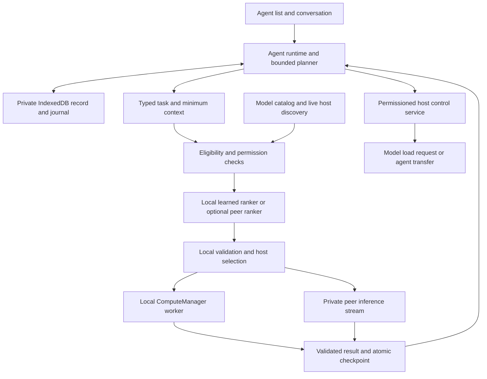

# Persistent agents over the model hosting network

Date: November 5, 2026. Status: planned, not implemented.

Read the [one-page summary](agentlayer.pdf) or its [editable source](agent-layer-summary.html).
This is the first software-agent step toward [Humunculus](../humunculus/humunculus.pdf),
before learned bodies, navigation, training curricula and connectome experiments.

## Work order and outcome

1. **MODEL-BROWSER-01 — next:** implement the model-browser modal and wider Hugging
   Face discovery described in the [branch plan](../../branch/ipfs-large-files-model-inference.md).
   Search names and descriptions; filter task, selected-package size, precision,
   source and compatibility; resolve exact supported variants and preserve
   provenance, stored loading, cancellation and peer availability.
2. **AGENT-01 — immediately afterward:** implement persistent agents that use
   eligible local or hosted models through learned model selection. Include
   strict local-only operation and optional peer-hosted routing, then consented
   model provisioning, cloning and migration through the stages below.

Discovery supplies a shared normalized model catalog and exact package resolver.
An agent can use a currently hosted, protocol-compatible model without downloading
its weights. A search result or a file provider alone does not establish an
available inference service. The older IPFS-01 acceptance gaps remain tracked;
these new TODOs do not mark that broader effort complete.

The user spawns a template, gives it a name and goals, and chooses local-only or
network-assisted operation. The agent keeps its identity and memory as models
change. It plans bounded steps, routes each step, retains results and explains
what it used. It may ask permissioned hosts for a different model or a new home.
Agent templates, context and transfers are data; the application supplies code.

## User experience and basic agent types

Add an **Agents** entry beside model browsing. Show a list of saved agents with
name, template, current goal, status, execution host and last saved time. Actions:
Spawn, Open, Pause/Resume, Cancel task, Edit, Export, Clone, Move and Delete.
Deleting an agent and deleting shared model weights are independent operations.

The spawn modal offers these initial templates, all using the same runtime:

| Type | Initial purpose | Capability boundary |
| --- | --- | --- |
| General assistant | Conversation, reasoning and goal decomposition | Text models; vision when an image is attached |
| Coding assistant | Explain, generate and revise code | Code generation is initially an output artifact; running it needs a separately admitted tool |
| Visual creator | Describe images and generate illustrations | Current vision and text-to-image adapters |
| 3D maker | Develop object/body descriptions and request meshes | Initial structured geometry proposals; direct mesh generation waits for a qualified adapter |
| Voice companion | Listen, converse and speak | Template can exist in text mode; ASR/TTS require the speech stage before voice is advertised as usable |

Templates contain default instructions, suggested skills and budgets; they do
not permanently bind an agent to a model. The user can inspect/edit identity,
goals and summaries. Model-written memory is distinguished from user-authored
instructions and confirmed tool outcomes. The activity view shows each step,
model variant, executing peer, router choice, load requests and failures.

Two independent selectors control **inference location** and **router location**.
Inference is either Local only or Network assisted. The router is Local ML or
Peer ML with local fallback; local-only disables the peer option. A distinct
mobility setting allows or denies migration and cloning. Defaults for mobility,
guest-agent access and agent-requested downloads are off; existing inference
sharing preferences retain their current behavior.

## Architecture and current foundation



| Existing surface | Reuse and required extension |
| --- | --- |
| `demos/inference/src/modelRuntimeController.js` | `listModelSources`, `listInferenceTargets`, `refreshPeers`, `generate`, `acquireModel` and `loadStoredModel`; add shared agent-facing adapters rather than another importer |
| `networkManager/inference/PeerInferenceService.js` | Existing private inference, host discovery, cancellation and pre-commit fallback; add separate agent/host-control protocols |
| `networkManager/inference/protocol.js` | Currently accepts text generation, image-to-text and text-to-image; negotiate new versions/capabilities for other tasks |
| `stateManager/StateManager.js` | Own a private agent-record repository through an additive composition seam; do not redesign current public state APIs |
| `inference/ModelInferenceService.js` and ComputeManager | Own GPU execution, workers, cancellation and admission; add a trusted scorer task and later speech/mesh adapters |
| ArtifactStore | Verified weights and explicit artifacts/checkpoints; private context is not automatically shared or announced |

Source paths in the table after the first row are relative to
`peercompute/src/peercompute/`. One NetworkManager owns one inference service;
many agents multiplex that service. The standalone console currently configures
one worker and one CPU/GPU admission unit. Sharing one loaded model across agents
is practical; simultaneous model residency is not assumed. A small router must
not evict the answering model or bypass ComputeManager resource accounting.

The existing console disables ordinary StateManager Yjs persistence/networking;
its conversations are transient. Model files already have separate persistence.
`writeScoped()` is synchronous and may broadcast: it is not an acknowledged
durable save for private agent identity or authority.

## Agent record and private persistence

An agent's core is a small, versioned context record. Its live IndexedDB form and
portable JSON export use the same schema. A conceptual record is:

```json
{
  "schema": "peercompute.agent.v1",
  "agentId": "stable-random-id",
  "controllerKeyId": "user-controller-public-key-id",
  "templateId": "general-assistant",
  "identity": { "name": "Ada", "instructions": "Help develop the project." },
  "goals": [{ "id": "goal-1", "text": "Design a small avatar", "status": "active" }],
  "context": { "summary": "", "memoryHead": "local-record-key", "artifactRefs": [] },
  "preferences": { "qualityLatencyBalance": "balanced", "preferredModels": [] },
  "policyRef": "user-controlled-policy-revision",
  "authority": { "hostId": "current-host-key-id", "epoch": 0 },
  "revision": 1,
  "status": "paused",
  "lineage": null
}
```

Separate object stores hold agent heads, conversation/events, policy grants,
operation receipts, authority/transfer records and attachment references. Start
with a **64 KiB target maximum for the compact head**, excluding history and
attachments. This is a proposed schema bound, not the inference context budget
or an application disk quota. Large audio/images/meshes remain separate objects.
The current model token and byte limits still determine each actual prompt.

Commit the event, new head and operation state in one IndexedDB transaction.
Resolve save only on transaction completion; use revision checks for conflicts.
Run fetches, model inference and hashing outside transactions. Checkpoint after
each completed step and before transfers, not just during page unload. Use an
exclusive per-agent Web Lock for same-origin tabs, together with transactional
revision checks; that lock does not coordinate different machines. If reliable
local exclusion is unavailable, disable automatic execution in additional tabs.

Request persistent storage where supported and offer explicit export/restore.
Quota estimates stay advisory. On actual write failure, show unsaved state and
pause new autonomous actions and authority changes; never silently substitute
an in-memory agent while promising persistence. Origin changes require export
or an authorized transfer. Storage can be cleared/evicted, so persistence is
not a backup guarantee. [Browser storage behavior](https://developer.mozilla.org/en-US/docs/Web/API/Storage_API/Storage_quotas_and_eviction_criteria).

Restored exports are paused data, not a fresh authority grant. Never overwrite
relinquishment/accepted-transfer records with an older snapshot. Reconcile the
current authority chain before same-identity resumption, including on a different
origin. If exclusive ownership cannot be established, offer a new-ID clone;
restoring a backup must not reactivate an agent that already moved elsewhere.

Only selected context leaves the current host. Raw private context and agent
keys never enter ordinary Yjs/pubsub announcements. Shared model-file settings
do not publish conversations. For portable private artifact references, transfer
protected bytes directly or publish encrypted payloads with separately delivered
keys; a CID is integrity/addressing, not access control. Export keys and host
delegations are separate from editable agent prose. Recipient hosts processing
an agent or inference request can read the context sent to them; transport
encryption does not hide it from the executor.

## Decision loop and task contracts

Begin with one active decision per agent and a fair queue across agents. Suggested
defaults are eight steps per user goal and a visible elapsed/token budget; users
can adjust limits. Completion, waiting for input, budget exhaustion and failure
are explicit states. Open-ended activity requires an enabled schedule and bound,
not an unbounded self-prompt loop.

1. Load identity, policy, current goal and relevant memory; check execution authority.
2. Use an eligible reasoning model to propose a bounded structured next step.
   A simple direct user task can bypass this planner. The planner's own selection
   uses the same local bootstrap/ranking rules.
3. Validate task, inputs, output schema and permission; construct the smallest
   sufficient prompt. Retrieve/summarize context within the selected model budget.
4. Rank eligible model packages and dispatch to an admitted host.
5. Validate the result, attach provenance, and commit the outcome/context revision.
6. Continue, wait, finish or pause; reject results whose authority/policy/context
   revision has become stale.

Every step carries agent ID, authority epoch, decision ID, context revision,
policy revision and deadline. Every attempt also records exact model manifest,
runtime and provider. Persist intent before dispatch; a committed remote request
with an unknown outcome becomes `outcome-unknown`, not an automatic replay.
The current transport prevents cross-host fallback after commitment but does
not provide durable exactly-once execution across restarts. Later side-effecting
tools need idempotency receipts at the effect executor; otherwise require
reconciliation before retry. Cancelling a task stops future steps and awaits
worker/transport cleanup; it cannot undo an already applied external effect.

| Logical skill | Required input/output | Initial adapter status |
| --- | --- | --- |
| Reasoning and coding | Text or structured messages → text/validated structured result | Existing text generation; skill quality needs measured profiles |
| Vision | Image plus text → description/structured observations | Existing image-to-text |
| Image generation | Prompt → bounded image artifact | Existing text-to-image |
| Transcription | Audio with declared format → transcript | New ASR worker and audio transport/schema |
| Speech synthesis | Text and approved voice → audio | New TTS worker and result transport/schema |
| 3D generation | Text/image/specification → validated mesh/body artifact | New runtime, artifact validation and preview; generated source is not automatically executable |
| Model ranking | Task/candidate features → bounded scores | New compact scorer runtime and optional ranking protocol |

Multi-step work composes these contracts, for example speech → text → reasoning
→ image → spoken explanation. Unsupported steps wait or explain the missing
capability; labels in a model card do not make a new adapter executable. An
agent can use any hosted model that satisfies its policy and the negotiated task
contract. It is not limited to the originating device's catalog or GPU size.

## Learned model router with optional peer hosting

Use a compact learned scorer as the intended selector, with ordinary code
enforcing eligibility. The selector predicts task suitability among allowed
models; it does not grant permissions or invent model capabilities.

**Stage one filters** exact variants by task/modality, context/output bounds,
protocol/runtime support, service state and user policy. Maintain separate pools
for ready-to-run models and models eligible for authorized provisioning. The
latter require an explicit load/wait decision accounting for download/startup
cost and host consent, and never appear as ready inference targets. If loading
is selected, recheck actual session readiness before dispatch. Apply local
device requirements only to local execution. Local-only disables remote
inference, peer routing, remote tools and automatic remote context transfer,
including migration and cloning. Downloads
of public model/router weights are a separate provisioning permission; local-only
does not by itself mean offline. A user-initiated Move or Clone may explicitly
authorize a new device/policy boundary; an agent's mobility grant must never
override local-only silently.

**Stage two scores task–model pairs.** Begin with a small MLP over task features
and candidate features, scoring each candidate rather than assigning one output
neuron to every catalog model. Inputs include task representation, required
modalities, prompt size, exact variant, measured task quality/confidence, failures,
load cost and observed latency. Keep rapidly changing host state outside any
claim of permanent model quality. A 100k–1M parameter scorer (0.4–4 MB FP32 weights)
is a design target, excluding any text encoder, activations and runtime. It is not
a qualified checkpoint or a total memory estimate. Start with task labels and
compact features; evaluate a small local encoder when semantic routing helps.

**Stage three picks a host** for the selected exact manifest CID. Preserve the
existing preference for nonbusy, longest-idle hosts and bounded queuing if all
are busy. Revalidate live state before sending. Show the selected model/provider,
measured factors and fallback reason; do not treat an LLM's narrative about its
choice as evidence. Low-confidence or unseen variants use an explicit qualified
fallback or pause for selection; they do not gain a high score from names/size.

Support two deployment modes:

- **Local ML router:** default and required for strict local-only agents. Run a
  trusted scorer in a managed task; benchmark CPU/WASM versus WebGPU for this
  small workload. If sharing the answering model's worker creates contention,
  add explicit lightweight worker admission rather than an unmanaged worker.
  Keep a simple local ranking baseline for cold start, offline recovery and
  comparison; surface when the trained scorer was not used.
- **Optional peer ML router:** choose its host from a locally configured allowed
  router list or nonrecursive capability lookup. Send an authorized task summary
  or features plus a candidate-snapshot hash and IDs. Embeddings are not assumed
  anonymous. The reply contains scores/confidence for those IDs, router version
  and snapshot hash; no executable instruction or authority change. The local
  host validates it, reapplies policy and refreshes availability. Use a short
  routing deadline (initial target two seconds), then local fallback. A router
  never invokes another router to decide where to route its own request.

An isolated model-ranking protocol can be added before broad multimodal protocol
expansion; its host still executes through ComputeManager. Routing service
consent is distinct from accepting a persistent agent. A user may run the agent
locally, ask a peer to rank candidates, and ask a different peer to generate.

### Training and evaluation

1. Assemble versioned representative tasks for the actual available models and
   quantizations. Begin with reasoning, coding, vision and image generation;
   add speech/3D only with qualified adapters and appropriate metrics.
2. Record task success or human preference, errors, time, queue/load costs and
   resource observations. Use executable correctness checks for coding/math,
   grounded image questions and human judgments where objective labels are
   insufficient. LLM judges can propose labels but are not the only ground truth.
3. Collect bounded offline comparisons across multiple candidates. Logs of only
   the chosen model cannot show how the alternatives would have performed.
   Personal context is excluded from shared training data unless the user opts in.
4. Train pairwise/ranking scores and calibration offline first. Export a pinned
   scorer/feature-schema artifact and compare reference versus managed-browser
   output. Initial deployment does not require browser backpropagation.
5. Hold out task families, model families/revisions and later network periods.
   Compare fixed default, transparent heuristic, learned scorer and an offline
   best-choice bound. Report success, selection regret, total latency, routing
   overhead, calibration and recovery under host churn. Include encoder cost.
6. Promote versioned weights only when they improve the declared quality/latency
   objective without policy regressions. Keep rollback. Optional later contextual
   bandit updates require explicit exploration budgets and protection against
   forged peer quality reports. Agent-requested training cannot replace these gates.

[RouteLLM](https://arxiv.org/abs/2406.18665) is a precedent for preference-trained
stronger/weaker LLM selection. [RouterBench](https://arxiv.org/abs/2403.12031)
provides a multi-LLM evaluation precedent. Neither is a drop-in browser router
for changing multimodal peers; this plan trains/evaluates the actual task/model
set. A baseline implementation is a development milestone, not proof that the
learned-routing part of AGENT-01 is complete.

## Host permissions and requested model loading

Keep these separate in host Config: serve loaded inference; serve model ranking;
accept guest agents; permit agent-requested model loading; accept transfers or
clones. Guest-agent mode is Closed, Invited only, or Open within limits. Open
mode is standing host consent for a defined class of requests, not unlimited
access. Enforce accepted templates/tasks, agent count, rate/concurrency, runtime,
download/time budgets, lifetime and tool grants at the receiving host.

The effective permission is the intersection of controller policy, delegated
agent grant and host policy. Agent text/model output cannot expand it. Opt-in
agent hosting does not enable microphone access, shell execution, public file
sharing or remote model downloads. Provide host-visible pause/revoke controls.
Use short-lived, recipient-bound grants with authenticated identity and durable
request IDs. Offline revocation of an already partitioned peer is not guaranteed;
state that limit and stop renewal/requests when revoked. Expiry stops work and
does not create a new owner elsewhere.

The new host-control protocol requests an exact supported manifest or immutable
HF repository/revision/variant resolved by MODEL-BROWSER-01. Both the agent's
grant and the host's loading option must allow it. The host verifies package,
license/access requirements, device support, storage writes and ComputeManager
admission; arbitrary model URLs or new executable code are not accepted.

Lifecycle: `requested → accepted/queued → fetching → loading → ready`, or
`rejected/failed/cancelled`. Use durable request IDs, progress and a bounded
reservation; repeated messages reconcile the same operation. Reuse stored
weights first. Loading consent does not imply permission to evict the user's
active model: default to an idle slot or queue, and allow replacement only under
a separately enabled host policy. Coordinate pending loads across all agents to
avoid repeated swaps. Ready means a specific model session and host reservation,
not just successful download. Revalidate readiness before inference; no model
advertisement is a guaranteed reservation. Cancel cleans up reservations without
deleting independently retained weights.

## Hosting identity, clones and migration

Separate stable agent ID, controller identity, active host identity and model
identity. Agent records contain public identifiers/delegations; never export the
user's root signing key or libp2p private key. A new controller-key/grant subsystem
is required; authenticated transport alone does not establish user authority.
Host-local private keys are persisted separately from portable context.

Hosting moves the decision loop and context, not model weights, GPU allocations
or KV cache. The receiving host discovers models afresh and reconstructs prompts.
An agent can propose a host change or clone within the user's mobility grant.
An explicit invitation or open host policy must produce an authenticated scoped
acceptance before any private checkpoint is sent.

**Cloning:** allocate a new agent ID and recipient-bound clone request, record
parent ID/checkpoint lineage, copy selected identity/goals/memories, and obtain
fresh policy grants. Inherited memories keep their provenance. Do not copy live
requests, authority keys or effect receipts as executable state. The original
continues independently. Repeated clone delivery produces the same child, not
more children. Default clones cannot replicate further; additional permission
specifies a bounded allowance. Per-host quotas and single-use invitations work
without claiming a globally consistent clone counter during partitions.

**Migration:** retain the agent ID and transfer its one active authority epoch.

```mermaid
sequenceDiagram
  participant A as Source host
  participant B as Consenting destination
  A->>B: Request scoped acceptance
  B-->>A: Grant and preparation capacity
  Note over A: Pause and drain; commit checkpoint
  A->>B: Bound transfer and private checkpoint
  Note over B: Verify and persist PREPARED; do not run
  B-->>A: Prepared receipt
  Note over A: Atomically persist RELINQUISHED and commit record
  A->>B: Recipient-bound transfer commit
  Note over B: Persist new epoch; recheck permission and capacity
  Note over B: ACTIVE if allowed; otherwise paused
  B-->>A: Recorded acceptance
```

Bind transfer ID, agent ID, sender, recipient, old/new epoch, checkpoint digest,
policy revision and acceptance grant. Source relinquishment and a retransmittable
commit record are saved before sending; the destination saves accepted ownership
before execution. Both endpoints return stored receipts for duplicates.
Immediately before activation, recheck grant expiry/revocation, current policy
(including local-only/device binding) and resource admission. If those changed
after PREPARED, durably record accepted ownership as paused/pending and reconcile;
do not execute or let the source resume. Each subsequent step rechecks its grant.
Before relinquishment the source can cancel and resume. After relinquishment it
can retry/status-query but cannot restart the agent merely because an ACK timed
out. A prepared destination cannot run without the commit. A committed transfer
cannot be silently rolled back. Replayed or stale epochs/results are rejected.

This protects cooperating hosts against crashes/retries, not hostile owners
running modified copies of an agent. Do not elect owners from a timeout, Yjs
merge or locally invented higher epoch. Permanent host loss initially yields a
paused/unavailable agent; recover only after proving prior authority stopped, or
create a clearly labeled new-identity clone from an available authorized backup.
Automatic same-identity partition failover needs a separate fencing/consensus
design. Private context supplied to an untrusted host cannot later be forcibly
erased by a revocation message.

The host must remain actually available for execution. Tabs/PWAs can freeze,
be discarded or close; installation does not provide an always-running agent.
Save incrementally, show last-seen/paused state and resume only with valid
authority. [Browser lifecycle](https://developer.chrome.com/docs/web-platform/page-lifecycle-api).

## Module boundaries and implementation stages

Use vanilla ES modules and existing managers. Proposed `peercompute/src/peercompute/agents/`
modules: `AgentContracts`, `AgentTemplates`, `AgentRecordStore`, `AgentRuntime`,
`AgentPolicy`, `AgentRouter`, `AgentAuthority` and `AgentTransfer`. Add host-control
and ranking adapters under NetworkManager, trusted scorer tasks under inference,
and reusable agent views under `demos/inference/src/agents/`. These are planned
names, not existing exports. UI code never owns model workers or authority.

| Stage | Deliverable | Exit evidence |
| --- | --- | --- |
| A0 Contracts | Normalized catalog/tasks, agent schema and policy/grant contracts after MODEL-BROWSER-01 | Explicit existing/new capability map; schema fixtures and bounded size checks |
| A1 Local agents | Templates, create/edit/export/delete/resume, private IndexedDB journal, strict local-only loop | Restart retains identity/goals/context; two-tab exclusion; write failure pauses; no remote context traffic |
| A2 Network routing | Shared catalog/host service, transparent baseline, compact trained ranker and local execution | Task/variant selection benchmark, reference equivalence, provenance, cancellation and changing-host tests |
| A3 Optional peer router | Authenticated ranking endpoint with bounded candidate snapshots and local fallback | Timeout, malformed/stale scores and strict-local denial; no recursive routing dependency |
| A4 Requested loading | Separate host grant, queue/progress/cancel/reservation; exact package resolver | Disabled host rejects; admitted idle load succeeds; busy user model preserved; duplicate requests coalesce |
| A5 Clones | Explicit invite/open acceptance, new identity/lineage, selected memory and fresh grants | Two independent agents; no duplicated child on replay; host/replication bounds enforced |
| A6 Migration | Private checkpoint, durable relinquishment, epoch handoff and reconciliation | Crash/disconnect injection at every transition; only one cooperating host runs; no timeout takeover |
| A7 Specialist extensions | Speech and validated 3D interfaces integrated through shared routing | Real ASR/TTS and mesh output contracts proven before enabling those template capabilities |

A1–A3 form the first user-visible agent slice. A4–A6 deliver the requested
optional network autonomy. A7 supplies the remaining named specialist tasks;
until then those template capabilities stay visibly pending. AGENT-01 is not
fully complete while required stages or their acceptance gates are unproven.
Humunculus's neural movement, learned bodies and fly-brain experiments follow
separately; this layer contributes persistent identity, memory and specialist
coordination without claiming those embodied behaviors.

## Validation and completion

- **Persistence:** reload, two tabs, aborted transaction, storage denial/quota,
  schema upgrade, export round trip, stale-backup restore after migration and
  attachment loss. Confirm no private agent
  data is broadcast or automatically announced as a shared artifact.
- **Routing:** exact task/model/variant compatibility; context packing; ambiguous
  tasks; no suitable model; stale advertisements; all hosts busy; model changed
  mid-request. Verify local-only blocks peer inference, routing, tools and implicit
  migration, while independently permitted weight downloads remain possible.
- **Learned routing:** held-out task/model/time splits, baseline comparisons,
  total encoder/scorer cost, calibrated confidence, version rollback and local
  versus peer scoring equivalence. Synthetic fixtures prove logic, not quality.
- **Execution:** cancel every phase, stale result rejection, interrupted commit
  and unknown remote outcome. No cross-host replay after inference commitment;
  verify tool effect receipts separately from model result delivery.
- **Host loading:** closed/open/granted policy combinations, stale/replayed grants,
  invalid package, real storage failure, residency contention, repeated requests,
  cancel and failed-load cleanup. Model success must be shown in a managed worker.
- **Clone/move:** invite replay, wrong recipient, expired grant, crash at each
  prepare/relinquish/commit/ack boundary, lost ACK, source restart, destination
  restart and partitions. Revoke grants/change admission between preparation and
  activation; preserve paused ownership without source restart. Distinguish independent clone identity from transferred
  authority. Same-identity recovery may remain paused; it must not split authority.
- **UI and real network:** desktop/mobile dialogs, keyboard/focus, saved status,
  visible route trace, host controls, PWA restart, two independent browser stores
  and eventually two physical devices against the existing backend. Do not claim
  same-machine tests as physical-host continuity or a new Pages release.

The initial demonstration is a saved agent that survives reload, uses different
qualified models for text and image tasks, and explains its routing choices.
Then demonstrate the same goal under local-only restrictions, optional peer
ranking, a consented model load, an independent clone and an acknowledged move.
Speech/3D demonstrations close their own gates. All implementation tests above
are planned; the current change only records the plan and summary.
