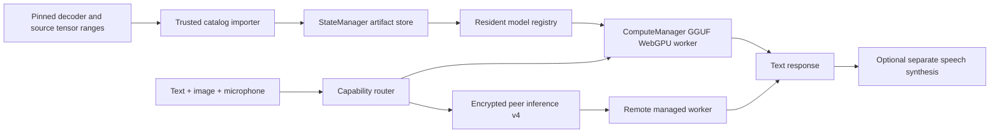

# Gemma4 native image/audio input

User authorization received November 10, 2026 at 17:45:48 America/Anchorage
(first tool receipt). User subsequently started a model test; no competing GPU
or full decoder downloads. Internal previews/local commits only, no Pages/push.

## Architecture



Preserve the original text-only package identity. The new
`gemma4-12b-uncensored-q4-k-m-multimodal-gguf` uses the same pinned Trevor Q4
decoder and a separate `mmproj-gemma4-unified-f16.gguf`. Completed decoder files
are reused by SHA256/size; independently retained packages keep shared bytes
alive. Do not rename a stored text manifest into a media manifest.

The pinned source has 11 BF16 projection tensors totaling 104,759,808 bytes.
A fixed application-owned recipe requests bounded ranges from source revision
`159eb7a8a04efb31ed43887e4732ff3edccff8ac`, verifies each tensor digest, performs
the upstream layout/type transforms, and emits an ordinary retained artifact.
Its 122,030,944-byte result has SHA256
`ee1fed84b7d15ffc4d13c44b59fff59e50fe89f36adcc5ec4900c83efd0edc27`.
The browser and command-line artifact importer use the same fixed source
generator. There is deliberately no direct Hugging Face URL for the derived file.
Whole-file identity matches an independent CPU conversion using llama.cpp
`46ca246de9bb1c35269722a6240d37d9dfd79cad`.
The publisher's whole-checkpoint LFS digest is metadata; we independently verify
only the selected ranges, not the entire 23,919,549,408-byte source. The GGUF
publisher does not attest its exact decoder conversion input revision. Preserve
that provenance limitation. The official processor config supplies missing
source settings explicitly. No model weights are committed to the repository.

The managed worker mounts the projector separately from decoder shards. It
encodes bounded RGBA as PNG and mono 16 kHz PCM as WAV, puts native media markers
on the latest user turn, and supplies the same ordered media to context preflight
and final completion. Use 512 batch/microbatch, 70–280 image tokens, 2048 context,
and at most 20 seconds of audio. Native load must confirm image/audio flags and
the configured batch before the package becomes ready. Text replies are not TTS.
Video files and persistent raw-audio conversation history are outside this slice.

Operations are distinct from primary model tasks. A text-primary package can
serve `image-text-to-text` and `audio-text-to-text` only when its admitted input
modalities support them. ASR remains audio-only. Negotiated inference v4 preserves
the operation and uses existing bounded credited image/PCM streams. v3/v2 hosts
retain their old task conventions; their descriptors cannot acquire media
capabilities from another host advertising the same package. Combined media
requires one host capable of both, not the union of separate providers.

Personal direct-model Talk uses native audio when a suitable route has capacity.
Agents and Global transcribe first; Global still publishes only the transcript.
Native audio can supply transcription when ASR has no capacity. All paths retain
local-only policy, hold/release cancellation and owned microphone cleanup.

## Validation and open acceptance

Focused tests cover exact package/source matching, saved decoder reuse, corrupted
and cancelled derivations, PNG/WAV encoding, media ordering, context preflight,
native flags, legacy defaults, per-host capability/queue selection, actual Noise
peer media transfer, v3/v2 fallback, repeated changed inputs, and voice UI flows.
Build and preview receipts are recorded in the root log.

Actual Gemma GPU image/audio generation remains an explicit open gate while the
user tests the existing model. Source and simulated-engine tests cannot close it.
The updated client independently queried the user's text-only Gemma peer over
legacy inference v3: two arithmetic prompts returned distinct correct answers
in about 1.6/1.0 seconds. That proves peer text delivery, not native media support.
Use an owned profile and neutral speech fixture once GPU time is available:

```sh
MODEL_SUPPORT_REPO=TrevorJS/gemma-4-12B-it-uncensored-GGUF \
MODEL_SUPPORT_DTYPE=q4_k_m MODEL_SUPPORT_MEDIA=1 \
MODEL_SUPPORT_AUDIO_WAV=/absolute/path/to/mono-16khz-pcm16.wav \
MODEL_SUPPORT_AUDIO_EXPECTED='the known words in the recording' \
MODEL_SUPPORT_PROFILE=/absolute/path/to/owned-profile \
node demos/tests/model-support-browser.mjs
```

The harness checks changing text, red versus blue images, known speech content,
actual GPU dispatch, cancellation, unloading/resource release and source-blocked
browser restart with all media repeated. It has not been executed for Gemma media
in this slice. Follow with an actual two-browser model-hosted media request and
confirm no source downloads when reopening the retained package.
