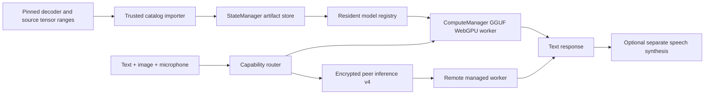

# Gemma4 native image/audio input

November 10, 22:49 America/Anchorage: native acceptance **passed** on owned
hardware Chrome/RTX5060Ti. The exact saved decoder plus derived companion answered
text controls, distinguished red/blue images and transcribed an11second known
speech sample. A source-blocked browser restart repeated all media. A separate
GPU-disabled browser with no stored weights then repeated text/image/audio over
encrypted inferencev4 via SecretWorkshop. First-token cancellation, subsequent
text generation, host withdrawal and unload with zero active leases passed.
Evidence: external `peercompute-gemma4-native-20261111/run-2/report.json` and
`peer-run-2/report.json`. These results supersede the earlier unverified status
and removal recommendation below; no native media failure was reproduced.
The earlier observed peer was advertising the distinct text-only package.
The original manifest provenance is preserved to avoid changing saved CIDs;
current execution status lives in catalog capabilities and this evidence record.

User authorization received November 10, 2026 at 17:45:48 America/Anchorage
(first tool receipt). User subsequently started a model test; no competing GPU
or full decoder downloads. Internal previews/local commits only, no Pages/push.

November 10 follow-up: the user reports the derived-companion version does not
work and is considering removing it. Failure stage/root cause is not established.
Prefer evaluating complete publisher-supplied packages before more custom
conversion: [Unsloth 12B](https://huggingface.co/unsloth/gemma-4-12b-it-GGUF)
publishes an F16 companion; [Zaakirio's abliterated 12B](https://huggingface.co/zaakirio/gemma-4-12b-it-uncensored-GGUF)
publishes a BF16 companion and reports native llama.cpp image/audio tests. Neither
has passed PeerCompute browser media qualification. Recommended cleanup replaces
the custom derivation/catalog entry while retaining generic worker media mounting,
routing and transport. This is a recommendation, not an applied rollback.

### Live peer check after the reported failure

November 10, 20:40–20:47 America/Anchorage: an owned no-GPU browser joined the
internal 5189 preview and found only the original text Gemma package, now over
inference v4. Two text requests returned correct answers in about 1.1 seconds;
an image request was rejected by capability routing with “This model accepts
text only.” This is not a reproduction of companion loading or media execution.
An owned persistent peer began copying the retained decoder by CID; this was
deliberately stopped while incomplete, preserving its partial cache. Only about
6.5 GiB GPU memory was free; the user has been asked to unload the active model.
Do not start a competing full-model load or interpret elapsed time as an answer.

Abstraction review: independent artifact mounting, PNG/WAV encoding and peer
transport are reusable. The derived recipe, accepted filename, exact catalog
closure, one-decoder restriction and media/batch/context profile are Gemma-specific.
A generic companion role still needs explicit, validated per-runtime profiles.
The current native API requires a decoder; no projector-only test is exposed.
Next qualification needs a complete owned decoder and available GPU capacity,
then real image/audio requests and sanitized native failure diagnostics. Existing
simulated-engine tests cannot substitute for that check.

## Architecture



Preserve the original text-only package identity. The new
`gemma4-12b-uncensored-q4-k-m-multimodal-gguf` uses the same pinned Trevor Q4
decoder and a separate `mmproj-gemma4-unified-f16.gguf`. Completed decoder files
are reused by SHA256/size; independently retained packages keep shared bytes
alive. Do not rename a stored text manifest into a media manifest.

The pinned source has 11 BF16 projection tensors totaling 104,759,808 bytes.
A fixed application-owned recipe requests bounded ranges from source revision
`159eb7a8a04efb31ed43887e4732ff3edccff8ac`, verifies each tensor digest, performs
the upstream layout/type transforms, and emits an ordinary retained artifact.
Its 122,030,944-byte result has SHA256
`ee1fed84b7d15ffc4d13c44b59fff59e50fe89f36adcc5ec4900c83efd0edc27`.
The browser and command-line artifact importer use the same fixed source
generator. There is deliberately no direct Hugging Face URL for the derived file.
Whole-file identity matches an independent CPU conversion using llama.cpp
`46ca246de9bb1c35269722a6240d37d9dfd79cad`.
The publisher's whole-checkpoint LFS digest is metadata; we independently verify
only the selected ranges, not the entire 23,919,549,408-byte source. The GGUF
publisher does not attest its exact decoder conversion input revision. Preserve
that provenance limitation. The official processor config supplies missing
source settings explicitly. No model weights are committed to the repository.

The managed worker mounts the projector separately from decoder shards. It
encodes bounded RGBA as PNG and mono 16 kHz PCM as WAV, puts native media markers
on the latest user turn, and supplies the same ordered media to context preflight
and final completion. Use 512 batch/microbatch, 70–280 image tokens, 2048 context,
and at most 20 seconds of audio. Native load must confirm image/audio flags and
the configured batch before the package becomes ready. Text replies are not TTS.
Video files and persistent raw-audio conversation history are outside this slice.

Operations are distinct from primary model tasks. A text-primary package can
serve `image-text-to-text` and `audio-text-to-text` only when its admitted input
modalities support them. ASR remains audio-only. Negotiated inference v4 preserves
the operation and uses existing bounded credited image/PCM streams. v3/v2 hosts
retain their old task conventions; their descriptors cannot acquire media
capabilities from another host advertising the same package. Combined media
requires one host capable of both, not the union of separate providers.

Personal direct-model Talk uses native audio when a suitable route has capacity.
Agents and Global transcribe first; Global still publishes only the transcript.
Native audio can supply transcription when ASR has no capacity. All paths retain
local-only policy, hold/release cancellation and owned microphone cleanup.

## Validation and open acceptance

Focused tests cover exact package/source matching, saved decoder reuse, corrupted
and cancelled derivations, PNG/WAV encoding, media ordering, context preflight,
native flags, legacy defaults, per-host capability/queue selection, actual Noise
peer media transfer, v3/v2 fallback, repeated changed inputs, and voice UI flows.
Build and preview receipts are recorded in the root log.

Actual Gemma GPU image/audio acceptance passed in the owned runs above.
Source and simulated-engine tests alone cannot close this gate.
The updated client independently queried the user's text-only Gemma peer over
legacy inference v3: two arithmetic prompts returned distinct correct answers
in about 1.6/1.0 seconds. That proves peer text delivery, not native media support.
Use an owned profile and neutral speech fixture once GPU time is available:

```sh
MODEL_SUPPORT_REPO=TrevorJS/gemma-4-12B-it-uncensored-GGUF \
MODEL_SUPPORT_DTYPE=q4_k_m MODEL_SUPPORT_MEDIA=1 \
MODEL_SUPPORT_AUDIO_WAV=/absolute/path/to/mono-16khz-pcm16.wav \
MODEL_SUPPORT_AUDIO_EXPECTED='the known words in the recording' \
MODEL_SUPPORT_PROFILE=/absolute/path/to/owned-profile \
node demos/tests/model-support-browser.mjs
```

The reusable harness checks changing text, red versus blue images, known speech,
GPU dispatch, cancellation, unloading and source-blocked restart. The recorded
acceptance used equivalent external owned-browser harnesses with an exact local
file source because repeated serial CDN transfers were slow. Normal importer
SHA/CID verification and the actual managed native worker were retained. The
second browser used actual peer streams, not a simulated transport. This is one
GPU/browser qualification, not a guarantee for all hardware or media quality.
