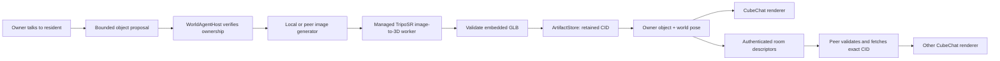

# Generated objects for CubeChat

Authorized November 10, 2026 after general LoRA support. Managed local and actual
encrypted peer inference pass. Two full CubeChat pages generated, shared and
displayed a retained object, then restored it after reload. Temporary viewer-cache cleanup and source-off owner reload also pass; the three affected
demo production builds and internal inference preview checks pass.

## First executable slice

Use the pinned `cgb/triposr-onnx-webgpu` Q8 export, approximately 467 MiB, for
image-to-3D. The managed hardware-browser run reconstructs a recognizable
chair with 4,908 triangles and 1,207 GPU dispatches. That initial receipt used an alpha cutout; the complete opaque-image chain is
qualified below. The ONNX native WebGPU
backend supports this export's eight-bit MatMulNBits; the JSEP backend used by
existing diffusion does not. A tiny known-answer GPU test verified that
distinction before the full download. This runtime uses separate matching ORT
asyncify assets and a managed device. No FP16 feature is required.

TripoSR creates static vertex-colored geometry. It is not Hunyuan3D-2.1 and does
not generate rigging or animation. Hunyuan3D remains a future generator behind
the same output contract. Model execution, artifact storage, world placement and
rendering are independent components.

An owner can ask a resident to create an object. A text request first uses an
available image generator, then the 3D generator. The reusable object manager
also accepts actual RGBA input directly. Check both providers before starting
the text chain; missing providers produce a clear unavailable result. TripoSR
receives only pixels, never an ignored text prompt or conversation history.

## Boundaries

- `onnx-mesh` is a fixed ComputeManager runtime with admitted model hashes,
  preprocessing and 64³ density sampling. No model-supplied executable code.
- `image-to-3d` advertises input image and output mesh. Versioned peer transport
  preserves older text/vision/audio clients without offering them 3D operations.
- Generated GLB has one static triangle mesh with embedded geometry and optional
  normals/colors; maximum 16 MiB, 100,000 vertices and 150,000 triangles. Reject
  external URLs, extensions, animations, skins, invalid indices,
  nonfinite coordinates and mismatched bounds/hashes before renderer access.
  The SF3D extension admits bounded embedded PNG/JPEG albedo/normal textures
  with checked UV/tangent attributes. Legacy inference v5 remains texture-free;
  textured results use v6. See [SF3D](stable-fast-3d.md).
- ArtifactStore retains the generated file and manifest. Agents/world state
  keep small references, not binary mesh data in prompts or journals.
- World placement requires current ownership, unchanged resident revision and
  successful retained commit. Bounded idempotent request IDs prevent duplicates.
  Limit 32 objects per owner and 128 displayed objects per world.
- Room discovery authenticates descriptor publishers. Inspect remote manifests
  and enforce the one-file geometry budget before fetching their closure.
  A viewer holds temporary GC retention while fetching and validating the GLB;
  viewing does not permanently pin another owner's objects. Failed CIDs back off
  without blocking later objects. Existing independent pins remain intact.
- Objects are cosmetic scene geometry. Resident bodies, collisions, movement,
  identity, nameplates and chat remain unchanged. Avatars are a later slice.

## Required acceptance

1. Run actual TripoSR in the managed worker through the catalog/importer and CID
   reader; validate and visually inspect its colored GLB, with measured GPU work.
2. Cancel and recover, unload with zero leases, and reload retained weights and
   generated geometry with source downloads disabled.
3. A separate GPU-disabled peer requests 3D inference over the actual network and
   receives the same bounded, hash-verified result.
4. A real resident action creates and places an object. A second CubeChat peer
   sees the same CID/pose, and reload restores without regenerating.
5. Verify owner restrictions, repeated requests, stale revisions, provider loss,
   malformed/oversized assets, cancellation and clean disposal.

External evidence lives under `peercompute-browser3d-research-20261111` and
`peercompute-mesh-native-20261111` in the user's cache; the actual two-page world
test lives under `peercompute-cube3d-native-20261111`. Scratch pipeline success
is not a substitute for managed inference and world integration acceptance.

The first full-world acceptance invokes the owner-authorized object tool with
an actual source image and a remote TripoSR provider. It proves neural generation,
placement, peer transfer, rendering and retained reload. LLM-authored proposals
and the text-to-image chain have separate integration tests; this receipt alone
does not qualify their full combined model execution or image quality.

## November 11 continuation

The user authorized proceeding with the remaining live authoring chain. Test an
owner's actual chat request, the real language model's separate object proposal,
an actual image generator, managed TripoSR and two CubeChat renderers together.
Preserve all earlier receipts. Fix demonstrated failures and add focused regression
coverage; do not replace any inference stage with a fixture. No Pages or push.

Actual first continuation exposed a coalesced resident refresh losing a resume
invalidation, so the first speech appeared to supersede its own action. Drain
invalidated snapshots before returning while retaining genuine movement guards.
Four regressions cover stale pause/resume, owner movement, store failure and
disposal. The next run completed all four model calls and the two-peer retained
object lifecycle, but visual acceptance found an opaque-background slab around
the reconstructed chair. Alpha crop/padding already matched TripoSR; opaque
generated input needs foreground preparation before that stage. The color-matte experiment was rejected as too restrictive for gray/white objects.
A 4.36 MiB U2NetP foreground model passed a real native WebGPU probe on both the
original and grayscale reference. Add its pinned graph to the managed TripoSR
package, preserve usable caller alpha, reject unusable masks and repeat the full
GPU/world acceptance. This is learned preprocessing; it does not guarantee correct
segmentation or reconstruction for arbitrary photos.

The current package adds pinned `edgetools/u2netp` at
`25dee37ab19c5b6ad64ba6578eba63f1ae07720c`, byte-identical to the official
[rembg release](https://github.com/danielgatis/rembg/releases/download/v0.0.0/u2netp.onnx).
The [upstream preprocessing](https://github.com/danielgatis/rembg/blob/991927b77667946dab59c50df31f7d4640e80457/rembg/sessions/u2netp.py)
is reproduced with bounded RGB normalization and mask composition; browser
canvas high-quality resize approximates PIL Lanczos. The same owned GPU now
executes foreground, encoder and decoder sessions. There is no separate provider
to discover or remote script to execute. Model files retain their exact hashes,
source revisions and upstream licenses. Existing alpha-only package manifests
remain admitted for cutouts, without appearing as duplicate catalog choices.

## Complete live authoring acceptance — November 11

The final run uses an ordinary owner chat with no supplied image or replaced
inference stage. Real peer Qwen3.5 0.8B GGUF supplies speech and independent
object JSON, DreamShaper supplies opaque 512×512 RGBA, and the managed mesh worker
uses U2NetP followed by TripoSR. Both full CubeChat clients display the same
883,820-byte, 7,356-triangle chair. Close visual inspection confirms an isolated
chair with seat, back and legs; surfaces remain coarse and uneven, not a polished
production asset. The owner restores it without inference or HF requests; the
unpinned viewer cache is collectible while owner retention survives.

Model request durations were 4.49s speech, 2.57s object selection, 4.65s image and
5.01s mesh including foreground separation. These are one hardware/network run,
not general performance guarantees. Both clients have zero page/console errors,
failed requests and unexpected HF requests. The provider closes with zero active
CPU/GPU leases. Expected ORT constant-folding/node-placement warnings are retained
in the provider report.

Evidence: `/home/cos/.cache/peercompute-cube3d-chain-20261111/cube-run-3/`.
Artifact CID: `bafkreibng7sc3br6axkansm5zwv2x6oququjouemdbvgbgfkdv6ag34nqy`.
GLB SHA256: `277a963c5b9b66361f7ef7e43deea2fc5e90b770f5897def6b58ea83f186ae16`.
Earlier run1 preserves the stale-refresh failure; run2 preserves successful
transport with failed visual quality. Their receipts are not overwritten.

The updated package also passes source-off IndexedDB restart in the same browser
origin/profile. Cancellation after the first density batch leaves the worker
ready; recovery regenerates the exact same GLB with 1,693 GPU dispatches and
zero downloads. All sessions and CPU/GPU leases release on unload. See
`retained-mesh-report.json` alongside the live-chain evidence.

## Resident avatar input and recovery follow-up (November 11)

`WorldAvatarInput` parses explicit owner controls separately from conversational
speech. Supplied RGBA references skip text and image inference; `Avatar prompt:`
and `Use this exact prompt:` preserve the literal image prompt and skip speech
inference. CubeChat accepts these references only for an owned resident, with
preview/removal and retry retention. The shared image intake/decoder now lives
under `demos/shared/chat`; inference's old import paths re-export it unchanged.
Placed-object chat retains its existing generated-reference behavior.

A conversational physical decision receives the completed reply and must agree
with it. Explicit leading declines skip the action call; this is a bounded
English consistency check, not a general semantic guarantee or content filter.
Failure outcomes enter private scoped WorldMemory, while normal speech keeps its
original agent journal and route. Explicit commands/results use authenticated
owner / verified-action memories, not fabricated language-model turns. Multibyte
history truncation respects the memory store's UTF-8 byte limit. Reference pixels
are transient; the resulting mesh remains durably content addressed.

Mesh selection is refreshed both before image generation and just before mesh
dispatch, preserving local-only policy and cancellation. No automatic inference
retries, model downloads or refusal rewriting are introduced. Provider loss can
still fail a request; the UI preserves the prior body and reports the failure.
The reported identical model reply was not independently reproduced as a cached
transport result. Tests prove current prompts, distinct calls, idle recovery and
saved failure context, rather than claiming all semantic repetition is fixed.

## Grounded placement and manipulation roadmap — November 12

Placement now shares `WorldSpatialReferences` with navigation. The argument
model selects a request-local location (`lN`) or authenticated participant
(`speaker`/`pN`); raw generated coordinates are never authority. A separate
trusted target passes through `WorldConversationTurn` and `WorldAgentHost` to
`WorldGeneratedObjects`. Render prompts describe the object only. Remembered
places retain their original point and revision; moving participants are
observed again during generation and immediately before retention.

`CubeSpatialTargets` validates the current bounded Cannon floor, navigation
range, center clearance and conservative full-size object envelope. Actual
physics shape bounds and rendered prop bounds prevent overlap. Explicit invalid
destinations fail without falling back to nearby placement. The saved manifest,
visible object and receipt use the same final validated position. The geometry
remains cosmetic; footprint admission does not add collision bodies.

Next todo: manipulate existing owned props. For “go get the throne and put it
near the castle,” expose stable observed object IDs, resolve an authorized
source and destination, reserve the source, approach it using the learned motor,
acquire/carry it, then place it using this validator. Persist idempotent objective
steps and actual approach/acquisition/release receipts. Keep immutable mesh CIDs
separate from revisioned placement state. Visibility grants no right to move
another host's object; remote permission/transfer must be explicit. Do not mark
the task complete from speech or teleport an object to simulate carrying.

Owner-chat execution order: WorldConversationTurn can accept an executeObject
host callback. It first requests object-or-none with complete argument schema;
validated object plans execute before persona speech. The callback returns a
bounded placed/saved/not-placed receipt. Speech sees that receipt and never owns
commit authority. A completed receipt remains available if narration fails or
is cancelled. An error after retention but during presentation returns saved
with CID/position and displayError, preserving restore/share without regeneration.
Nonobject requests continue through the existing post-speech intent path.

Actual peer qualification (November12): Qwen2B action planning, DreamShaper image
generation and SF3D mesh generation completed; a31,252-triangle GLB was retained
and displayed at the selected sensed point and restored identically after reload.
The original distant-placement test remains semantically failed: selected32units
when96-unit points were available. Subsequent Qwen narration contradicted the
verified receipt. Host receipt/state is authoritative; model prose is not. Further
spatial/narration qualification remains necessary, with no silent benchmark
relaxation or automatic replay of a committed object.
