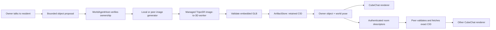

# Generated objects for CubeChat

Authorized November 10, 2026 after general LoRA support. Managed local and actual
encrypted peer inference pass. Two full CubeChat pages generated, shared and
displayed a retained object, then restored it after reload. Temporary viewer-cache cleanup and source-off owner reload also pass; the three affected
demo production builds and internal inference preview checks pass.

## First executable slice

Use the pinned `cgb/triposr-onnx-webgpu` Q8 export, approximately 462 MiB, for
image-to-3D. The managed hardware-browser run reconstructs a recognizable
chair with 4,908 triangles and 1,207 GPU dispatches. The ONNX native WebGPU
backend supports this export's eight-bit MatMulNBits; the JSEP backend used by
existing diffusion does not. A tiny known-answer GPU test verified that
distinction before the full download. This runtime uses separate matching ORT
asyncify assets and a managed device. No FP16 feature is required.

TripoSR creates static vertex-colored geometry. It is not Hunyuan3D-2.1 and does
not generate rigging or animation. Hunyuan3D remains a future generator behind
the same output contract. Model execution, artifact storage, world placement and
rendering are independent components.

An owner can ask a resident to create an object. A text request first uses an
available image generator, then the 3D generator. The reusable object manager
also accepts actual RGBA input directly. Check both providers before starting
the text chain; missing providers produce a clear unavailable result. TripoSR
receives only pixels, never an ignored text prompt or conversation history.

## Boundaries

- `onnx-mesh` is a fixed ComputeManager runtime with admitted model hashes,
  preprocessing and 64³ density sampling. No model-supplied executable code.
- `image-to-3d` advertises input image and output mesh. Versioned peer transport
  preserves older text/vision/audio clients without offering them 3D operations.
- Generated GLB has one static triangle mesh with embedded geometry and optional
  normals/colors; maximum 16 MiB, 100,000 vertices and 150,000 triangles. Reject
  external URLs, extensions, animations, skins, textures, invalid indices,
  nonfinite coordinates and mismatched bounds/hashes before renderer access.
- ArtifactStore retains the generated file and manifest. Agents/world state
  keep small references, not binary mesh data in prompts or journals.
- World placement requires current ownership, unchanged resident revision and
  successful retained commit. Bounded idempotent request IDs prevent duplicates.
  Limit 32 objects per owner and 128 displayed objects per world.
- Room discovery authenticates descriptor publishers. Inspect remote manifests
  and enforce the one-file geometry budget before fetching their closure.
  A viewer holds temporary GC retention while fetching and validating the GLB;
  viewing does not permanently pin another owner's objects. Failed CIDs back off
  without blocking later objects. Existing independent pins remain intact.
- Objects are cosmetic scene geometry. Resident bodies, collisions, movement,
  identity, nameplates and chat remain unchanged. Avatars are a later slice.

## Required acceptance

1. Run actual TripoSR in the managed worker through the catalog/importer and CID
   reader; validate and visually inspect its colored GLB, with measured GPU work.
2. Cancel and recover, unload with zero leases, and reload retained weights and
   generated geometry with source downloads disabled.
3. A separate GPU-disabled peer requests 3D inference over the actual network and
   receives the same bounded, hash-verified result.
4. A real resident action creates and places an object. A second CubeChat peer
   sees the same CID/pose, and reload restores without regenerating.
5. Verify owner restrictions, repeated requests, stale revisions, provider loss,
   malformed/oversized assets, cancellation and clean disposal.

External evidence lives under `peercompute-browser3d-research-20261111` and
`peercompute-mesh-native-20261111` in the user's cache; the actual two-page world
test lives under `peercompute-cube3d-native-20261111`. Scratch pipeline success
is not a substitute for managed inference and world integration acceptance.

The first full-world acceptance invokes the owner-authorized object tool with
an actual source image and a remote TripoSR provider. It proves neural generation,
placement, peer transfer, rendering and retained reload. LLM-authored proposals
and the text-to-image chain have separate integration tests; this receipt alone
does not qualify their full combined model execution or image quality.
