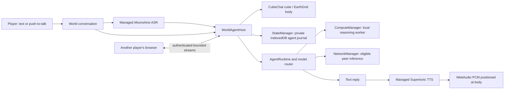

# Conversational inhabitants in CubeChat and EarthGrid

November 6, 2026. Conversational inhabitant slice implemented and qualified on
`feature/ipfs-artifacts-webgpu`. This corrects the previous integration: a shared
model console alone does not make an agent inhabit a world.

Run `npm run test:world-agents` for the combined contracts, protocol, scene, UI
and managed-speech lifecycle checks. `npm run test:world-speech:browser` is the
explicit hardware gate and requires the external verified source cache described
in the harness. Internal preview builds are separate from public GitHub Pages.

An agent has a selectable, named body in the scene. Players open its conversation
by selecting that body, type a message or explicitly record a short utterance,
and receive text and optionally positional speech. Closing the conversation
leaves the body, identity, memory and loaded models alive. Leaving a room or
destroying the world awaits the host's complete shutdown.

## Ownership and persistence

- One general agent can have up to eight world bindings, containing world ID,
  position, color and an explicit sharing preference. The identity and journal
  remain in the existing private AgentRecordStore, outside shared GIS/Yjs data.
- CubeChat uses its room's existing network for world conversations and its
  StateManager for private storage. Its model runtime owns a separate global
  model connection, so standalone model hosts remain discoverable across game
  rooms without weakening conversation scope checks. Its agent bodies
  have separate Three.js objects and static Cannon collision bodies; they are
  not fake human peers or video participants.
- EarthGrid uses a separate, lazy Cesium data source for georeferenced bodies.
  Its private GIS StateManager remains network-disabled; the agent model runtime
  connects its own network manager to the configured backend.
- Removing a body removes its binding, not the agent's identity or memory.
  Existing agent administration remains available through Models → Agents.
- The model console borrows the scene-owned runtime. A closed console must not
  unload a body’s active model or terminate another visitor's request.

## Conversations between peers

The fixed `/peercompute/world-agents/1.0.0` protocol advertises only bounded public
body descriptors and accepts bounded text requests. Its owner comes from the
encrypted libp2p connection, never a caller-supplied identity. Requests must match
the application game/room/topology and world. Only shared bodies accept visitors.
Discovery polls known peers every five seconds and expires stale bodies.

The owning host derives a conversation channel from the world and authenticated
requester. The owner's channel uses a stable local identity. Private model-console
history and other visitors' turns are excluded from that context. This is not a
portable login: a visitor whose network peer identity changes gets a new channel.
Replies and captions are directed to the requester, not broadcast to the world.

Per-peer/global concurrency, prompt/reply byte limits, deadlines and replay
suppression bound work. Disconnect, cancellation and world shutdown abort the
request and await acknowledged inference cleanup. A committed request is never
silently retried after an uncertain outcome. Interrupted agents require explicit
Resume; no prompt is replayed.

## Managed speech and budgets

Voice is explicitly enabled before downloading approximately 376 MB of pinned
Moonshine Tiny and Supertonic FP32 packages. Both use the trusted
`transformers-speech` runtime inside ComputeManager workers. No browser cloud
speech API or unmanaged inference worker is substituted. Source files use the
same content verification and ArtifactStore retention system as other models.

The scene's dedicated model ComputeManager admits up to three residents:
reasoning, transcription and synthesis. They share the existing 12 GiB CPU /
16 GiB GPU admission envelopes; three slots do not triple the memory budget.
Speech packages hold artifact-use leases until acknowledged unload. Stored-model
deletion first unloads any matching auxiliary service and fails safely if cleanup
cannot finish.

Microphone capture requires a user action, produces at most 20 seconds of mono
16 kHz PCM, and releases tracks on stop/cancel/leave. Transcription is local;
only recognized text goes to a remote agent/model. Replies are synthesized locally
into real PCM and played using the selected body's audio pose. Longer replies
are split into bounded sentences without silently truncating text.

### November 7 voice follow-up

The user's CubeChat report exposed an incorrect generic “Unsupported model
runtime” label on loaded speech packages. Their runtime is an auxiliary service,
not a main chat model. Stored Models must recognize the exact pinned packages,
show their 1GiB RAM/GPU reservations and direct loading through Enable voice.
FP32 speech does not require shader-f16; unknown or modified packages remain
unsupported.

Capture, pending microphone permission and transcription are conversation work:
typed Send and Models must not overlap them or hide an active recorder. Cancel
must retain ownership through cleanup. If a speech package is unloaded/deleted,
resynchronize the checkbox and show an explicit recovery message; reloading is
the user's Enable voice action. Do not silently omit a requested spoken reply.
CubeChat acoustic distance uses the player's body, with camera orientation for
spatial direction. Orbit-camera zoom must not move the listener away from the
player. EarthGrid has no separate player avatar and retains its camera listener.

Native Talk/Stop with real cached managed reasoning/ASR/TTS reproduced successful
capture, transcription, generated PCM and playback before these corrections.
This does not establish the cause of every reported failure. Controlled native
UI/host tests reproduce overlapping-operation and stale-readiness bugs; actual
audio measurements establish camera-distance attenuation. Keep those evidence
categories separate from human listening and the user's unresolved exact path.

## Acceptance gates

1. Unit/browser contracts: durable bindings, private visitor history, authenticated
   directory/request scope, cancellation and acknowledged teardown.
2. Real scene bodies: desktop/mobile picking, captions, static collisions, Earth
   geodetic placement, audio pose and disposal, with existing input/GIS regressions.
3. Real hardware speech: transcription of a recorded fixture; synthesis with GPU
   dispatch and PCM evidence; cancellation, zero leases after unload, source-off
   restart. Simulated UI fixtures do not satisfy this gate.
4. Integrated worlds: actual managed reasoning, typed/spoken conversation, close
   and reload persistence, owner/visitor interaction and no private history leak.
5. Production builds and owned headless visual/console checks on exact internal
   HTTPS previews, including the configured SecretWorkshop connection.

Learned movement/navigation, autonomous training, self-editing meshes, multi-peer
agent migration, learned model ranking and automatic host provisioning remain
later work. These first bodies are stationary conversational inhabitants; their
text must not claim an unexecuted movement or world action.

## Existing bot movement survey — November 6 follow-up

The user requested review of existing bots for movement and behavior. The
reusable foundation is `demos/shared/peercomputeBots.js`,
`demos/shared/peercomputeBotBridge.js`, the CubeChat `snapshot/applyAction/clearAction`
bridge, and `net-chaos-lab/agent/quake3/bot-core.mjs`. The current policy ticks at 120 ms
and uses deterministic objective/combat/pickup/roam scoring, seeded jitter,
strafe/jump/unstick logic and short-lived navigation memory. It has no learned
weights, optimizer or neural policy.

Do not reuse the current bridge unchanged: CubeChat applies its actions to the
human controller, and the bot host launches additional complete iframe peers.
Instead, implement a separately owned dynamic-body motor using the action
vocabulary `{forward, strafe, rotation, pitch, jump}`, preserving analog values.
Reuse existing physics force/jump and observation math without editing user keys.
Pause, stale policy output, room changes and authority loss must zero actions.

Movement requires more than the present static body and five-second directory:
add authenticated sequence/heading/velocity updates, remote interpolation and
low-rate durable checkpoints. Run policy evaluation at a bounded rate through
ComputeManager. The existing heuristic can be an explicitly labeled baseline or
teacher for a later small learned controller, not evidence of learned behavior.

EarthGrid has no existing bot bridge. Convert longitude/latitude to a local ENU
frame in metres, with terrain/slope/collision checks, before applying Cartesian
navigation. CubeChat's current bot snapshot supplies no navigation points,
hazards or occlusion; this is not an existing navmesh solution. Extend the
Quake bot/core behavior tests with per-body control isolation, collision/stuck
behavior, pause/stale-authority rejection, seeded baseline comparisons and Earth
terrain/geographic-unit checks. This follow-up records reuse findings; movement
is not part of the completed conversational-body claims.

## Agent-to-agent dialogue — capability boundary

The user asked whether agents can talk to each other. This slice supports players
addressing agents; it does not initiate conversations on behalf of an agent.
A later `speakToAgent` action can reuse the private stream transport after adding
a validated originating-agent identity bound to its owning host. Peer identity
alone cannot distinguish several agents on the same host. Keep per-dialogue
memory, explicit recipient policy and turn/time/token budgets, with duplicate
and loop suppression. Do not route a model-generated action automatically until
that executor and its tests exist.

## Qualification results and preview

- `npm run test:world-agents`:70/70 pass. Existing console/library/native
  IndexedDB regression slice:79/79 pass. Speech/model/worker affected slice:
  96/96 pass; additional core identity/router/runtime checks:37/37 pass.
  These overlapping suites are separate receipts, not summed as unique tests.
- Actual shared host, CubeAgentLayer and UI in independent browser processes:
  real Gemma GPU replies, owner/two-visitor isolation, authenticated addresses,
  active cancellation/disconnect and zero resource leases after unload pass.
  Three simultaneous residents (Gemma/Moonshine/Supertonic) produce a real
  reasoning→TTS→positional PCM reply. Recorded-fixture ASR, synthesized-text
  roundtrip, source-disabled restart and actual microphone lifecycle pass.
- Actual complete CubeChat/Earth production scenes separately pass native
  picking, body persistence, desktop/mobile screenshots and SecretWorkshop
  connection. Exact trusted internal previews:
  [CubeChat](https://fastbox.tail5c077c.ts.net:5176/) and
  [EarthGrid](https://fastbox.tail5c077c.ts.net:5187/).
- Limits retained: Gemma270M sometimes repeats text or ignores a brief-output
  instruction; transport success is not a quality benchmark. Direct native
  libp2p upgrade timed out in the isolated fixture despite connected ICE;
  owner conversations succeeded through encrypted relay. The full-world visual
  gate uses software rendering and no models; actual model/voice gates use the
  shared host/body fixture. Earth local geodata backend is unconfigured. No
  automatic movement, agent-initiated dialogue, migration or learned policy is
  implied by these results. Public GitHub Pages remains unchanged.
