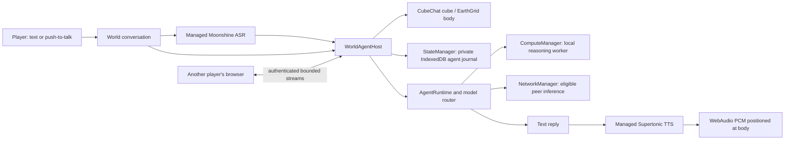

# Conversational inhabitants in CubeChat and EarthGrid

## Future TODO: generated 3D objects and avatars

Requested November 10, 2026; planning only, not implemented or runtime-qualified.
Add [Tencent Hunyuan3D-2.1](https://huggingface.co/tencent/Hunyuan3D-2.1)
as a target for CubeChat's reusable Homunculus appearance/body pipeline:

- [ ] Generate a mesh from an uploaded image or a reference image produced from
  the user's/resident's appearance description; add optional PBR texturing.
  Route generation to a capable local or peer provider with progress/cancel.
- [ ] Package geometry and materials as a bounded glTF/GLB artifact; retain it
  by CID in the artifact store and share it over the PeerCompute/IPFS network.
- [ ] Preview and place the generated object directly in CubeChat, with other
  players fetching the same artifact and seeing its authoritative world pose.
- [ ] Offer an explicit “Use as avatar” action for players and owned residents.
  Initially replace the visual mesh while preserving the existing body, motor,
  collisions, identity, nameplate and chat target. Keep the cube as a fallback.
- [ ] Later qualify rigging, animation/retargeting and physical body changes;
  a generated mesh alone does not supply a controllable articulated character.

Runtime investigation is a prerequisite. The [upstream implementation](https://github.com/Tencent-Hunyuan/Hunyuan3D-2.1)
uses Python/PyTorch with CUDA installation instructions and custom rendering
components; it reports 10 GB VRAM for shape, 21 GB for texture, and 29 GB combined.
These are upstream requirements, not browser measurements. Evaluate a native GPU
peer adapter first and investigate WebGPU conversion separately; neither exists
in the current model router. Check the pinned model/code license before packaging.
Extend reusable generation routing, artifact loading and world presentation rather
than putting model-specific execution into CubeChat UI. This builds on the
[Homunculus body design](../humunculus/humunculus.html#body).

Acceptance when implemented: two peers see the same generated object/avatar;
reload restores its CID without regeneration; replacement preserves movement,
collision and conversation; cancellation/provider loss and invalid or oversized
assets leave the previous body intact. Measure actual generation memory/time
and mobile rendering cost separately. No implementation or deploy in this note.

## Existing implementation

November 6, 2026. Conversational inhabitant slice implemented and qualified on
`feature/ipfs-artifacts-webgpu`. This corrects the previous integration: a shared
model console alone does not make an agent inhabit a world.

Run `npm run test:world-agents` for the combined contracts, protocol, scene, UI
and managed-speech lifecycle checks. `npm run test:world-speech:browser` is the
explicit hardware gate and requires the external verified source cache described
in the harness. Internal preview builds are separate from public GitHub Pages.

An agent has a selectable, named body in the scene. Players open its conversation
by selecting that body, type a message or explicitly record a short utterance,
and receive text and optionally positional speech. Closing the conversation
leaves the body, identity, memory and loaded models alive. Leaving a room or
destroying the world awaits the host's complete shutdown.

## CubeChat native social pass — November 7

CubeChat now supplies its own world presentation through WorldAgentHost.uiFactory:
one Room/resident composer and one Residents roster. Human text is broadcast only
through RoomChatService's authenticated, same-room live streams; direct agent
conversations retain the existing private visitor channels. SpeechBubbleLayer
presents typed human text above the sender's rendered body. Models uses the
optional managementOnly console mode, with no second composer or startup download.

Cube opts into WorldEmbodimentLease, separate from agent request locks, so a saved
identity is restored by one same-origin tab at a time. The body adapter exposes
live pose without updating the identity journal each frame. Its replaceable
WorldResidentMotion policy supports grounded roaming/follow/stationary control;
remote bodies interpolate owner directory samples with one sample of lag.
Earth retains its existing UI and stationary adapter defaults. The reusable
components are foundations for homunculus observation/action policies, not neural
movement, agent migration, autonomous training or shared private histories.

Acceptance is tracked in the CubeChat plan and plan/log.md; protocol fixture
proof, native input/body tests, and actual multi-browser preview checks are
separate evidence categories.

## Ownership and persistence

- One general agent can have up to eight world bindings, containing world ID,
  position, color and an explicit sharing preference. The identity and journal
  remain in the existing private AgentRecordStore, outside shared GIS/Yjs data.
- CubeChat uses its room's existing network for world conversations and its
  StateManager for private storage. Its model runtime owns a separate global
  model connection, so standalone model hosts remain discoverable across game
  rooms without weakening conversation scope checks. Its agent bodies
  have separate Three.js objects and kinematic Cannon collision bodies; they are
  not fake human peers or video participants.
- EarthGrid uses a separate, lazy Cesium data source for georeferenced bodies.
  Its private GIS StateManager remains network-disabled; the agent model runtime
  connects its own network manager to the configured backend.
- Removing a body removes its binding, not the agent's identity or memory.
  Full agent administration remains available in the dedicated model/agent demo.
- The model console borrows the scene-owned runtime. A closed console must not
  unload a body’s active model or terminate another visitor's request.

## Conversations between peers

The fixed `/peercompute/world-agents/1.0.0` protocol advertises only bounded public
body descriptors and accepts bounded text requests. Its owner comes from the
encrypted libp2p connection, never a caller-supplied identity. Requests must match
the application game/room/topology and world. Only shared bodies accept visitors.
Discovery polls known peers every five seconds and expires stale bodies.

The owning host derives a conversation channel from the world and authenticated
requester. The owner's channel uses a stable local identity. Private model-console
history and other visitors' turns are excluded from that context. This is not a
portable login: a visitor whose network peer identity changes gets a new channel.
Replies and captions are directed to the requester, not broadcast to the world.

Per-peer/global concurrency, prompt/reply byte limits, deadlines and replay
suppression bound work. Disconnect, cancellation and world shutdown abort the
request and await acknowledged inference cleanup. A committed request is never
silently retried after an uncertain outcome. Interrupted agents require explicit
Resume; no prompt is replayed.

## Managed speech and budgets

Voice is explicitly enabled before downloading approximately 376 MB of pinned
Moonshine Tiny and Supertonic FP32 packages. Both use the trusted
`transformers-speech` runtime inside ComputeManager workers. No browser cloud
speech API or unmanaged inference worker is substituted. Source files use the
same content verification and ArtifactStore retention system as other models.

The scene's dedicated model ComputeManager admits up to three residents:
reasoning, transcription and synthesis. They share the existing 12 GiB CPU /
16 GiB GPU admission envelopes; three slots do not triple the memory budget.
Speech packages hold artifact-use leases until acknowledged unload. Stored-model
deletion first unloads any matching auxiliary service and fails safely if cleanup
cannot finish.

Microphone capture requires a user action, produces at most 20 seconds of mono
16 kHz PCM, and releases tracks on stop/cancel/leave. Transcription is local;
only recognized text goes to a remote agent/model. Replies are synthesized locally
into real PCM and played using the selected body's audio pose. Longer replies
are split into bounded sentences without silently truncating text.

### November 7 voice follow-up

The user's CubeChat report exposed an incorrect generic “Unsupported model
runtime” label on loaded speech packages. Their runtime is an auxiliary service,
not a main chat model. Stored Models must recognize the exact pinned packages,
show their 1GiB RAM/GPU reservations and direct loading through Enable voice.
FP32 speech does not require shader-f16; unknown or modified packages remain
unsupported.

Capture, pending microphone permission and transcription are conversation work:
typed Send and Models must not overlap them or hide an active recorder. Cancel
must retain ownership through cleanup. If a speech package is unloaded/deleted,
resynchronize the checkbox and show an explicit recovery message; reloading is
the user's Enable voice action. Do not silently omit a requested spoken reply.
CubeChat acoustic distance uses the player's body, with camera orientation for
spatial direction. Orbit-camera zoom must not move the listener away from the
player. EarthGrid has no separate player avatar and retains its camera listener.

Native Talk/Stop with real cached managed reasoning/ASR/TTS reproduced successful
capture, transcription, generated PCM and playback before these corrections.
This does not establish the cause of every reported failure. Controlled native
UI/host tests reproduce overlapping-operation and stale-readiness bugs; actual
audio measurements establish camera-distance attenuation. Keep those evidence
categories separate from human listening and the user's unresolved exact path.

## Acceptance gates

1. Unit/browser contracts: durable bindings, private visitor history, authenticated
   directory/request scope, cancellation and acknowledged teardown.
2. Real scene bodies: desktop/mobile picking, captions, bounded body collisions, Earth
   geodetic placement, audio pose and disposal, with existing input/GIS regressions.
3. Real hardware speech: transcription of a recorded fixture; synthesis with GPU
   dispatch and PCM evidence; cancellation, zero leases after unload, source-off
   restart. Simulated UI fixtures do not satisfy this gate.
4. Integrated worlds: actual managed reasoning, typed/spoken conversation, close
   and reload persistence, owner/visitor interaction and no private history leak.
5. Production builds and owned headless visual/console checks on exact internal
   HTTPS previews, including the configured SecretWorkshop connection.

Learned movement/navigation, autonomous training, self-editing meshes, multi-peer
agent migration, learned model ranking and automatic host provisioning remain
later work. CubeChat now has bounded heuristic movement; Earth remains stationary.
Neither agent's text may claim an unexecuted movement or world action.

## Existing bot movement survey — November 6 follow-up

The user requested review of existing bots for movement and behavior. The
reusable foundation is `demos/shared/peercomputeBots.js`,
`demos/shared/peercomputeBotBridge.js`, the CubeChat `snapshot/applyAction/clearAction`
bridge, and `net-chaos-lab/agent/quake3/bot-core.mjs`. The current policy ticks at 120 ms
and uses deterministic objective/combat/pickup/roam scoring, seeded jitter,
strafe/jump/unstick logic and short-lived navigation memory. It has no learned
weights, optimizer or neural policy.

Do not reuse the current bridge unchanged: CubeChat applies its actions to the
human controller, and the bot host launches additional complete iframe peers.
Instead, implement a separately owned dynamic-body motor using the action
vocabulary `{forward, strafe, rotation, pitch, jump}`, preserving analog values.
Reuse existing physics force/jump and observation math without editing user keys.
Pause, stale policy output, room changes and authority loss must zero actions.

The November 7 pass adds grounded motion and five-second remote interpolation.
Responsive learned movement still requires more than that directory transport:
add authenticated sequence/heading/velocity updates, remote interpolation and
low-rate durable checkpoints. Run policy evaluation at a bounded rate through
ComputeManager. The existing heuristic can be an explicitly labeled baseline or
teacher for a later small learned controller, not evidence of learned behavior.

EarthGrid has no existing bot bridge. Convert longitude/latitude to a local ENU
frame in metres, with terrain/slope/collision checks, before applying Cartesian
navigation. CubeChat's current bot snapshot supplies no navigation points,
hazards or occlusion; this is not an existing navmesh solution. Extend the
Quake bot/core behavior tests with per-body control isolation, collision/stuck
behavior, pause/stale-authority rejection, seeded baseline comparisons and Earth
terrain/geographic-unit checks. This follow-up records reuse findings; movement
is not part of the completed conversational-body claims.

## Agent-to-agent dialogue — capability boundary

The user asked whether agents can talk to each other. This slice supports players
addressing agents; it does not initiate conversations on behalf of an agent.
A later `speakToAgent` action can reuse the private stream transport after adding
a validated originating-agent identity bound to its owning host. Peer identity
alone cannot distinguish several agents on the same host. Keep per-dialogue
memory, explicit recipient policy and turn/time/token budgets, with duplicate
and loop suppression. Do not route a model-generated action automatically until
that executor and its tests exist.

## Qualification results and preview

- `npm run test:world-agents`:70/70 pass. Existing console/library/native
  IndexedDB regression slice:79/79 pass. Speech/model/worker affected slice:
  96/96 pass; additional core identity/router/runtime checks:37/37 pass.
  These overlapping suites are separate receipts, not summed as unique tests.
- Actual shared host, CubeAgentLayer and UI in independent browser processes:
  real Gemma GPU replies, owner/two-visitor isolation, authenticated addresses,
  active cancellation/disconnect and zero resource leases after unload pass.
  Three simultaneous residents (Gemma/Moonshine/Supertonic) produce a real
  reasoning→TTS→positional PCM reply. Recorded-fixture ASR, synthesized-text
  roundtrip, source-disabled restart and actual microphone lifecycle pass.
- Actual complete CubeChat/Earth production scenes separately pass native
  picking, body persistence, desktop/mobile screenshots and SecretWorkshop
  connection. Exact trusted internal previews:
  [CubeChat](https://fastbox.tail5c077c.ts.net:5176/) and
  [EarthGrid](https://fastbox.tail5c077c.ts.net:5187/).
- Limits retained: Gemma270M sometimes repeats text or ignores a brief-output
  instruction; transport success is not a quality benchmark. Direct native
  libp2p upgrade timed out in the isolated fixture despite connected ICE;
  owner conversations succeeded through encrypted relay. The full-world visual
  gate uses software rendering and no models; actual model/voice gates use the
  shared host/body fixture. Earth local geodata backend is unconfigured. No
  automatic movement, agent-initiated dialogue, migration or learned policy is
  implied by these results. Public GitHub Pages remains unchanged.

## Cube resident appearance and public response layer — November 7 2026

`WorldAppearance` uses the existing agent inference adapter/router and durable
image attachments. The world binding stores private appearance text and the
acknowledged image attachment reference; `normalizePublicAgent` exposes only
bounded face dimensions/hash. `AgentConversationService` verifies the current
shared binding and authenticated same-world requester before credited pixel
transfer. `WorldAppearancePresenter` owns bounded reads, shape/hash caching and
stale-result suppression; the Cube adapter alone owns Three.js front textures.
This separates identity, inference, persistence, transport and presentation so
other homunculus bodies can reuse the same attachment and appearance contracts.
No image provider means saved description plus explicit retry, not auto-loading
weights or preventing a resident from existing. Reload reads the saved image.

`WorldChatResponder` consumes authenticated public human messages, chooses only
local opted-in residents and serializes responses with bounded context/dedup/
cooldown/latest-message coalescing. `WorldAgentHost` routes a public turn under a
separate conversation ID; direct visitor histories are excluded. Existing shared
identity/goals and explicitly saved agent context still apply. Output carries
agentId under the room sender's authenticated owner identity. Resident messages
are displayed but do not trigger another response. Opt-out cancels and awaits
cleanup; provider absence does not persist a failed turn. This is bounded social
interaction infrastructure, not learned dialogue initiation or motor training.

Cube model management borrows the world's runtime through a single owned dialog.
Config/setup/loading replace that dialog's content, preserve library state and
never create a second composer. Closing awaits panel cleanup before releasing
world input; failed cleanup remains owned and retryable. Other embeddings retain
their existing lifecycle unless they explicitly opt into panel-owned windows.

## November 8 — current public dialogue follow-up

The earlier resident-message exclusion is replaced with bounded replies to
authenticated resident speakers. Each human world-chat message opens a short
discussion window; participating local residents can answer once and follow up
once, with their existing cooldown. Resident messages cannot renew the budget.
Context is taken at dispatch and contains current public turns, the world
adapter's observations and a bounded roster. Direct conversations stay isolated.
This addresses stale public snapshots and permits resident exchanges without
introducing an idle autonomous loop or changing the RoomChat v1 wire format.
Actual user-reported model repetition remains a separate observational limit
until reproduced; deterministic tests qualify context, not semantic diversity.

Implementation and integration checks pass:148standardworld-agent cases plus
separate core/transport/social regressions, and two isolated real browser peers.
Newer human messages and expired social turns suppress obsolete output after
inference settles; they do not abort the managed agent and leave it paused.
Provider preflight rechecks ownership; directory races retain a bounded message
for15seconds and admit it only after owner verification. CubeChat's internal
preview is updated, while GitHub Pages remains on hold.

## November 9 — private persistent world objectives

The next CubeChat increment composes existing agents, model routing and learned
movement through a private `WorldGoalStore` owned by StateManager.
`WorldGoalController` checkpoints a bounded planning request before inference,
then a validated action before dispatch. `WorldExperience` correlates physical
outcomes to the exact action; the next decision reads fresh observations and
saved receipts. `WorldGoalDecision` uses managed local-first inference and the
resident's local-only/network-assisted policy. `ResidentGoalControls` presents
owner Start/Pause/Resume/Cancel and distinguishes physical results from model
completion assessments. The host injects body ownership, scheduling, observation
and action adapters rather than embedding Cube geometry in the controller.

The initial action vocabulary is approach, look-at and stop. Human chat preempts
planning; manual movement takes over the body. Limits persist across Resume:
eight decisions and ten minutes, with a pause after three consecutive failures.
Reload adopts only owned bodies and pauses interrupted work without replay.
Durable objective records stay local; a selected network-assisted inference host
receives the planning prompt, while local-only policy prevents peer inference.
Shared profiles and memory permissions do not authorize transferring an active
job or its execution authority. This is a
bounded model-directed task loop, not open-ended self-training or a semantic
proof that an arbitrary objective has been achieved. Actual-model qualification
is separate from simulated controller tests.

Persistent-objective implementation is experimental. Private CAS checkpoints,
finite model-selected actions, physical receipts and owner controls are in place.
Prompt-local participant/receipt references resolve back to exact durable IDs;
this removes repeated network-identity token overhead without choosing a plan.
Missing encrypted inference links now use existing bounded manager relay recovery.
Live Qwen2B selected real approaches, but repeated the first destination in the
ordered visit/return task. Eight actual requests fit the context and the step cap
stopped the loop. Multi-step quality remains an open acceptance gate; do not mark
this broader objective complete or encode the test itinerary as a fixed behavior.
Next: evaluate reliable model-produced plans on varied multi-step tasks, keeping
this failed fixture and distinguishing model/export/runtime quality from delivery.
