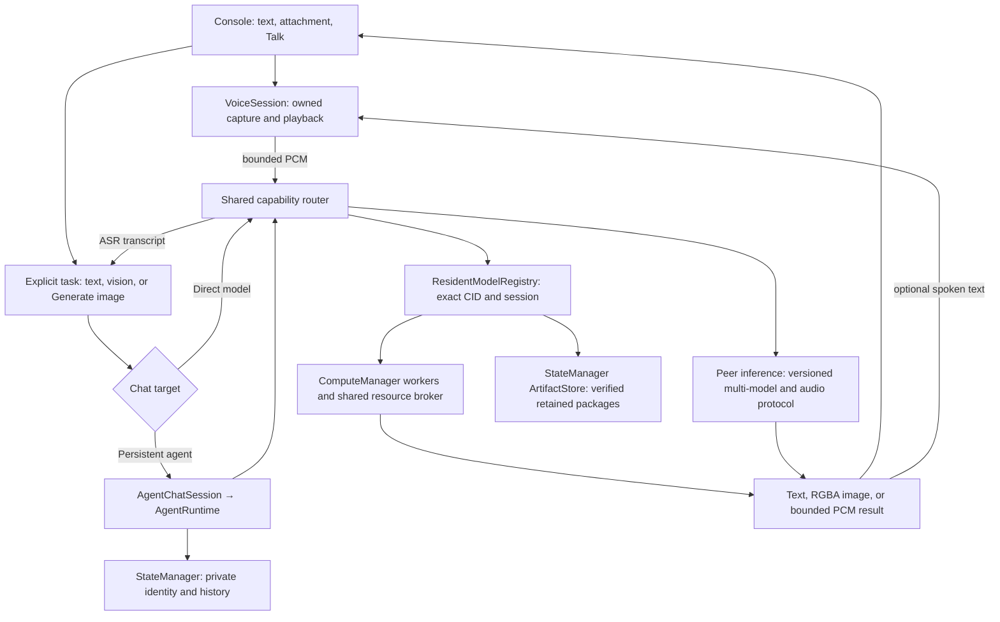

# Multimodal resident model console

## Purpose and Humunculus relationship

The console is a reusable specialist execution surface: several independently
managed models can stay loaded, and a task router selects a capable local or
peer provider. Speech, vision, language and image generation share resource
admission, artifact identity, cancellation and route evidence. This is a step
toward the specialist workspace in [Humunculus](../humunculus/humunculus.pdf),
not a claim of learned motor behavior or a trained routing policy.

Agent identity and memory remain separate from the model provider. The same
resident registry and capability policy are available to the console and the
agent adapter. A future learned ranker can choose among eligible candidates;
it cannot bypass task compatibility, locality policy or resource limits.

## User behavior

- **Load** adds a resident model. Loading another model never silently unloads
  existing models. Stored Models distinguishes saved files from loaded workers,
  provides per-model Unload, and retains Verify locally and Delete.
- **Mixed** is the default. A ready, capable local model with bounded queue
  capacity takes precedence; otherwise a capable peer host is selected.
  Local only prohibits remote dispatch. Explicit model targets remain available.
  The actual selected model/provider is shown with the response.
  An open connection that cannot create an inference stream gets bounded
  same-peer relay recovery before any prompt is sent. Existing streams stay
  untouched, and a request already sent to a model is never replayed automatically.
- An attachment selects image understanding. **Generate image** explicitly
  selects text-to-image; unsupported attachment combinations are explained.
  Image generation is not guessed from a sentence or mixed with chat history.
  A remote vision model enables attachments even when this device cannot run it.
  Full queues keep attachments/drafts available but disable Send until capacity
  returns. Local only and explicit model selections retain their restrictions.
- **Talk** explicitly opens the microphone; **Stop recording** ends the utterance
  and routes ASR, then the conversation task. **Speak replies** routes short TTS
  chunks and plays them sequentially. Voice is usable through loaded local or
  hosted peer specialists. These controls do not silently download speech models.
- Explicit local model selection keeps speech stages local-only. A specific
  remote conversational model uses mixed speech routing because that model need
  not support audio. Explicit locality modes apply to every speech stage.

## Ownership and contracts

Each resident binds an immutable manifest CID to a managed service, session ID,
runtime options, descriptor, artifact-use lease and queue state. One service
retains one worker/session. Multiple models using the same backend remain
independent. A selected-model compatibility accessor must not determine which
service receives cancellation after a request has already started.

Aggregate CPU/GPU estimates remain tracked. Explicit combined limits are enforced
atomically, including a caller's stricter cap on a borrowed broker. Owned-console
Auto imposes no application byte cap; it does not claim automatic hardware fit.
An injected manager's existing limits remain authoritative. Lowering a cap keeps
current/cleanup-pending reservations and rejects additional loads until policy
permits them. Additional worker slots do not prove hardware fit. Admission failure
leaves existing residents usable; unload/delete affects only the selected model.
Startup reuses the remembered compatible conversational model and preserves
pending retained-package recovery. It does not automatically reload every saved
model or make a speech model the default conversation model.

The task contract covers text-generation, image-text-to-text, text-to-image,
automatic-speech-recognition and text-to-speech. It retains exact model/session
identity, request ID, cancellation signal and progress. Route evidence names
the actual provider; a deterministic baseline is not model-quality ranking.
No automatic fallback replays a request after execution has committed or emitted
partial output. Disconnects cannot prove that a remote worker finished cleanup.

Peer hosting advertises bounded per-model capabilities, busy/idle state and
queue capacity. New protocol support carries bounded mono Float32 PCM with
validated dimensions/sample rate, finite samples, chunk credits and digests.
Legacy v2 peers remain usable for their existing text/vision/image tasks, but
are never advertised as audio hosts. Current speech adapter limits remain
16 kHz/20 seconds for input and 256 codepoints per TTS chunk, with bounded output.
Audio and prompts travel over encrypted inference streams; they do not enter
the shared artifact catalog or replicated world state.

VoiceSession owns no model residency. One caller turn signal spans capture,
ASR, language/vision generation and optional playback. Cancellation stops owned
tracks/nodes and waits for cleanup; a late microphone grant is closed. World
speech reuses the same registry where present, while older injected runtimes
keep a compatibility path. Shared speech chunking prevents response truncation.

## Implementation and acceptance

1. Registry/runtime/controller: additive same-backend residents, per-CID loading,
   dispatch, unload, deletion, resource rejection and artifact-use ownership.
2. Shared router/agent adapter and interoperable multi-host/audio protocol:
   local-first capability policy, bounded request/result validation, backpressure,
   cancellation and no replay after commitment.
3. Console controls: default Mixed, explicit image intent, per-model unload,
   useful route labels and native microphone/speech controls.
4. Shared VoiceSession and world-speech registry integration: cancellation and
   cleanup across the entire voice turn without duplicate model loads.
5. Acceptance: focused unit/native UI tests, private two-peer synthetic audio
   transport, actual managed-model checks when resources permit, all affected
   production builds and exact internal HTTPS desktop/mobile/SecretWorkshop
   checks. Preserve the user's active27B session and cached data throughout.

Implementation results, failed experiments and remaining limits are recorded in
[the repository log](../../log.md). Learned selection, motor policies, training,
cloning and migration retain their separate Humunculus/agent-layer gates.

November7 acceptance passes with Gemma270M, SmolVLM256M, Moonshine Tiny and
Supertonic on four independent ComputeManager GPU workers. Mixed selects Gemma
for text and SmolVLM for an image; a separate browser with no local residents
uses real peer ASR, text and TTS, including native microphone controls and
completed playback. Unloading vision preserves the other three residents;
final cleanup releases every CPU/GPU lease. The test uses owned profiles and
separate browsers on one machine, not two physical devices. No27B or diffusion
hardware rerun is claimed for this change. Exact internal console and world
previews pass desktop/mobile and SecretWorkshop connection checks.

## One conversation surface — November 7

The main Chat target menu includes saved agents alongside Mixed, Local only and
explicit model choices. The Agents modal manages identity, instructions, goals,
summary, policy, export/import and deletion. Its Chat button selects that identity
in the main composer; it neither executes work nor resumes a paused agent. New
agents use Network assisted/Mixed, while saved policies and import-as-new's
paused local-only policy are preserved. Resume agent remains explicit.

`agents/agentChatSession.js` adapts the existing controller rather than owning a
second runtime. Direct model turns retain their transient model histories; agent
turns always pass through AgentRuntime's identity/context and acknowledged
request/result checkpoints. Selecting an agent restores bounded private history
(up to 300 inspected events, 24 visible entries, six image previews), excluding
world visitor channels. No agent data is merged into a direct model history.
Switching targets aborts stale reads; failed reads show an error rather than
substituting another identity. Clear conversation is unavailable for agents
because clearing a transcript would not erase persistent memory.

The agent identity is fixed for each complete turn. The selector stays locked
through capture, ASR, agent execution, TTS, cancellation and history refresh.
VoiceSession receives only local-only or mixed speech policies, with the saved
agent policy re-read before every ASR/TTS dispatch. Tightening policy during a
turn blocks subsequent remote stages. Agent cancellation waits for its own
runtime cleanup; disposing the UI aborts its reads and does not take ownership of
unrelated agents or shared model workers.

Controlled native browser acceptance covers history/reload/channel isolation,
image previews, voice policy, failed saves, explicit Resume, cancellation and
late reads. Separate actual GPU acceptance uses Gemma270M, Moonshine Tiny and
Supertonic on a private peer, native Talk/Stop, durable agent request/result and
completed speech playback in the same main composer. It uses two owned browser
contexts on one machine; model output quality and physical-device networking
are not established by that check.

Unified UI acceptance: agent/store/bridge60 tests, console/voice/unified97 tests
and world-agent85 tests pass. All three affected production builds and final
exact internal TLS desktop/mobile/SecretWorkshop checks pass. Native model-load
focus restoration and post-deletion cleanup were included in the final regressions.
The earlier external Earth tile-network failure and generic ICC deletion-size
failure remain in the log; neither was hidden by modifying an acceptance rule.

### November 7 residency and peer recovery qualification

The standalone default now accounts for estimated residency without imposing the
old12GiB CPU/16GiB GPU ceiling. Explicit Config budgets constrain combined
reservations; borrowed manager limits remain authoritative. Actual GPU errors
invalidate the managed session and retain resource ownership until cleanup is
acknowledged, including an error racing with cancellation. Browser memory hints
and estimates do not establish actual free VRAM.

Validated peer directories and completed results survive stream-close errors.
Expired explicit targets refresh the same CID, and Mixed can use a fresh cached
provider immediately. Image-input capability remains available while a queue is
full, with Send using the execution router's shared capacity predicate.

A stalled open WebRTC connection now permits a bounded fresh authenticated relay
path before any application header. Both endpoints protect negotiation and active
inference through bounded connection holds; existing active links remain intact.
An accepted request is never replayed. Manager policy constrains trusted routes,
capacity, coalescing, deadlines, cooldown, cancellation and shutdown ownership.

Validation:166peer,104inference,101native UI/voice and85world aggregate tests pass;
67manager/network tests and49private protocol tests are overlapping focused
evidence. Actual cached Gemma verifies managed native WebGPU binding and healthy
cancellation. Actual SmolVLM256 verifies Mixed/exact-peer red/blue image transfer
and correct GPU replies from a requester without WebGPU. A separate controlled
stalled-direct-link test recovers over Noise and executes exactly once, preserving
the old connection and both-end relay holds. Final leases and owned cleanup are
zero; no model downloads or public inference requests were used.

Three production builds and exact5189/5176/5187 TLS, desktop/mobile and
SecretWorkshop/noise checks pass. The Config gate reserves two8GiB accounting
records per resource; it proves admission/UI behavior, not physical co-residency.
A fresh two-client production discovery run receives the live hosted models and
mutual v3 directories, retaining transient startup errors as evidence. Concurrent
DreamShaper plus Qwen2B physical allocation remains unqualified. Detailed receipts
and corrected fixture failures are recorded in plan/log.md.
