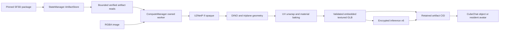

# Stable Fast 3D in PeerCompute

Authorized and qualified November 11, 2026 on a 16 GiB NVIDIA RTX 5060 Ti in
Chrome. Catalog status is tested for the scope below; other devices remain
unqualified. Internal preview only; no public deployment is included.

## Architecture

The adapter uses the complete `lyonsno/sf3d-webgpu` pipeline, pinned at
`86b7b68109434ffc33218f5fb697c7057c2518f9`, with WebGPU inference kit 0.1.60.
Weights come from `BasinShapers/sf3d-webgpu-weights` revision
`53cfd8926e0abe77443b97d8684da1ea36bc4af7`; the two tetrahedral arrays are
SHA-matched mirrors from `needle-tools/SF3D-webgpu` revision
`56d2f58d27395b0be9c633671b439b4aac482549`. All files and foreground weights
have fixed sizes and SHA-256 identities. Downloads use the normal retained
artifact import flow. No weights or grids are committed to Git.

The worker reads at most 4 MiB across the artifact bridge at a time. It uploads
eager weights directly instead of retaining another full checkpoint copy. The
stored weights use FP16; GPU calculations use FP32 and do not require
`shader-f16`. The 8 GiB RAM/GPU figures are planning estimates, not proof that
every such device can run it. Qualification uses a 16 GiB NVIDIA GPU. The package is about
2.18 GiB; GPU weights and intermediates require more memory than download size.

The runtime owns its device and runs all stages inside its ComputeManager
worker. Shader text is bundled. Direct URL weight/grid fetches and subordinate
worker paths are removed. Cancellation retires an interrupted session and
ComputeManager terminates its worker before releasing resources. Load the
retained model again to retry; the controller acknowledges that model's stale
registry entry before creating a clean session. Failed cleanup stays quarantined.

Buffer lifetime fixes enable upstream intermediate retirement and preserve live
pipeline, Map/Set and module-private shader caches across requests. ORT owns its
foreground allocations separately. No WGSL mathematical kernels change.

## Output and compatibility

The shared mesh validator admits bounded embedded PNG/JPEG textures, UVs,
tangents, base color and normal maps. Existing 16 MiB, 100,000-vertex and
150,000-triangle limits remain. Texture limits are 2,048 pixels per dimension,
8 MiB per compressed image and 8 million aggregate decoded pixels. External
URLs, extensions, animated/skinned geometry and malformed references fail
before the renderer. Three decodes checked blobs directly, with no texture URL
access; disposal closes decoded bitmaps and frees textures and geometry.

Inference protocol v6 carries textured meshes. Version 5 retains its previous
vertex-colored TripoSR profile and native audio/image capabilities. SF3D is
omitted from older directories and cannot silently downgrade execution. World
artifact descriptors remain unchanged; old viewers reject an unsupported asset
individually rather than losing the rest of the room.

The existing capability router can select this image-to-3D provider locally or
on a peer. Text-to-3D still needs an image generator first. Objects and avatars
reuse retained CIDs, semantic world scale and owner authorization. Output is a
static cosmetic mesh: no rigging, animation or new collision/vehicle behavior.

## Acceptance

- Pinned admission, multi-source downloads, bounded reads, device cancellation
  and output validation tests.
- Real hardware generation through the managed worker and ArtifactStore;
  measured dispatches and inspection of its textured output.
- Source-disabled retained reload, cancellation/recovery and zero leases after
  unload.
- A separate GPU-disabled peer receives and validates real v6 mesh output.
- Two CubeChat clients render the generated prop/avatar from its retained CID;
  peer fetch and owner reload preserve appearance and size.
- Build and verify exact internal HTTPS previews. No Pages deploy or push is
  included in this request.

Native receipts, failures and screenshots live outside the repository in
`/home/cos/.cache/peercompute-sf3d-20261111/`:

- Run3 produces a textured chair from a cutout image in 83.07 seconds.
- Run7 produces the same opaque-input GLB locally and through encrypted v6 peer
  inference in 84.75/82.58 seconds, then cancels a peer request with zero resource
  leases. Its final reload fails because that page predates the controller fix;
  the failed report is preserved.
- Run8 passes fresh-page cancellation, stored reload, peer generation, browser
  restart and regeneration with source fetches disabled. All opaque outputs
  match SHA-256 `1c54a025f2278d64260d8f48c9a02f93a65b068c40687ca9f0b988250d32806c`:
  59,160 vertices, 19,720 triangles, 2,469,812 bytes. Restarted generation takes
  84.53 seconds with 9,391 GPU dispatches. Unload leaves zero resource leases.
- `native-textures-3` renders the actual generated cutout mesh as an owned prop
  and resident avatar on two CubeChat clients; exact CID, texture appearance and
  scale survive both reloads. Two earlier directory-timeout failures remain
  recorded. The successful initial discovery included bounded diagnostic queries
  on existing encrypted connections; reloads did not. This does not establish
  general discovery reliability or a new LLM-to-image-to-mesh chain benchmark.
- The final focused regression suite passes 340 tests. All 18 WGSL kernels
  retain their upstream hashes. Requested SF3D buffer peak is about 5.4 GiB for
  the tested image; it excludes ORT buffers, driver overhead and physical VRAM.

These measurements are example workloads, not cross-device performance claims.

Internal inference, CubeChat and Earth production builds pass. Their HTTPS
indexes and entry assets match the promoted build hashes. Desktop/mobile catalog
visual checks and the inference preview's authenticated SecretWorkshop Noise
connection pass without browser errors or model downloads. Existing assets are
retained for open tabs; reload to obtain the new runtime/protocol.

Powered by Stability AI. Preserve the original Stability Community license,
source attribution and derivative notices. The inference-kit dependency has its
own MIT/BSD notices, included in catalog attribution. The initial 0.1.53 port
dependency declared UNLICENSED; integration now pins the licensed 0.1.60 release.

### Resident facing correction (November 11)

SF3D's camera-facing surface uses -Z, while CubeChat body-forward is +Z. The
resident adapter opts into `GeneratedMeshView` forward alignment, which adds a
cosmetic half-turn only when the validated GLB identifies `SF3D-WebGPU`. This
covers owned and remote avatars, including retained assets after reload. Generic
placed objects, TripoSR and unknown generators keep their original orientation.
Artifact bytes/CIDs, size, physics heading, motor state and identity are unchanged.

38 focused movement/rendering tests pass, including four cardinal headings,
remote interpolation, look-at, picking, grounding, labels and reset. Software
WebGL verifies asymmetric front/back pixels. An isolated Three render of the
actual retained SF3D chair shows the corrected front in the forward direction:
`/home/cos/.cache/peercompute-avatar-orientation-20261111/`. Root and an independent
reviewer inspected the screenshot. This is rendering evidence, not a new GPU
inference benchmark or live-network navigation qualification.
