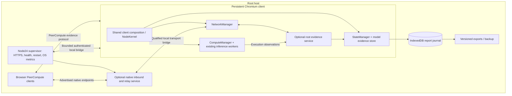

# Root node: client parity and model evidence

Status: experimental browser host plus automatic client model-evidence integration
implemented November14–15,2026. Real managed WebGPU collection, signed encrypted
upload, package lookup and persistent root restart are qualified. SecretWorkshop now serves the registry over its public WSS circuit.
Broader hosted-model parity remains open. See [host setup and boundaries](../root-node/README.md).
This updates the runtime choice and first slice in [the June root plan](root-node-todo.md).

## November15 collection and registry deployment checkpoint

November15 model-information integration: StateManager now owns bounded evidence
journals; the shared inference facade records HF inspections and actual executor
load/generation/device-loss results. Optional sharing defaults off. Signed outbox
records survive client identity changes, and model details query local/root
observations without overriding admission. Compatibility uses source/runtime/
policy fingerprints and coarse device/workload facts. Requested GPU-buffer peaks,
WASM sizes and planning estimates are separately labeled; physical VRAM is not
claimed measured. Real HF inspection, SmolVLM WebGPU execution, WSS/Noise upload,
catalog lookup and root restart pass. Minimal registry deployment packaging is
prepared; SecretWorkshop installation remains pending working SSH access.
No GitHub Pages publication or production relay/TURN change is included.

- Ordinary clients remain ephemeral. Reports are signed with the executing
  application's key before durable retention; the public proof remains usable
  after that peer disappears. A later uploader cannot rewrite the executor.
- Source file selection at an immutable HF revision is distinct from whole-file
  package fingerprints. This bridges verified Git-blob metadata to downloaded
  SHA-256 files without conflating quantization variants or changing artifact CIDs.
- Code/locked runtime build inputs, inspector and admission-policy hashes make
  old reports historical after relevant changes. UI-only changes do not veto
  compatibility. A successful inspection is never a successful execution claim.
- Registry-only deployment uses system Chromium (sandbox enabled), a small
  Node24/Playwright supervisor, existing production WSS relay and an expiring
  public descriptor. No second browser download or Bun runtime is required.
- Missing evidence: actual SecretWorkshop service installation/restart and
  independent-device discovery; public host SSH authentication was rejected.
  Existing relay/TURN services and all user previews were preserved.

## November14 implementation checkpoint

- `root-node/host` supervises persistent Chromium, owns a stable loopback origin,
  exclusive external profile, finite browser recovery and native companion.
- `root-node/browser` composes real client managers, privately persists the
  application identity in acknowledged IndexedDB and provides a fixed WGSL task.
  Optional key/provider injection leaves ordinary clients ephemeral.
- `peercompute/src/host/native` provides WS/WSS, distinct persisted relay identity,
  hosted-only admission by default and finite opt-in third-party circuits.
  No production relay/coturn settings change.
- `peercompute/src/peercompute/modelEvidence` contains normalized immutable
  contracts, bounded IDB receipts/query/outbox, fail-soft collector and encrypted
  submit/query RPC. Actual reporter comes from the authenticated connection.
  Host composition currently owns persistence lifecycle; StateManager registry
  integration is deliberately deferred to avoid unrelated in-progress edits.
- Hardware NVIDIA WGSL through ComputeManager, encrypted browser relay delivery,
  two-browser evidence/replay, browser-exit recovery and full supervisor restart
  with both identities and committed data pass. No arbitrary model loading,
  power-loss test or independent-device NAT claim is made.
- Next: opt-in HF inspection and executing-host ModelInferenceService hooks,
  root discovery/configuration, offline outbox scheduling, current-versus-stale
  evidence in discovery UI, and real model/worker/artifact qualification on the
  installed host. No observations from normal demos upload automatically yet.

## Current direction: browser client host and optional supernode networking

The latest November14 discussion favors a headless browser after native storage
and runtime compatibility investigation. Prefer modern unified Chromium with a
small Node24 supervisor, reusing the existing toolchain. No new Bun dependency
is needed just to supervise Chrome. Use a dedicated root bootstrap that composes
the real NodeKernel/managers/services; do not automate the inference demo UI.
The native alternatives below remain researched options, not the current first
implementation path. The initial implementation follows this composition; it
does not yet supply authority/session policy or a desktop installer.

[Modern headless Chrome](https://developer.chrome.com/docs/automation-and-testing/headless)
shares the normal browser implementation. Use an explicitly selected browser
binary, dedicated persistent profile, stable secure origin and one profile
owner. Reuse IndexedDB, Web Locks, MessagePorts, workers, WebGPU and browser media
APIs, while qualifying target GPU/driver/flags and actual model execution.
Measure browser/process overhead; API parity does not establish identical
performance or hardware capability. Preserve the metadata-only root mode.

An installed **supernode** adds a separate connectivity capability: native
listeners that other peers can dial, and optionally a Circuit Relay v2 server.
A **root** provides scoped workload/policy/evidence services. One installation
can be either or both; connectivity grants no room or global authority.
Normal browser clients can already exchange direct WebRTC traffic after setup.
Supernodes add server listeners and relay capacity, not the first direct path.

Compose the installed host from a browser client and a native networking
companion behind a narrow service/transport boundary. The repo already has Go
and Node relay implementations; reuse their protocols and deployment lessons.
Current NetworkManager's native branch advertises TCP listen addresses without
installing TCP transport and does not enable a relay-server service, so it is
not already an installed supernode. [libp2p relay documentation](https://libp2p.github.io/js-libp2p/modules/_libp2p_circuit-relay-v2.html)
explicitly excludes relay-server operation inside a browser.

A separate Websockify process is unnecessary for this initial path: existing
Go and Node relay transports already accept WS/WSS. Websockify translates
WebSocket bytes to a TCP-only target; it does not implement libp2p discovery,
reservations or circuit routing. Consider it only for a later TCP-only service
integration. WSS certificate termination may live in the native companion or
an ordinary reverse proxy. See [Websockify's scope](https://github.com/novnc/websockify).

Browser-facing listeners require compatible transports such as trusted WSS;
WebRTC Direct is another qualification candidate, not the existing WebRTC
transport's automatic server mode. Public reachability depends on firewall/NAT,
address/port configuration and certificate setup; installation alone does not
escape CGNAT. Probe reachability and advertise only usable addresses, retaining
relay fallback. Circuit Relay and STUN/TURN serve different purposes; adding a
Circuit Relay does not supply a TURN server for CubeChat media.

Make inbound listening and helping relay others explicit, independent host
options, with connection/bandwidth/reservation budgets. Define which process
owns each application/artifact/relay peer identity and any signed association;
do not copy one active private identity into independently running peers.
First qualify the simpler bridge: the browser compute peer reserves through its
co-located native relay and advertises an ordinary circuit address containing
both relay and compute IDs. Remote peers reach the installation without the
central relay; the local hop is still relaying, not a claimed direct transport
to the browser. Preserve existing inference/artifact authentication and upgrade
to direct WebRTC where available. Sharing one logical network endpoint through
native IPC is a later NetworkManager adapter option. The initial bounded native
relay bridge is implemented and exercised by two independent browser profiles.
Current Go/Node relay configurations effectively disable normal circuit limits;
do not inherit those settings for opt-in community relaying.

Server packaging can use Node24 plus headless Chromium. An installed desktop
shell such as Electron is an option because it already separates native Node
and Chromium processes, but does not prove headless-server or WebGPU parity.
Share host services and browser client modules across packaging choices. First
prove host persistence/peer connectivity and the versioned model-evidence MVP;
then qualify direct browser-to-supernode connections, opt-in relaying and relay
failover across machines/networks. Keep existing bootstrap/relay fallback during
that rollout. Additional paths can inform throughput-based topology decisions;
supernodes do not prove the cellular-automata core conjecture.

## Earlier alternative: native Bun qualification first

The user's dependency-size objection changes the recommendation: qualify a
native Bun root before adopting Chromium as a production dependency. The
browser-host design below remains the compatibility fallback/reference.
Use the same managers, protocols and service contracts with platform adapters;
root-as-client does not require identical storage implementation or browser UI.
If literal IndexedDB API compatibility is required on the root, it remains
additional work; SQLite behind StateManager preserves the service contract,
not the entire IndexedDB API.

Bun can execute WebGPU through [bun-webgpu's Dawn FFI binding](https://github.com/kommander/bun-webgpu).
This is a native dependency, not built-in WebGPU or Chromium. The binding's
published conformance results include failures/skips; qualify our actual
operations and model engines. The [Dawn Node binding](https://github.com/dawn-gpu/node-webgpu)
is another candidate, subject to Bun native-addon compatibility testing.

Current [Bun 1.4 release notes](https://bun.sh/blog/bun-v1.4) document JSPI and
memory64, improving prospects for the existing GGUF WASM runtime. Its exact
shared-memory64 configuration, loader and GPU binding still need execution
tests. [Bun.Image](https://bun.com/docs/runtime/image) may cover native image
decoding/resizing/encoding. [Workers](https://bun.com/docs/runtime/workers)
remain experimental, particularly termination. These are qualification items,
not proof that all existing inference engines work unchanged.

| Native scope | Expected difficulty and acceptance |
| --- | --- |
| Evidence registry | Bounded service/storage work. Bun HTTP/WSS and built-in SQLite; browser IDB outbox. Reuse StateManager and shared schemas; prove durable restart and browser submissions. Native P2P still needs transport qualification. |
| General WebGPU compute | Moderate platform-adapter work: initialize native GPU inside a managed worker, execute actual WGSL, transfer results, cancel and release resources. |
| Existing ONNX/GGUF/media engines | Largest uncertainty: qualify engine asset loading, WASM features, GPU API coverage, ports, image/audio processing and cleanup per backend. Separate native-engine results from browser-engine evidence. |

StateManager already permits browser persistence to be disabled; the inference
demo uses that mode. A read-only lifecycle probe on installed Bun1.3.9 initialized
and destroyed the current StateManager successfully. That older local runtime
lacks built-in navigator.gpu, IndexedDB and JSPI; it is not evidence against
the newer1.4 release. The subsequent storage investigation below tests an
isolated Bun1.4.4 binary; no GPU binding was installed/tested.
Add durable persistence for the native registry; disabling IDB alone is
not persistence. Native WebGPU means one JS runtime plus a GPU library, not
zero native dependencies. Keep Node24/Vite tooling unchanged.

Revised order: registry plus small native worker/GPU feasibility spike, then
one actual ONNX and GGUF execution, then wider modality parity. Chromium is
optional qualification infrastructure unless native blockers justify it.

### IndexedDB investigation: actual Bun and PeerCompute probes

The isolated official Bun1.4.4 Linux binary has no `indexedDB`, `IDBFactory`,
`IDBDatabase`, `IDBTransaction` or `IDBKeyRange` globals. Its npm archive SHA512
matches the package integrity metadata. Source review of stable38afee6c,
main1ae1ed55 and the current canary release-body revision4df48e4b found no
native global registrations or enablement flag. The
[native support request](https://github.com/oven-sh/bun/issues/2659) remains open.
The apparent [experimental IndexedDB entry](https://github.com/oven-sh/bun/blob/1ae1ed552560ed8bc6f36d98a1a648470c142c03/packages/bun-inspector-protocol/src/protocol/v8/protocol.json#L6925)
is imported Chrome debugging-protocol metadata, not a Bun database.
WebView storage still uses a browser. Avoid unused bare-variable presence
probes: upstream PR46886 describes an optimizer bug that can produce a false
positive; these probes consumed actual `globalThis` values.

Third-party IndexedDB APIs backed by persistent native storage are nevertheless
possible without Chromium. These are isolated qualification results, not a
dependency adoption or a browser-conformance claim:

| Candidate | Observed result on Bun1.4.4 | Limit for PeerCompute |
| --- | --- | --- |
| `react-native-indexeddb-sqlite@0.2.0` | Native `bun:sqlite` works through its existing `nodeSqlite` adapter. JSON/Uint8Array restart, abort/delete, injected SQL rollback, SIGKILL after completion, and sequential storage-worker restart pass. | Single owner; opened databases live in memory. Blob silently reopens as `{}`; cycles abort. Separate processes retain stale caches. Very new package dependent on fake-indexeddb internals. |
| `indexeddbshim@19.0.7` | Normal Node entry opens SQLite under Bun without compiling native addons. Basic binary/restart/abort/delete/cycle/crash probes pass; interleaved processes observe updates. | Real StateManager/y-indexeddb initialization/update triggers unhandled `TransactionInactiveError` and exit1. Blob is rejected. Simultaneous writers/upgrades unqualified. |
| `node-indexeddb@6.0.3` | Basic operations appear successful in memory. | Aborted/deleted records return after restart, even after explicit flushing/close; Uint8Array becomes a plain object. Reject this version. |
| `fake-indexeddb@6.2.8` alone | In-memory IndexedDB API. | No durable root persistence. |

The RN-named package does not require React or Expo for this path. Its only
package dependency is pinned fake-indexeddb6.2.7. Tests use `sliceMs:false`,
`fastClone:false`, `synchronous:'FULL'`; its optional fast-clone patch is not
needed. See its [storage contract and adapters](https://github.com/leonsilicon/react-native-indexeddb-sqlite/blob/main/npm/react-native-indexeddb-sqlite/README.md).
SIGKILL testing proves recovery from the tested process crashes, not power-loss
durability. The mature shim's [known issues](https://github.com/IndexedDBShim/IndexedDBShim/blob/main/docs/KNOWN_ISSUES.md)
include transaction timing and cross-process notifications; the exact Yjs fault
has been reproduced, not repaired or fully attributed.

Actual unchanged PeerCompute modules pass three fresh-process phases using the
RN/SQLite candidate: StateManager with y-indexeddb restores Yjs state;
AgentRecordStore restores host identity, head, event and RGBA attachment with
revision-conflict rejection; IndexedDBArtifactBackend preserves typed arrays,
deduplication, cursor order, accounting, transaction rollback and deletion.
This is a targeted storage test, not AgentRuntime/Web Locks, the whole
ArtifactStore, IPFS, network, GPU or model-engine qualification. The tested
worktree contains independently owned reservation-ledger changes; hashes are
retained with the results, and those changes were not edited here.

Recommendation: a replaceable, single-owner IndexedDB-over-SQLite adapter is
worth a bounded metadata/Yjs/agent-state pilot. Use message ports to reach that
owner; do not let workers open independent caches of the same file. Enforce
the proven JSON/typed-array value subset and reject unsupported values before
acknowledgement. Keep bulk model/IPFS blocks on the existing filesystem backend,
which must itself be qualified under Bun. For the growing model-evidence
registry, direct SQLite remains preferable unless measured memory/load time
and query tests establish that the shim fits its bounded retention policy.

Before production adoption: schema upgrades and failed migrations; owner crash
and recovery under queued writes; actual AgentRuntime/exclusive-lock semantics;
large metadata load/compaction; unsupported-value rejection; disk-full faults;
and browser/native contract comparison. Keep native SQLite behind the same
service contracts as the fallback. No library dependency, Node24/Vite toolchain,
live service, browser storage or GPU was changed.

Detailed scripts, package metadata, results and source hashes are retained
outside the repository at
`/home/cos/.cache/icc/artifacts/peercompute/root-indexeddb-20261114/`.

### Direct V8 alternative

The November14 follow-up asks whether a custom V8 host avoids Deno/Bun
dependency concerns. It is technically feasible: V8 supplies JavaScript/Wasm,
isolates and embedding hooks, while the host supplies I/O/event-loop integration,
module resolution, worker/message/termination behavior, WebGPU bindings,
storage and media APIs. V8 alone supplies neither WebGPU nor IndexedDB. See the
[embedding guide](https://v8.dev/docs/embed). A small purpose-built host could
omit browser rendering and unrelated runtime APIs, but binary size, startup,
memory and compatibility benefits require measurement; no such build was made.

Deno's [October9 announcement](https://deno.com/blog/cloudflare) explicitly
continues support for `rusty_v8`, despite ending company runtime development
after the announced year. That makes Rust plus rusty_v8 a credible custom-host
foundation. `deno_core` offers more runtime machinery but remains part of the
Deno source/maintenance dependency; its old standalone repository was merged
into denoland/deno and archived, not independently abandoned in April.

Before selecting a custom host, qualify **Node24 plus upstream Dawn bindings**
alongside Bun. Node already embeds V8 and provides modules, networking, worker
threads and native persistence APIs. [Dawn's Node binding](https://dawn.googlesource.com/dawn/+/refs/heads/main/src/dawn/node/README.md)
provides native GPU compute without Chromium; it is WIP and does not supply
browser image/video/canvas integration. Existing ComputeManager worker and
media/storage adapters remain necessary. No full-browser parity is inferred.
Installed Node24.18.0/V8 13.6 exposes no JSPI by default; the read-only
`--experimental-wasm-jspi` probe exposes Suspending/promising APIs. Actual GGUF
shared-memory64/JSPI execution remains untested. No GPU binding was installed.

Recommendation: compare maintained native hosts using the same bounded
registry/storage/WGSL/model gates. Defer a custom V8 runtime unless measured
limitations or deployment requirements justify owning its bindings, packaging
and engine-update work. This adds an evaluated alternative, not implementation
authorization or a final host selection.

## Original intent and current implementation

The original plan (`16b2f828`, 2025-11-11) allows hierarchical, distributed and
emergent topologies. A root defines a workload/overworld; ordinary nodes may
parent their own subworlds. The December architecture (`8059da16`) explicitly
makes root a role of the same Compute Node, with no parent and potentially
delegated/sharded global state. See [node roles](arch/node-roles.md),
[compute node](arch/compute-node.md) and [original state discussion](discussions/datastate.md).

The June 18 request, recorded at 2026-06-18 17:21:49 AKDT in log.md, led to a
Deno authority/storage sidecar proposal, later committed in `2834322f`. It
deliberately excluded browser GPU execution. The November request restores
full client capabilities as the desired boundary. Retain optional authority,
stable identity, signed/versioned policy, session namespaces, leases,
checkpoints/replay and NetViz visibility from that plan. Keep Go relay/coturn
independent. A root is scoped to a deployment/session, not a mandatory global
coordinator. Root federation and election still need design and testing.

Source review at `e8f4c3cf` found no implemented root service. Existing useful
seams and constraints:

- `NodeKernel` constructs NetworkManager, StateManager and ComputeManager and
  has optional inference initialization. The demo separately composes its full
  inference runtime; NodeKernel alone does not reproduce that composition.
  Extract a reusable client-service composition, with additional root roles.
- StateManager uses y-indexeddb; AgentRecordStore uses IndexedDB/browser locks.
  ArtifactStore accepts a backend, with atomic retention/GC requirements.
- Managed inference assumes browser Workers, WorkerGlobalScope, transferable
  MessagePorts, navigator.gpu, and image/canvas APIs. Native JS plus a GPU
  binding alone does not provide this environment.
- NetworkManager's native branch selects TCP addressing without installing a
  TCP transport in its current transport list. It is not a qualified native
  Bun/Node peer. Its application peer key is newly generated at initialization;
  root identity needs explicit persisted/injected keys. Artifact identity is
  already separate and must be bound explicitly, not confused with it.
- Model inspection results are UI-memory entries. Hugging Face HTTP metadata
  has a bounded localStorage cache; catalog execution notes are manually
  recorded. These are not a shared compatibility evidence service.

## Browser-host implementation outline

Prefer **an owned persistent Chromium process executing the actual browser
client modules**, supervised by existing Node24 tooling. Keep Vite and shared
manager composition. Bun remains an evaluated alternative supervisor; adding
it is unnecessary for the initial browser-host implementation.

| Candidate | Assessment for the requested root |
| --- | --- |
| Deno | Maintainers provide bug/security maintenance until October 2027, with no new features. Existing binaries do not expire, but this is a poor foundation for new long-lived work. [Maintainer announcement](https://github.com/denoland/deno/issues/37030). |
| workerd | Suitable to consider for a separate HTTP ingestion/query service, but not the current client execution environment. Its former experimental WebGPU API was removed. [Current source](https://github.com/cloudflare/workerd/blob/main/src/workerd/io/compatibility-date.capnp). |
| Bun alone | Useful server runtime, but not drop-in browser parity. Native IndexedDB remains an open request; third-party GPU bindings require their own qualification. [IndexedDB issue](https://github.com/oven-sh/bun/issues/2659). |
| Node24 + Chromium | Current preferred qualification path: real browser client, minimal process/health/metrics supervisor using existing tooling. |
| Bun + Chromium | Previously proposed supervisor alternative; no need to add Bun solely for browser hosting. |

Bun's experimental WebView API can drive installed Chromium and use a
persistent profile. Force the Chrome backend: macOS defaults to WebKit. Force
an owned process rather than auto-attaching, pin its browser binary, and use
an explicit profile directory; default storage is ephemeral. Isolate this
choice behind a BrowserHost adapter. [Bun WebView documentation](https://bun.com/docs/runtime/webview).

Headless WebGPU needs a functioning GPU/driver/backend, not just a browser
process. Qualify it on the target server. Metadata-only roots can run without
a GPU and advertise that honestly. [Chrome headless WebGPU guidance](https://developer.chrome.com/docs/web-platform/webgpu/colab-headless).

## Composition

The service schemas, aggregation and collector belong in the library, with a
thin root entrypoint. Any authorized ordinary client could host the same
service. Root operation adds uptime, retention, stable identity and operator
policy. Do not duplicate inference routing/scheduling in the supervisor or automate demo
buttons. Start with one authoritative IndexedDB journal and acknowledged
durable writes. Add SQLite as a derived query index or an explicit store
backend later, with recovery/migration semantics; avoid two authoritative
stores requiring fragile dual writes. Profile backup must use a consistent
export or a stopped browser, not a blind live-directory copy.
Keep the storage origin stable and the profile exclusively owned. Run bulk
model qualification in a separately supervised client process so GPU/model
failures do not take down registry ingestion. The initial registry needs no
loaded model. Keep browser debugging and the host bridge private.

Use bounded query/ingestion messages, cursors and local outboxes. Do not
replicate the entire historical corpus through Yjs or public presence. Signed
snapshots/CIDs and multiple providers can follow. Root outages must leave
local inspection/inference working. Existing generic remote execution stays
default-off: accepting a report does not authorize importing its code.

## First useful service: versioned model evidence

Keep facts and observations immutable; derive the current recommendation for
the requesting environment. Avoid a permanent boolean supported-model list.

| Record | Required distinction |
| --- | --- |
| Package facts | Repository and pinned revision; selected files, sizes and hashes; architecture, format and quantization; projector/LoRA composition. Separate package-byte fingerprint from manifest CID, which can change with runtime metadata. |
| Inspection | Package identity, inspector/resolver/admission revisions, extracted facts, complete or bounded search, structural outcome and reason. A first-32-GGUF search with no admitted candidate does not prove the repository contains none. |
| Execution | Actual executing peer, package, client build, engine/adapter/assets, device profile, workload settings, lifecycle stage, outcome and measurements. Successful loading is distinct from successful text, vision, audio or 3D execution. |

Client configuration should capture browser/OS version, GPU adapter information
when exposed, feature/limit set, execution backend, WASM capabilities, relevant
runtime options and client build. Missing hardware/driver values remain
unknown. Hardware fingerprints should be capability-oriented and avoid unique
device identifiers. For remote inference, attach the **executor's** profile,
not the requester's; correlate request/execution IDs without counting both as
independent tests.

Separate source/build identity from capability revision digests for inspection,
architecture admission, engine/shader/WASM assets and resource policy. Package
version strings alone miss our local engine patches. A UI-only change should
not invalidate every result. A relevant capability change should:

1. Preserve the old observation and its environment.
2. Recompute metadata admission against new rules where possible.
3. Change a stale negative to **needs reinspection/retest**, not to success.
4. Require new execution evidence for newly supported runtime/task combinations.

For example, a GGUF rejected by an old architecture allowlist may become a
candidate after an engine upgrade, while a previous GPU OOM remains evidence
only for its context size, offload settings and other resident models. A CDN
disconnect is an acquisition failure, never architecture incompatibility.

Normalize failures by stage: inspect, resolve/auth/download, verify/store,
load/compile, execute, device/session loss and cleanup. Record cancellation,
resource-policy rejection and unsupported architecture separately. Persist a
pending execution before running; after a crash, report interrupted/unknown
unless evidence establishes a cause. Do not invent an OOM diagnosis.

## Resource measurements and credibility

Record package size, load time, execution time/throughput, context/output
tokens, image resolution/steps, batch, GPU offload, cold/warm state and
co-resident workloads. A peak without its workload is misleading.

Every memory number needs units, method, scope, sample interval and whether it
is estimated, tracked allocation or sampled physical usage. Track separately:
JS/WASM memory, worker/process RSS, requested GPU buffers and GPU/driver memory
where available. Standard WebGPU does not expose portable exact per-model
physical VRAM peaks; maxBufferSize is a per-buffer limit, not VRAM capacity.
Adapter details may be withheld. [WebGPU specification](https://gpuweb.github.io/gpuweb/).

Our SF3D accounting excludes ORT/driver allocations; GGUF reports WASM memory;
neither is total model VRAM. Root-host OS sampling can improve measurements in
isolated runs. Shared GPU processes, unified memory and concurrent models need
explicit attribution limits. Display unknown/partial rather than false precision.

Distinguish user-reported, instrumented client-observed and root-reproduced
results. Signatures establish report authorship, not measurement honesty.
Deduplicate retries/replays, retain conflicts, show sample counts and separate
matching configurations from merely similar ones. Shared successes are
advisory; local capability/integrity checks still apply. Sharing should exclude
private prompts, images, generated responses, secrets and raw unrestricted
logs; keep bounded redacted error codes and diagnostics. Reporting policy and
retention/deletion controls must be explicit.

## Ordered implementation and acceptance

All items below are proposed and **unimplemented**.

1. **Qualify the root client host.** Start with Node24 and persistent Chromium
   using the existing managed worker, artifact MessagePort and a small
   actual GPU workload. Verify stable identity, IndexedDB/locks after restart,
   cancellation/worker cleanup, SecretWorkshop connectivity and watchdog
   recovery with an owned profile. No new scheduler or demo UI dependency.
2. **Ship the evidence MVP.** Add shared schemas, local StateManager store/outbox,
   collector hooks at inspection and ModelInferenceService lifecycle, optional
   root ingestion/query and durable acknowledgements. Reuse/extract the existing
   Hugging Face inspector; do not create a competing compatibility engine.
3. **Use it in model discovery.** Show exact versus similar-device evidence,
   modality tested, measured versus estimated resources and stale-result
   reasons. Reinspect on relevant capability changes; offer focused retesting.
   Metadata queries must not force weight downloads or model loading.
4. **Add reproducible qualification.** Opt-in root runs with versioned workload
   recipes, OS metrics and targeted regression queues. Preserve prior releases'
   results. Rank tests affected by an engine change instead of retesting every
   model after every UI build.
5. **Extend original root duties.** Signed session bootstrap/policy, leases,
   state journal/checkpoint/replay, NetViz and eventual multi-root recovery.
   Keep none/advisory/authoritative modes and root-free sessions. Evidence may
   inform local cellular-automata decisions; it does not establish the core
   conjecture or require centralized scheduling.

Required regressions include offline outbox/restart/idempotence, exact model and
adapter identities, partial inspection, matching executor profiles, relevant
versus irrelevant version changes, contradictory observations, honest unknown
memory, crash recovery, invalid reports and unaffected root-free clients.
See [test strategy](tests.md#planned-root-node-validation).

This analysis used live source/history and current primary-source runtime
documentation. It does not establish browser-host operational parity or server
operational readiness; those are the first implementation gates.
