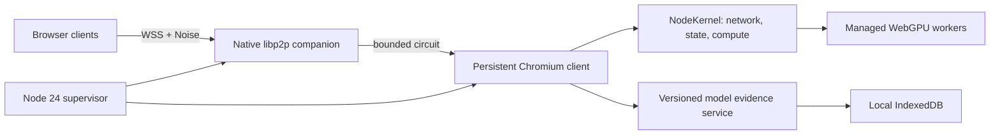

# PeerCompute browser root / supernode host

An experimental installed host that runs the real browser **NodeKernel,
NetworkManager, StateManager and ComputeManager** in persistent headless Chromium.
Node.js 24 owns process lifecycle and an optional native WS/WSS Circuit Relay
companion. It does not emulate WebGPU or IndexedDB in Node, and adds no Bun or
Websockify dependency.



The browser and relay have **different persisted peer identities**. A browser
reserves a circuit through its local companion; clients reach that circuit using
ordinary libp2p protocols. This still includes a local relay hop. Supernode
connectivity confers no root authority, room ownership or model trust.

## Run locally

From the repository with Node 24, installed dependencies and a system Chromium:

```sh
nvm use 24
npm run host:root -- --help
npm run host:root -- --config root-node/config.example.json
```

The example binds the browser bootstrap to `http://127.0.0.1:5199` and the native
listener to loopback port5200. The loopback origin is a browser secure context;
COOP/COEP enable isolation. No public backend or model is contacted by default.
`GET http://127.0.0.1:5199/health` returns status. There is no public browser-control
HTTP endpoint. Stop with Ctrl+C or SIGTERM; only owned processes are closed.

Profile, private keys, installation metadata and generated bundles live under
`~/.local/share/peercompute/root`, outside Git. A profile lock plus browser Web
Lock enforces single ownership. Preserve both the directory and origin/port:
changing origins makes browser storage appear empty. `port:0` selects and saves
a port on first boot, useful for isolated tests; normal installations should use
a fixed port. `--no-build` reuses the previous bundle and must not be used after
source updates until a new build has been made.

Browser/page exit or failed heartbeat triggers at most `maxBrowserRestarts`
relaunches per supervisor lifetime. Health becomes `failed` after exhaustion.
The launcher exits unsuccessfully so an external process manager can handle it.
A process manager should terminate the entire owned process group on supervisor
failure; a surviving orphan Chromium profile is not forcibly stolen. Corrupt or
ambiguous locks/identities fail closed instead of generating a replacement ID.

## GPU qualification

```sh
npm run host:root -- --config /path/to/host.json --qualify
```

This starts the host, dispatches real WGSL through ComputeManager's worker,
checks all64 readback values, prints adapter/features/timing, then shuts down.
Set `requireHardwareGpu:true` to reject software/unverified adapters. Ordinary
startup leaves GPU qualification unset: the evidence registry also runs without
a GPU. Qualification is not a claim that any particular model will load.

On the tested Linux NVIDIA system, the hardware test uses these `chromeArgs`:

```json
["--enable-gpu", "--enable-unsafe-webgpu",
 "--enable-features=Vulkan,VulkanFromANGLE", "--use-angle=vulkan",
 "--use-vulkan=native", "--disable-vulkan-surface"]
```

These flags are configuration for that tested backend, not portable hardware
detection. The host reports actual adapter results and never infers VRAM capacity
from feature support. No model is automatically loaded.

## Accepting other devices

Set `companion.listenHost` to a reachable interface, use a fixed `listenPort`,
and supply a browser-trusted certificate outside the repository:

```json
{
  "companion": {
    "enabled": true,
    "listenHost": "0.0.0.0",
    "listenPort": 5200,
    "connectHost": "your-host.example",
    "announce": ["/dns4/your-host.example/tcp/5200/wss"],
    "tls": {"certPath": "/private/host.crt", "keyPath": "/private/host.key"},
    "relay": {"enabled": false}
  }
}
```

Merge that example with the other host settings. `connectHost` preserves the
certificate hostname when the local browser connects to a listener bound on all
interfaces; TLS verification is not bypassed. Advertised addresses must actually
be reachable through your firewall/router/Tailnet. A native listener does not
remove CGNAT. External bootstrap relays can be supplied in `bootstrapPeers`.

By default only this installation's browser identity can reserve relay service;
other clients can reach its hosted circuit. `relay.enabled:true` explicitly
allows third-party reservations. Defaults limit reservations to16, connections
to64, and each circuit to64MiB/300seconds. Stream limits are per-peer; this is not
a whole-host bandwidth-per-second quota. The installed libp2p relay's duration
wire metadata has a unit discrepancy; tests verify actual server-side cutoff.
Circuit Relay does not provide TURN for audio/video. Existing production relay
and coturn configuration is unchanged.

## Initial model-evidence service

The browser hosts `/peercompute/model-evidence/1.0.0`. The reusable library modules
live in `peercompute/src/peercompute/modelEvidence/`:

- `ModelEvidenceContracts`: immutable content identities, source revision/file
  fingerprint, independent runtime/policy/environment facts and applicability.
- `ModelEvidenceStore`: bounded private IndexedDB records, transactional
  acknowledgments, query cursors and a replay-safe upload outbox.
- `ModelEvidenceCollector`: fail-soft recording and bounded outbox flush.
- `ModelEvidenceService`: authenticated encrypted submit/query, frame and rate
  bounds; direct reports derive identity from the connection, while signed
  outbox reports verify their original executor even after the uploader reloads. Execution reports must
  name the reporting executor, not the requesting client.

Only admitted structural/numeric fields survive projection; prompts, images,
responses and raw error text are excluded. Resource fields state measurement
scope/method. Browser allocation counters are not physical VRAM measurements.
Old reports remain historical facts; changed engines/policies/hardware require
reinspection or retesting. Authentication identifies the reporter, not the
truth of its claim. Retention is bounded, not an archival guarantee.

StateManager now owns evidence stores on roots and ordinary clients. The shared
inference runtime records HF inspection results and executing-host load,
generation and device-loss outcomes. Reports include source revision, selected
file-set identity, verified package digest/CID, code/dependency fingerprints,
coarse environment and workload facts. These are independent of demo rooms.

In Models → Config, **Share model compatibility observations** opts into upload;
it starts off. Observations made after the application peer initializes remain
local unless sharing is enabled. Offline signed uploads survive reload without
relabeling the executor. Each file set is tracked separately; Git blob hashes
from HF metadata are distinguished from verified SHA-256 package digests.
In Browse models, **Check observations** queries local and root evidence on
request. Root failure never gates loading. Reports remain untrusted claims;
current versus historical labels do not override admission or guarantee fit.

Code and locked runtime build-input hashes drive compatibility freshness. A UI
commit alone does not invalidate results. Browser GPU-buffer high-water counters
track requested, not-yet-explicitly-destroyed buffer bytes on owned devices;
textures, garbage collection, driver overhead and physical VRAM are outside
that measurement. WASM buffer size and planning RAM/GPU envelopes are separately
labeled. Failed operations use bounded reason categories, never raw error text.

[Deployment packaging](deploy/README.md) provides a minimal registry-only release,
systemd unit and static public discovery route through existing TLS hosting.
Chromium sandboxing is enabled. SecretWorkshop installation is pending SSH
access; no public registry is claimed deployed. The root does not yet expose
model loading/hosted inference, signed root policies, checkpoint authority or a
desktop installer. Full model parity and independent-device routing remain open.

## Validation

```sh
npm run test:root-host
npm run test:root-host:browser
```

Optional trusted-WSS check (no GPU required):

```sh
PEERCOMPUTE_HOST_WSS_NAME=your-host.example SSL_CERT=/private/host.crt \
  SSL_KEY=/private/host.key node root-node/tests/wss-host.mjs
```

The browser suite requires working hardware WebGPU and owns temporary profiles,
ports and browsers. It checks a real managed WGSL dispatch, encrypted peer
evidence over the native relay, privacy projection, replay, browser Web Lock,
automatic browser-exit recovery and complete supervisor restart with durable
data/identities. It closes all its resources. It does not exercise power loss,
arbitrary model parity or independent-machine NAT traversal. Set
`PEERCOMPUTE_HOST_REPORT=/outside/repo/report.json` to retain its result and
`PEERCOMPUTE_HOST_CHROME_ARGS` to a JSON array to qualify another driver setup.

Real client collection acceptance (requires the cached SmolVLM256M package plus
trusted local WSS certificate paths):

```sh
PEERCOMPUTE_HOST_WSS_NAME=your-host.example SSL_CERT=/private/host.crt \
  SSL_KEY=/private/host.key npm run test:root-host:client
```

This test inspects a pinned HF revision, imports cached verified files, runs a
real managed WebGPU generation, submits signed observations and queries them
through the actual model-browser detail view. It owns and closes its profiles,
servers and GPU workers. Public discovery is routed to the test root for this
acceptance check; production SecretWorkshop discovery is a separate deployment
gate. `PEERCOMPUTE_EVIDENCE_REPORT` and `PEERCOMPUTE_EVIDENCE_SCREENSHOT` retain
external evidence files when set.
